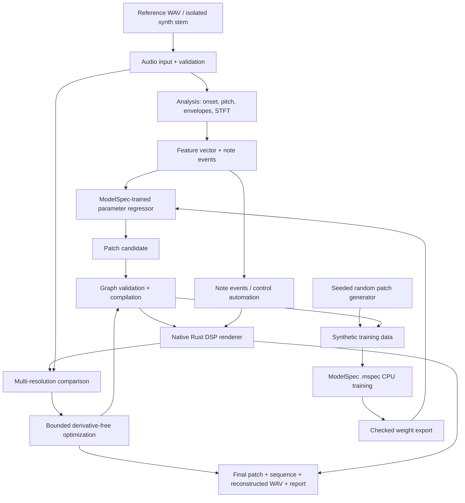

# Patchback — Technical Design

**Status:** Proposed architecture / implementation-ready MVP scope  
**Revision:** 0.2  
**Date:** 2026-10-22  
**Primary stack:** Rust + [Beyond10x ModelSpec](https://github.com/beyond10x/modelspec)  
**Dependency policy:** No third-party ML, DSP, mathematics, serialization, or application frameworks. External audio I/O is the **only** permitted application dependency category.

> **Design principle:** Do not synthesize opaque audio with a neural decoder. Infer a small, executable, editable DSP program and the events that drive it, render that program, and improve it against the reference recording.

## 1. Executive decision

Build an **inverse-synthesis system for electronic music**. Given an audio reference, the system should produce:

1. a valid, editable DSP patch (modules, connections, parameters);
2. a sequence of note/gate events and, later, control automation;
3. a deterministic audio rendering of that patch and sequence;
4. a comparison report showing how closely the rendering matches the reference.

**First prove this on one isolated monophonic synth voice.** Full mixed-track transcription, source separation, arbitrary feedback graphs, and complete music generation are later-stage capabilities, not implicit MVP promises.

The design uses **Beyond10x ModelSpec for trainable tensor programs**, not Beyond10x ESS as a substitute for a trainer. The audio engine, feature extraction, patch graph, data generation, search, and inference adapter are implemented in Rust. ESS specifies the application contracts (`spec/`) and their conformance scenarios; it is a specification dependency, never a runtime, ML or executable subsystem (ADR-008, revision 0.2).

### 1.1 Upstream reality check (2026-10-22)

ModelSpec currently provides an M0 subset with static `f32` tensor shapes, the operations `matmul`, `add`, `sub`, `mul`, `relu`, `transpose`, `sum`, `mean`, and `mse`, CPU execution, reverse-mode autodiff, and SGD. The CLI exposes `modelspec check`, `modelspec ir`, and `modelspec train --backend cpu`; current CLI documentation also describes dense data via `train --data`, evaluation via `--eval`, and parameter initialization via `--init`. **Vulkan/SPIR-V training is on the roadmap and must not be treated as working today.** Checkpoint/inference export APIs are also not an assumed M0 capability.

Consequently:

- **MVP neural model:** fixed-shape MLP regression, trained on the ModelSpec CPU backend.
- **MVP application inference:** a small, internally implemented Rust `matmul`/`relu` runner that reads **validated exported weights**, not an unimplemented ModelSpec inference API.
- **Future GPU path:** adopt ModelSpec's Vulkan backend when implemented and verified; keep the application's DSP engine independent of GPU infrastructure.

Sources: [ModelSpec README](https://github.com/beyond10x/modelspec), [current CLI reference](https://beyond10x.github.io/modelspec/docs/reference/cli), [operator reference](https://beyond10x.github.io/modelspec/docs/reference/operators), [upstream design](https://github.com/beyond10x/modelspec/blob/main/DESIGN.md).

## 2. Goals, boundaries, and invariants

### Goals

- Recover a **plausible** synthesis recipe that reproduces characteristic electronic sounds.
- Keep the output **editable**: module types, routing, ADSR, filter cutoff/resonance, distortion, LFOs, and eventually feedback.
- Generate all initial training examples **locally** by rendering known patches, so labels and audio are consistent.
- Provide an **audio-in → patch-out → render-out → compare** workflow before building a large network.
- Let the same DSP runtime render training examples, previews, and production output.
- Make artifacts, numerical behavior, seeds, and feature contracts versioned and testable.

### Non-goals for the MVP

- Source separation from a mastered stereo mix.
- Polyphonic, multi-instrument transcription; drum recognition or genre-level arrangement.
- Arbitrary user-defined DSP code or arbitrary feedback loops.
- Real-time training, low-latency inference, or DAW-plugin integration.
- Identifying the exact historical synth patch used by the producer.
- Claiming that any current ModelSpec implementation supports arbitrary audio models, convolution, attention, GPU training, or waveform backpropagation.

### Non-negotiable invariants

1. The generated patch **must execute** in the same renderer used for training-data generation.
2. Every parameter has a documented domain, default, unit, mapping, and clamping policy.
3. The DSP graph is validated **before** compilation or execution.
4. Audio processing rejects or safely handles non-finite input and never generates non-finite output.
5. Fixed seed + fixed build + fixed input + fixed execution configuration gives reproducible offline results within the specified numerical contract.
6. Audio callback code (when added) does not allocate, block, lock, or perform file/network I/O.
7. No hidden third-party ML/DSP stack is introduced to work around unsupported ModelSpec capabilities.

## 3. Dependency and platform policy

| Category | Decision |
| --- | --- |
| Language / runtime | Rust standard library |
| Model specification, training | Beyond10x **ModelSpec**, pinned to a tested version/commit |
| Audio file I/O | Implement minimal WAV reader/writer with `std`; no crate required for offline MVP |
| Live sound-card I/O | At most **one** external audio I/O backend (e.g. `cpal`), isolated behind an optional feature |
| DSP, FFT, pitch/onset, optimizer | Internal Rust modules only |
| Serialization, PRNG, tests | Internal Rust modules and `std` |
| ML / tensor / numerical crates | **Forbidden** (e.g. PyTorch, TorchSynth, ndarray, rustfft, tch, burn) |
| GPU | ModelSpec's future backend only; system Vulkan loader / driver are platform prerequisites, not application ML libraries |
| ESS | Required **specification** tool: `spec/` holds the application contracts and conformance scenarios, validated by `task check`; **not** a runtime or ML dependency (ADR-008) |

The rule applies to application-level dependencies. ModelSpec and an optional audio backend have their own upstream/transitive build requirements; these do **not** grant permission to add unrelated application dependencies. CI audits dependency changes and rejects unreviewed additions. An offline first milestone can be built with **zero** third-party runtime crates.

## 4. End-to-end architecture



**Boundary:** ModelSpec trains a parameter predictor. The Rust DSP engine is not assumed to be a differentiable ModelSpec operator. The first audio-matching optimizer is therefore **gradient-free**. Differentiable synthesis, if pursued, is a separate later research track.

### 4.1 Repository structure (proposed)

```text
/
├── DESIGN.md
├── README.md
├── spec/                             # ESS domains + conformance scenarios (task check)
├── .engineering/                     # AEP planning store
├── models/
│   └── patch_regressor.mspec          # ModelSpec source
├── crates/
│   ├── patchback-core/               # Typed patch graph + parameter contracts
│   ├── patchback-dsp/                # Oscillators, envelopes, filters, effects
│   ├── patchback-audio/              # std-only WAV + optional live audio backend
│   ├── patchback-analysis/           # FFT/STFT, pitch, onset, features
│   ├── patchback-dataset/            # Deterministic examples + ModelSpec f32 files
│   ├── patchback-model/              # ModelSpec CLI adapter + CPU weight runner
│   ├── patchback-fit/                # Candidate search + audio loss
│   └── patchback-cli/                # Application entry point
├── tests/
│   └── fixtures/                     # Small licensed/synthesized fixtures
└── runs/                             # Ignored generated data, weights, reports
```

No extra service, database, HTTP backend, or UI framework is necessary for the first release.

## 5. Patch and DSP graph contract

### 5.1 Data model

```rust
struct Patch {
    format_version: u32,
    sample_rate_hz: u32,
    topology_id: String,
    nodes: Vec<Node>,
    edges: Vec<Edge>,
}

struct Node {
    id: u32,
    kind: NodeKind,
    parameters: Vec<ParameterValue>,
}

struct Edge {
    from: PortAddress,
    to: PortAddress,
}

enum PortRate { Audio, Control, Event }
```

Each module declares input/output ports with explicit rate and meaning. Connections must be type-compatible. Parameters are addressed by **stable module/parameter identifiers**, not by mutable UI order.

Graph compilation performs: identifier checks → parameter validation → port/rate checks → cycle checks → scheduling → buffer assignment → a DSP execution plan. The runtime never follows arbitrary graph references in the hot audio loop.

### 5.2 MVP: fixed subtractive voice

```text
MIDI note/gate ---> Saw Oscillator ---> Drive ---> Lowpass Filter ---> VCA ---> Output
        |                                                    ^
        +------------------> ADSR Envelope ------------------+
```

One monophonic voice, one Saw oscillator, one drive stage, one resonant lowpass filter, one ADSR, and one output gain stage. Oscillator frequency follows note events; the VCA envelope responds to note-on and note-off. The signal-chain topology is fixed during MVP training, so the first model predicts **only continuous parameters**.

Eight normalized prediction targets in `[0, 1]`:

| Index | Parameter | Physical mapping (example contract) |
| --- | --- | --- |
| 0 | Attack | `0.001 * 2000^p` seconds (1 ms–2 s) |
| 1 | Decay | `0.005 * 400^p` seconds (5 ms–2 s) |
| 2 | Sustain | `p` linear amplitude |
| 3 | Release | `0.005 * 400^p` seconds (5 ms–2 s) |
| 4 | Filter cutoff | `40 * 400^p` Hz (40 Hz–16 kHz) |
| 5 | Resonance Q | `0.5 + 11.5*p` |
| 6 | Drive | `24*p` dB pre-filter drive |
| 7 | Output gain | `-24 + 24*p` dB |

These ranges are design choices to evaluate, not assertions about upstream ModelSpec. Implement forward/inverse mappings with tests, clamp `p` to `[0,1]`, and reject NaN/Infinity. Keep serialized values in **physical units** and model outputs in **normalized units**. Note frequency is driven separately by note events; it is **not** learned as a timbre parameter.

### 5.3 DSP implementation rules

- **Sampling:** internal sample rate 48,000 Hz for MVP; explicit rejection of unsupported sample rates (no silent conversion).
- **Processing:** deterministic block processing; offline block size configurable, default 256 frames.
- **Saw oscillator:** phase accumulator and a documented anti-aliasing method (e.g. internally implemented polyBLEP). Test frequency limits and high-note aliasing.
- **ADSR:** explicit note-on/retrigger/note-off semantics; sample-accurate event offsets; zero and near-zero time constants are handled safely.
- **Lowpass:** a stable topology-preserving transform/state-variable structure; clamp cutoff below Nyquist and bound resonance.
- **Drive:** deterministic bounded nonlinearity with finite-output guarantees; oversampling is deferred and aliasing measured.
- **VCA/gain:** parameter smoothing where necessary to prevent clicks; protective output clipping/limiting **reported**, not silently used to hide instability.
- **State:** each voice owns phase/filter/envelope state; patch descriptions contain no mutable sample state.

### 5.4 Later: graph extension and feedback

Add Square/Sine, highpass/bandpass, LFO, delay, noise, FM, and more oscillators **one family at a time**. Module ports will distinguish audio-rate and control-rate signals; control interpolation is explicit. A graph with cycles is rejected unless the cycle contains an explicit stateful `Delay` node with **at least one sample** of latency. Limit feedback gain, monitor runaway energy, and provide a fail-closed numerical safety path. Unbounded instantaneous cycles are never evaluated.

## 6. Audio analysis: a small native DSP library

### 6.1 Input constraints

MVP accepts mono WAV or stereo WAV downmixed explicitly to mono, with PCM16 or IEEE float32 samples at 48 kHz. Validate RIFF sizes and chunks, allocation bounds, finite float samples, channel counts, and frame limits. Initial unit of analysis: **isolated single-note synth recordings** (roughly 0.5–2 seconds including release). For synthetic data, exact note-on/off timing and MIDI pitch are known; for external monophonic audio they are estimated and emitted with confidence scores.

### 6.2 Algorithms implemented internally

- An iterative radix-2 complex FFT and inverse FFT (no `rustfft`); Hann windows.
- STFT / magnitude / log magnitude for several frame sizes.
- RMS and peak envelopes; spectral centroid, rolloff, flatness, log-band energies.
- Spectral flux for transient/onset proposals.
- Monophonic fundamental frequency estimation (autocorrelation or YIN-style difference function), with low-confidence refusal.
- Basic silence detection and note-gate boundary estimation.

A full mixed track may not yield a uniquely identifiable pitch, gate, or instrument from these methods; that limitation must be surfaced rather than guessed away.

### 6.3 M0 feature contract: `features/1`

A fixed-size **32-element** vector for the ModelSpec M0 model:

- **24 values:** energy in eight logarithmic frequency bands, computed separately for attack, body, and release windows aligned to the detected/known note events.
- **8 values:** calibrated RMS, peak, spectral centroid, rolloff, spectral flatness, zero-crossing rate, attack-envelope slope, and normalized MIDI pitch.

All feature definitions (window bounds, FFT size, amplitude reference, band edges, normalization statistics, missing-data behavior) are frozen as a versioned spec before dataset generation. Training-set means/standard deviations are saved as an internal artifact and reused **unchanged** for inference. Neither test-set statistics nor test audio may affect training normalization. If a feature cannot be computed reliably, fail with a structured diagnostic; do not silently fabricate an estimate.

Recommended analysis FFT lengths at 48 kHz: **512, 2048, 8192** samples, with consistent overlap/window conventions. These are internal implementations and can be changed only by versioning the feature contract.

## 7. Training data generation

### 7.1 Paired synthesis, not track scraping

Create a deterministic generator that samples valid normalized patch parameters and one-note event programs, renders them through the **same** DSP engine, extracts `features/1`, and writes each `(x: [32], y: [8])` pair. Use a local PRNG implemented with `std`; record its algorithm and seed. Keep sampled notes and note lengths within a declared training distribution, and include silence/noise/clipping rejection cases in a separate diagnostic set.

Recommended first dataset:

- 50,016 train, 4,992 validation, 4,992 test patches (60,000 total; each split divisible by the initial batch size of 16), adjustable to measured CPU cost.
- Train/validation/test split by **patch seed/identity**, not by rendering the same patch at different notes and placing copies across splits.
- Vary note pitches and gate durations in a controlled range; preserve them as metadata. The normalized note pitch is a model feature.
- Stratify log-time and log-frequency parameters instead of sampling all physical values uniformly.
- Save reference WAV examples for listening, but train on compact feature/parameter arrays.

### 7.2 ModelSpec dense-data bridge

The current ModelSpec CLI supports a directory with files named after its `input` and `target`, each containing row-major **little-endian `f32`** values. For the proposed M0 model, generate:

```text
data/train/x.f32         # N × 32 f32 feature matrix, one sample per row
data/train/y.f32         # N × 8  f32 normalized target matrix
data/train/order.u32     # optional, checked sequence of sample indices
data/val/x.f32
data/val/y.f32
```

The leading dimension in the `.mspec` declaration is the **minibatch size**, not the entire dataset size. The data writer verifies exact byte counts, no NaNs/Infinities, matching sample counts, and endianness. Validation count must be a multiple of the ModelSpec batch size when using `--eval`.

## 8. ModelSpec model and training plan

### 8.1 M0-compliant initial model (proposed source)

The following uses only documented M0 operations and **static shapes**. Validate it with the pinned ModelSpec binary before implementation work proceeds.

```mspec
model PatchRegressor {
    param w1: Tensor<f32, [32, 64]> = xavier_uniform();
    param w2: Tensor<f32, [64, 8]> = xavier_uniform();

    fn forward(x: Tensor<f32, [16, 32]>) -> Tensor<f32, [16, 8]> {
        let h = relu(matmul(x, w1));
        return matmul(h, w2);
    }
}

train FitPatches {
    model = PatchRegressor;
    input x: Tensor<f32, [16, 32]>;
    target y: Tensor<f32, [16, 8]>;
    loss = mse(model.forward(x), y);
    optimizer = sgd(lr = 0.01);
    steps = 5000;
    seed = 42;
    device = cpu;
}
```

```sh
modelspec check models/patch_regressor.mspec
modelspec ir models/patch_regressor.mspec --stage training
modelspec train models/patch_regressor.mspec --backend cpu \
  --data data/train --eval data/val
```

`steps` and learning rate are **experiment parameters**, not prevalidated optimal values. Keep a deterministic data ordering or explicitly supplied `order.u32`; otherwise ModelSpec's default sample ordering is sequential/cyclic. ModelSpec also prints an `accuracy` value for `--eval`, but for continuous parameter regression **the evaluation loss and audio tests matter**, not argmax classification accuracy. M0 does not provide an assumed softmax, convolution, variable-length sequence encoder, or GPU execution. Regression outputs may leave `[0,1]`; clamp with an explicit warning and evaluate how often that happens.

### 8.2 Weight export and inference without extra dependencies

Until ModelSpec supplies a stable inference/checkpoint interface, use a **version-locked adapter**:

1. Run `modelspec train` as a subprocess from Rust `std::process::Command`.
2. Recognize only the documented `param @PatchRegressor.w1` and `.w2` outputs for the pinned version. Validate names, matrix shapes, exact element counts, all values finite, and exit status.
3. Convert those weights to an internal, checksummed, versioned little-endian `f32` artifact along with the model and feature-spec version. Reject unrecognized output rather than approximating it.
4. Run the two dense layers and ReLU in a small native Rust prediction function. Maintain **golden tests** comparing its outputs with independently computed reference matmul results.
5. Replace this bridge with ModelSpec's official inference/checkpoint capability when it exists and passes equivalence tests.

This temporary bridge is deliberately narrow; it is **not** an invitation to implement another general neural-network framework.

## 9. Audio matching: closed-loop inverse synthesis

ModelSpec predicts a starting patch; that is **not** the final answer. The patch is rendered with the inferred/known note events, compared to the source, then refined.

### 9.1 Comparison loss (internal, offline)

Use a weighted sum, initially:

```text
L = 0.45 · L_log_spectral
  + 0.25 · L_envelope
  + 0.15 · L_transient
  + 0.15 · L_band_energy
```

- `L_log_spectral`: normalized absolute difference of `log(epsilon + |STFT|)` at multiple resolutions.
- `L_envelope`: normalized difference of short-time RMS curves.
- `L_transient`: difference of aligned onset envelopes / spectral flux.
- `L_band_energy`: difference of frequency-band energy distributions.

Time alignment and note matching must be performed **before** computing these losses. Keep the original loudness reference calibrated so gain prediction remains identifiable. These initial weights are hypotheses to benchmark, not universal psychoacoustic constants. The loss code must log its component values for every candidate.

### 9.2 Derivative-free refinement

1. Create a candidate from the ModelSpec regressor or a fixed safe default if no weights are available.
2. Evaluate several seeded, bounded restarts within the same known topology.
3. Use coordinate search (one normalized parameter at a time with shrinking step size), retaining only improvements.
4. Stop after a fixed number of renderer calls or when improvement falls below a threshold.
5. Preserve the best *valid* patch, its loss breakdown, and render; never replace it with a numerically invalid candidate.

An initial budget of **up to 2,000 render evaluations per note** is a tunable offline upper bound, not a real-time guarantee. The optimizer must be benchmarked against both the default patch and the raw regressor prediction.

### 9.3 Non-identifiability

Several DSP programs may produce nearly identical audio. We therefore optimize for **audible match + validity + simplicity**, not recovery of the original producer's exact settings. Later free-topology search adds an explicit complexity penalty (number of nodes, edges, and control routes). Maintain a small ranked candidate set if multiple solutions sound equivalent.

## 10. Musical event layer and longer tracks

The DSP patch is an **instrument**. Music playback also needs a **score**. Keep these components separate:

```rust
struct NoteEvent {
    start_sample: u64,
    end_sample: u64,
    midi_note: u8,
    velocity: f32,
}

struct ControlEvent {
    sample: u64,
    parameter_path: String,
    normalized_value: f32,
}
```

All event timing is represented in **samples** at the patch sample rate. V0 uses known note events for generated references. V1 adds monophonic onset/pitch/gate estimates; refusals include confidence/ambiguity diagnostics. V2 supports one instrument stem with repeated notes, then simple polyphony. V3 handles multiple stems and arrangement, *not* an unconstrained stereo mix as the first task.

A separate composition/generation model may eventually propose sequences, but **sound reconstruction** and **musical composition** are distinct objectives with distinct evaluations. Do not claim the first feature regressor can compose electronic music.

## 11. Application interfaces and file artifacts

Proposed CLI (these commands are for **this application**, not commands claimed to exist in ModelSpec):

```sh
patchback generate-dataset --seed 42 --samples 60000 --out data/
patchback patch validate patches/example.patch
patchback render --patch patches/example.patch --notes notes.events --out out.wav
patchback analyze --input reference.wav --out analysis/
patchback fit --input reference.wav --out results/ --max-renders 2000
patchback compare --reference reference.wav --candidate results/reconstructed.wav
```

Produced per fit run:

```text
results/
├── patch.patch           # canonical, human-readable, versioned patch data
├── notes.events          # versioned sample-timestamped events
├── reconstructed.wav     # rendered waveform
├── report.txt            # loss terms, versions, timings, warnings, confidence
└── run.meta              # seed, inputs digests, ModelSpec version, feature spec
```

Use a small internally parsed **line-oriented, versioned** format for `.patch`, `.events`, and metadata, not an unreviewed homegrown general JSON parser. All parsers reject unknown versions, duplicate keys/IDs, malformed numbers, unsupported rates, and unbounded lengths. Consider a standard interoperable format later if the dependency rule changes.

## 12. Verification, quality gates, and safety

### 12.1 Unit and property tests

- WAV parser: valid PCM16/f32 roundtrip, truncation, size overflow, unsupported format, NaN/Inf, corrupted chunks.
- DSP: ADSR boundary conditions; cutoff/resonance limits; oscillator phase continuity; no NaN/Inf for bounded input and controls; repeatability.
- Graph: nonexistent ports/nodes, duplicates, incompatible rates, illegal zero-delay cycles, allowed delayed feedback, resource caps.
- FFT/STFT: direct small DFT reference, FFT/IFFT roundtrip, sine-bin localization, window energy accounting.
- Model bridge: exact `[32,64]` and `[64,8]` weight sizes, wrong-model rejection, finite checks, deterministic output.
- Data writer: exact row-major f32 bytes, sample counts, isolated dataset splits, feature version pinning.
- Optimization: never worsens retained best candidate, bounded evaluations, safe behavior on silence or pitch ambiguity.

### 12.2 Integration and acceptance gates

| Milestone | Acceptance evidence |
| --- | --- |
| DSP engine | Single-note synth renders repeatably; bounded controls yield finite samples; waveform/ADSR/filter golden tests pass |
| Dataset | Deterministic paired `x.f32`/`y.f32`, exact feature contract and split proof; no invalid samples |
| ModelSpec bridge | `.mspec` checks, CPU training succeeds on **real generated data** (not only its built-in synthetic teacher), weights export, inference test passes |
| Sound matching | On a held-out synthetic set, the closed-loop optimizer reduces median audio loss versus a fixed default-patch baseline; raw-model-only result is also reported |
| External audio | At least one independently recorded isolated monophonic synth note produces a valid editable patch, reconstructed WAV, and diagnostic report |
| Dependency gate | Dependency audit shows no extra application crates beyond an explicitly approved optional audio I/O backend and pinned ModelSpec tooling |

For the first quality review, target **≥20% reduction in median normalized audio loss** versus the default patch over a seeded holdout set; treat this as a **go/no-go experiment target**, not a guaranteed result. Record wall-clock time, render evaluations, and listening examples alongside numerical metrics. Maintain a fixed sample-rate/build/device configuration when comparing runs.

### 12.3 Operational guardrails

- Bound input duration, graph size, voice count, note count, FFT length, memory, and optimizer time.
- Reject corrupt models, non-finite features, impossible sample rates, empty audio, and untrusted graphs.
- Clamp and smooth DSP controls; implement safe bypass/mute for unstable feedback.
- Avoid audio callbacks invoking subprocesses, model training, allocations, or file I/O.
- Use recordings the project is authorized to analyze; maintain provenance for test fixtures.

## 13. Delivery plan and decisions

### Milestone A — Sound engine, no ML

- [ ] Implement std-only WAV input/output (48 kHz mono focus).
- [ ] Build fixed subtractive synth, ADSR, filter, drive, gain, and note-event renderer.
- [ ] Implement FFT/STFT, envelopes, spectral loss, and bounded parameter search.
- [ ] Demo: reference **generated by our synth** → recover a comparable patch without any neural network.

**Exit:** reliable executable patches, defensible audio comparison, deterministic test fixtures.

### Milestone B — Native data + ModelSpec M0

- [ ] Freeze feature spec `features/1` and eight-parameter mapping.
- [ ] Generate train/validation/test data through the renderer; write ModelSpec dense f32 files.
- [ ] Check and train the M0 model on CPU; record loss curves and holdout behavior.
- [ ] Validate and export weights; integrate tiny CPU regressor.
- [ ] Compare default vs ML-init vs ML-init-plus-search.

**Exit:** a ModelSpec-trained regressor genuinely reduces matching work or improves audio fit.

### Milestone C — From notes to phrases

- [ ] Detect monophonic note onsets, pitches, gate lengths, and tails.
- [ ] Produce event sequence and one editable patch for a short bass/lead phrase.
- [ ] Handle timing and pitch estimation uncertainty explicitly.

**Exit:** isolated bassline/lead phrase in, audible reconstruction and editable program out.

### Milestone D — Module choice and modulation

- [ ] Introduce bounded candidate topologies: Saw/Square/Sine, filter families, LFO, delay.
- [ ] Select topology by candidate rendering/ranking before attempting unrestricted graph generation.
- [ ] Add time-varying control automation and explicit delayed feedback.
- [ ] Reward simplicity and enforce graph stability.

**Exit:** the system selects and drives meaningful module combinations, not merely eight knobs.

### Milestone E — Larger musical scope

- [ ] Multiple monophonic/polyphonic instrument stems.
- [ ] Drum and effect modules, repeated-pattern analysis, arrangement events.
- [ ] Optional sequence-generation model as a **separate** specification.
- [ ] Move supported training workloads to ModelSpec GPU backend only when upstream M1 actually ships and passes regression tests.

**Exit:** reconstruct and remix structured electronic music; full-mix separation remains a separate research problem.

## 14. Open architecture decisions / ADR candidates

| ID | Question | Initial decision |
| --- | --- | --- |
| ADR-001 | Is ModelSpec the ML engine? | **Yes**: train static tensor model; do not replace it with an ML library |
| ADR-002 | Must synthesis be differentiable? | **No** for MVP: native DSP + derivative-free audio search |
| ADR-003 | Are topology and parameters learned together? | **No** initially: fixed graph → candidate topology selection → structured graph decoder |
| ADR-004 | Audio input unit? | **Isolated mono note**, then phrases, then stems; not a mastered mix first |
| ADR-005 | Does the output encode PCM audio? | **No**: output is a runnable DSP program + events; renderer generates PCM |
| ADR-006 | Model inference before upstream `infer` ships? | Strictly versioned weight export + small native Rust matrix runner |
| ADR-007 | Which audio dependency? | No external crate offline; approve at most one backend for live audio later |
| ADR-008 | Is ESS mandatory? | **Yes, for the specification only** (revision 0.2): the beyond10x workspace rule "ESS drives every product repository" wins over revision 0.1's "optional". ESS types the contracts in `spec/`; it is never a runtime or ML dependency |
| ADR-009 | How to handle ambiguous reconstruction? | Auditory loss + simple patch bias + transparent candidate ranking |
| ADR-010 | When to support GPU? | After documented upstream implementation and CPU/GPU equivalence tests |

## 15. Immediate next engineering slice

Deliver a repo that can run the following **without ML**:

```text
input:  generated reference.wav + known note.events
output: recovered.patch + reconstructed.wav + report.txt
proof:  deterministic audio-loss improvement over the default patch
```

In parallel, check that the **pinned ModelSpec binary** accepts the minimal `.mspec` from §8.1 and the dense-data directory from §7.2. Only after the renderer and feature contract are stable should synthetic training data be generated at scale.

This minimizes project risk: if the patch search fails, a bigger neural model will not fix a broken renderer, loss function, or parameter representation.

---

## Upstream references

- [Beyond10x ModelSpec repository](https://github.com/beyond10x/modelspec)
- [ModelSpec current capability status](https://beyond10x.github.io/modelspec/)
- [ModelSpec CLI reference, including `--data`, `--init`, `--eval`](https://beyond10x.github.io/modelspec/docs/reference/cli)
- [ModelSpec supported operators](https://beyond10x.github.io/modelspec/docs/reference/operators)
- [ModelSpec design and roadmap](https://github.com/beyond10x/modelspec/blob/main/DESIGN.md)
- [Beyond10x ESS (specification and conformance tooling, **not** the trainer)](https://github.com/beyond10x/ess)

*All architecture choices not explicitly attributed above are proposals for this audio-to-synth project, not claims of functionality already delivered by Beyond10x.*
