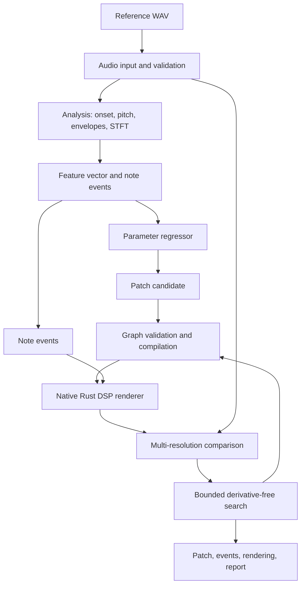

# The closed loop

A prediction is a starting point, not an answer. Patchback renders every candidate patch with
the note events of the reference, compares the rendering with the recording and keeps what
sounds closer. The loop ends when the render budget is spent or the improvement becomes too
small to matter.



## The starting point

The search starts from the [regressor's](./regressor.md) prediction: eight normalized
parameters computed from 32 features of the reference. Without trained weights, it starts from
a fixed, safe default patch. Either way the candidate goes through the same validation as any
other patch before it renders.

## The comparison

Before any loss is computed, the rendering is aligned with the reference in time and its notes
are matched with the reference's notes. The loss is then a weighted sum of four terms:

```text
L = 0.45 · L_log_spectral
  + 0.25 · L_envelope
  + 0.15 · L_transient
  + 0.15 · L_band_energy
```

| Term | Compares |
| --- | --- |
| `L_log_spectral` | Normalized absolute difference of the log-magnitude STFT, log(epsilon + magnitude), at several resolutions |
| `L_envelope` | Normalized difference of the short-time RMS curves |
| `L_transient` | Difference of the aligned onset envelopes and spectral flux |
| `L_band_energy` | Difference of the energy distributions over frequency bands |

The loudness reference stays calibrated, so the output gain remains something the fit can
recover. Every candidate's four terms are logged, not only the total, and `patchback compare`
reports the same terms for any two recordings. The weights are a starting hypothesis to
benchmark, not a psychoacoustic constant.

## The search

The renderer is not differentiable, so the search does not use gradients. It:

1. creates a candidate from the regressor, or the default patch when there are no weights;
2. evaluates several seeded, bounded restarts within the same topology;
3. runs a coordinate search: one normalized parameter at a time, with a shrinking step, keeping
   only improvements;
4. stops after a fixed number of renders (`--max-renders`) or when the improvement falls below
   a threshold;
5. keeps the best *valid* patch, its loss breakdown and its rendering. A numerically invalid
   candidate never replaces it.

The initial budget is up to 2,000 renders per note, set with `--max-renders`. It is a tunable
offline upper bound, not a real-time guarantee.

## More than one right answer

Different patches can produce nearly the same audio. Patchback therefore optimizes for an
audible match, a valid patch and a simple one, not for the settings a producer happened to use.
When several candidates sound equivalent, it keeps a small, ranked set of them in the open
rather than picking one silently.
