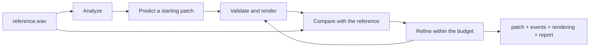

# What Patchback is

Patchback works backwards from a sound. Give it a recording of a synth note and it gives you
four things:

1. an editable DSP patch: the modules, how they connect, and their parameters;
2. the note events that play it;
3. a deterministic rendering of that patch playing those events;
4. a report on how closely the rendering matches the recording.

It does not generate audio with a neural decoder. It infers a small program that a synthesizer
can run, runs it, and improves it against the reference. The patch is the answer, and you can
open it, read it and change a knob.

```bash
patchback fit --input reference.wav --notes notes.events --out results/ --max-renders 2000
```

## How it gets there

Patchback analyzes the reference, predicts a starting patch, renders it, compares the rendering
with the reference and refines the patch, within a fixed budget of renders. The
[closed loop](./concepts/closed-loop.md) explains each step.



With trained weights, the starting patch comes from a small regressor trained with ModelSpec on
audio Patchback rendered itself; without them the fit starts from the default patch. Everything
else is native Rust: the WAV reader and writer, the DSP engine, the FFT and the analysis, the
search and the predictor that runs the trained weights. Patchback uses no ML, DSP, maths or
serialization crates.

## What it reconstructs

Patchback starts with one isolated, monophonic synth note, roughly half a second to two
seconds long including its release, and one instrument: a
[fixed subtractive voice](./concepts/patch.md#the-fixed-subtractive-voice) with a saw
oscillator, drive, a resonant lowpass filter, an ADSR envelope and an output gain. From there
the scope grows one step at a time: short phrases, then a choice of modules and modulation,
then several stems. The [status page](/docs/status) says which of these steps exists.

A full mastered mix is not an input. Patchback does not separate sources, and it does not
claim to find the exact patch a producer used: several programs can sound the same, so it aims
for a patch that sounds right, is valid and stays simple.

## What it is not

| Patchback does not | Instead |
| --- | --- |
| Generate audio with a neural network | It renders a DSP patch with its own engine |
| Train neural networks itself | [ModelSpec](https://beyond10x.github.io/modelspec/) ([GitHub](https://github.com/beyond10x/modelspec)) trains the regressor; Patchback only runs the exported weights |
| Separate sources in a mastered mix | Out of scope; give it an isolated note or stem |
| Run in real time or as a DAW plugin | It renders and fits offline, from files to files |

## Where it sits

- [ModelSpec](https://beyond10x.github.io/modelspec/) ([GitHub](https://github.com/beyond10x/modelspec))
  trains Patchback's parameter regressor on its CPU backend.
- [ESS](https://beyond10x.github.io/ess/) ([GitHub](https://github.com/beyond10x/ess)) specifies
  Patchback's contracts and their conformance scenarios; it is a specification tool, not a
  runtime dependency.
- [AEP](https://beyond10x.github.io/ecosystem/aep/) ([GitHub](https://github.com/beyond10x/aep))
  holds Patchback's planning store: its milestones and the work under them.

## Where to go next

- [Getting started](./getting-started.md): the commands from a recording to a fitted patch.
- [Concepts](./concepts/closed-loop.md): the loop, the patch, the events, the analysis and the
  regressor.
- [Guides](./guides/render-a-patch.md): render a patch, fit a recording, train the regressor.
- [Reference](./reference/cli.md): every command, every file and every parameter.
- [ESS specification](/docs/reference/ess): the contracts Patchback is built against.
