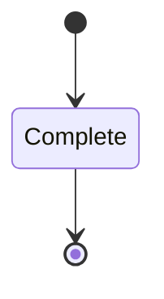
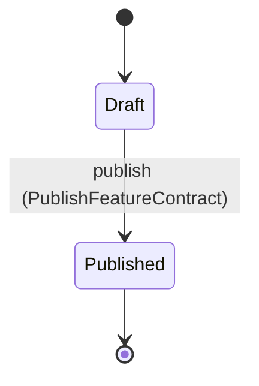
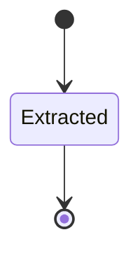

---
# generated by patchback-docs, do not edit
title: "analysis domain"
sidebar_label: "analysis"
description: "ESS reference for the analysis domain, generated from the specification."
custom_edit_url: null
---

<!-- generated by patchback-docs, do not edit -->

The native analysis library (DESIGN.md 6): STFT, envelope and spectral descriptors of an audio clip with their recorded configuration, the versioned feature contract `features/1`, the feature vectors extracted under it, the training-split normalization statistics, and monophonic note estimation (DESIGN.md 6.1, 6.2, 6.3, 7.1, 10, 12.3).

`patchback.analysis` is one of patchback's bounded contexts. [All domains](./index.mdx).

## Types

### `AnalysisId`

`patchback.analysis.AnalysisId` wraps `Uuid` and is not interchangeable with one: the whole value of naming it separately is the crossings the model then refuses.

### `BandWindow`

`patchback.analysis.BandWindow` is one of `Attack`, `Body` and `Release`.

### `EstimatedNote`

`patchback.analysis.EstimatedNote` is a record of eight fields:

- `start_sample` — `Integer`
- `end_sample` — `Integer`
- `tail_end_sample` — `Integer`
- `midi_note` — `Integer`
- `onset_confidence` — `Decimal`
- `pitch_confidence` — `Decimal`
- `gate_confidence` — `Decimal`
- `tail_confidence` — `Decimal`

### `FeatureContractId`

`patchback.analysis.FeatureContractId` wraps `Uuid` and is not interchangeable with one: the whole value of naming it separately is the crossings the model then refuses.

### `FeatureContractVersion`

`patchback.analysis.FeatureContractVersion` wraps `String` and is not interchangeable with one: the whole value of naming it separately is the crossings the model then refuses.

### `FeatureVectorId`

`patchback.analysis.FeatureVectorId` wraps `Uuid` and is not interchangeable with one: the whole value of naming it separately is the crossings the model then refuses.

### `NormalizationStatsId`

`patchback.analysis.NormalizationStatsId` wraps `Uuid` and is not interchangeable with one: the whole value of naming it separately is the crossings the model then refuses.

### `NoteEstimationId`

`patchback.analysis.NoteEstimationId` wraps `Uuid` and is not interchangeable with one: the whole value of naming it separately is the crossings the model then refuses.

### `ScalarFeature`

`patchback.analysis.ScalarFeature` is one of `Rms`, `Peak`, `SpectralCentroid`, `Rolloff`, `SpectralFlatness`, `ZeroCrossingRate`, `AttackEnvelopeSlope` and `NormalizedMidiPitch`.

### `WindowKind`

`patchback.analysis.WindowKind` is one of `Hann`.

## Entities

An entity is what this context is about: something with an identity that outlives any one request, a shape, and a lifecycle. The lifecycle is exhaustive — a move that is not drawn below is a move this specification does not permit, and that is the only way it says so. Every move is labelled with the command that takes it, because a move nothing can trigger is refused rather than drawn.

### `Analysis`

`patchback.analysis.Analysis`.

An instance is identified by `analysis_id`, a `patchback.analysis.AnalysisId`. The name is part of the model and not a convention: a view projects the identity under that name, so a projection inventing its own would disagree with the view.

It holds:

- `audio_clip_id` — `patchback.audio.AudioClipId`
- `out_dir` — `String`
- `sample_rate_hz` — `Integer`
- `frame_count` — `Integer`
- `fft_lengths` — `List<Integer>`
- `hop_length` — `Integer`
- `window` — `patchback.analysis.WindowKind`

It references at most one [`patchback.audio.AudioClip`](patchback-audio.md#audioclip), as `clip`, carried by `Analysis.audio_clip_id`.

Every instance satisfies `sample_rate_hz == 48000` and `frame_count > 0` — a predicate over this entity's own fields, checked against them rather than stored as a sentence, so an invariant reading something the entity does not have is refused instead of documented.

Its state is a `patchback.analysis.Analysis.State`, one of `Complete`. That enum is synthesised from the lifecycle rather than declared beside it, so the states a view's filter compares and the states drawn below cannot disagree.

An instance is created in `Complete`. `Complete` is terminal, so an instance may rest there forever. That is declared rather than inferred from having no way out: an entity that cannot leave a state is either finished or stuck, and only its author knows which.

It declares no moves, so nothing changes its state once it exists.

It has one state, so there is no move to permit or to forbid.

One view projects it: [`Analyses`](#analyses).

### `FeatureContract`

`patchback.analysis.FeatureContract`.

An instance is identified by `feature_contract_id`, a `patchback.analysis.FeatureContractId`. The name is part of the model and not a convention: a view projects the identity under that name, so a projection inventing its own would disagree with the view.

It holds:

- `version` — `patchback.analysis.FeatureContractVersion`
- `value_count` — `Integer`
- `band_count` — `Integer`
- `band_windows` — `List<patchback.analysis.BandWindow>`
- `scalar_features` — `List<patchback.analysis.ScalarFeature>`
- `fft_lengths` — `List<Integer>`

It declares no relation to another entity, and no other entity names it.

No invariant is declared, so nothing here constrains an instance at rest.

Its state is a `patchback.analysis.FeatureContract.State`, one of `Draft` and `Published`. That enum is synthesised from the lifecycle rather than declared beside it, so the states a view's filter compares and the states drawn below cannot disagree.

An instance is created in `Draft`. `Published` is terminal, so an instance may rest there forever. That is declared rather than inferred from having no way out: an entity that cannot leave a state is either finished or stuck, and only its author knows which.

Each move is taken by a declared command outcome, and a move nothing takes is refused as `missing_causation` rather than left as a state change nobody can trigger:

- `publish` — taken by `patchback.analysis.PublishFeatureContract` on its `published` outcome

An instance is brought into existence by `patchback.analysis.DefineFeatureContract` on its `defined` outcome.

Illegal transitions are illegal by absence: no rule forbids them, there is simply no arrow, because a rule would be a second place for the same truth to live. A diagram cannot show an absence, so the pairs it does not connect are listed here, derived from the same transitions — anything named below is a move this specification does not permit.

- `Published` may not become `Draft`

One view projects it: [`FeatureContracts`](#featurecontracts).

### `FeatureVector`

`patchback.analysis.FeatureVector`.

An instance is identified by `feature_vector_id`, a `patchback.analysis.FeatureVectorId`. The name is part of the model and not a convention: a view projects the identity under that name, so a projection inventing its own would disagree with the view.

It holds:

- `analysis_id` — `patchback.analysis.AnalysisId`
- `feature_contract_id` — `patchback.analysis.FeatureContractId`

It references at most one [`Analysis`](#analysis), as `analysis`, carried by `FeatureVector.analysis_id`. It references at most one [`FeatureContract`](#featurecontract), as `contract`, carried by `FeatureVector.feature_contract_id`.

No invariant is declared, so nothing here constrains an instance at rest.

Its state is a `patchback.analysis.FeatureVector.State`, one of `Extracted`. That enum is synthesised from the lifecycle rather than declared beside it, so the states a view's filter compares and the states drawn below cannot disagree.

An instance is created in `Extracted`. `Extracted` is terminal, so an instance may rest there forever. That is declared rather than inferred from having no way out: an entity that cannot leave a state is either finished or stuck, and only its author knows which.

It declares no moves, so nothing changes its state once it exists.

It has one state, so there is no move to permit or to forbid.

One view projects it: [`FeatureVectors`](#featurevectors).

### `NormalizationStats`

`patchback.analysis.NormalizationStats`.

An instance is identified by `normalization_stats_id`, a `patchback.analysis.NormalizationStatsId`. The name is part of the model and not a convention: a view projects the identity under that name, so a projection inventing its own would disagree with the view.

It holds:

- `feature_contract_id` — `patchback.analysis.FeatureContractId`
- `feature_contract_version` — `patchback.analysis.FeatureContractVersion`
- `dataset_split_id` — `patchback.dataset.DatasetSplitId`
- `split_role` — `patchback.dataset.SplitRole`

It references at most one [`FeatureContract`](#featurecontract), as `contract`, carried by `NormalizationStats.feature_contract_id`. It references at most one [`patchback.dataset.DatasetSplit`](patchback-dataset.md#datasetsplit), as `split`, carried by `NormalizationStats.dataset_split_id`.

Every instance satisfies `split_role == Train` — a predicate over this entity's own fields, checked against them rather than stored as a sentence, so an invariant reading something the entity does not have is refused instead of documented.

Its state is a `patchback.analysis.NormalizationStats.State`, one of `Computed`. That enum is synthesised from the lifecycle rather than declared beside it, so the states a view's filter compares and the states drawn below cannot disagree.

An instance is created in `Computed`. `Computed` is terminal, so an instance may rest there forever. That is declared rather than inferred from having no way out: an entity that cannot leave a state is either finished or stuck, and only its author knows which.

It declares no moves, so nothing changes its state once it exists.

It has one state, so there is no move to permit or to forbid.

One view projects it: [`NormalizationStatsSet`](#normalizationstatsset).

### `NoteEstimation`

`patchback.analysis.NoteEstimation`.

An instance is identified by `note_estimation_id`, a `patchback.analysis.NoteEstimationId`. The name is part of the model and not a convention: a view projects the identity under that name, so a projection inventing its own would disagree with the view.

It holds:

- `audio_clip_id` — `patchback.audio.AudioClipId`
- `notes` — `List<patchback.analysis.EstimatedNote>`

It references at most one [`patchback.audio.AudioClip`](patchback-audio.md#audioclip), as `clip`, carried by `NoteEstimation.audio_clip_id`.

No invariant is declared, so nothing here constrains an instance at rest.

Its state is a `patchback.analysis.NoteEstimation.State`, one of `Estimated`. That enum is synthesised from the lifecycle rather than declared beside it, so the states a view's filter compares and the states drawn below cannot disagree.

An instance is created in `Estimated`. `Estimated` is terminal, so an instance may rest there forever. That is declared rather than inferred from having no way out: an entity that cannot leave a state is either finished or stuck, and only its author knows which.

It declares no moves, so nothing changes its state once it exists.

It has one state, so there is no move to permit or to forbid.

One view projects it: [`NoteEstimations`](#noteestimations).

## Views

A view is what the outside world is promised it can observe. Each one says which instances it contains and how soon it reflects a command that has already returned, because "you can read this" without "how soon" is the promise every flaky suite is built on.

### `Analyses`

`patchback.analysis.Analyses`, shown to a person as "Analyses" and called `analyses` on the wire.

It reads [`Analysis`](#analysis).

It contains every instance of that entity: no filter narrows it, which is a decision somebody made and not a line somebody omitted.

It exposes:

- `analysis_id` — `patchback.analysis.AnalysisId`
- `state` — `patchback.analysis.Analysis.State`
- `audio_clip_id` — `patchback.audio.AudioClipId`
- `sample_rate_hz` — `Integer`
- `frame_count` — `Integer`
- `fft_lengths` — `List<Integer>`
- `hop_length` — `Integer`
- `window` — `patchback.analysis.WindowKind`

It declares no order, so the rows come back in whatever order the implementation has, and two reads may disagree.

**Read-your-writes**: it is current the moment the command that changed it returns. A caller that has just created an invoice and cannot see it in here has been told a lie about what it did.

A generated scenario asserts it once, immediately after the command: a view promising this and not keeping the promise has to fail the suite rather than be retried until it passes.

### `FeatureContracts`

`patchback.analysis.FeatureContracts`, shown to a person as "Feature contracts" and called `feature-contracts` on the wire.

It reads [`FeatureContract`](#featurecontract).

It contains every instance of that entity: no filter narrows it, which is a decision somebody made and not a line somebody omitted.

It exposes:

- `feature_contract_id` — `patchback.analysis.FeatureContractId`
- `state` — `patchback.analysis.FeatureContract.State`
- `version` — `patchback.analysis.FeatureContractVersion`
- `value_count` — `Integer`
- `band_count` — `Integer`
- `band_windows` — `List<patchback.analysis.BandWindow>`
- `scalar_features` — `List<patchback.analysis.ScalarFeature>`
- `fft_lengths` — `List<Integer>`

It declares no order, so the rows come back in whatever order the implementation has, and two reads may disagree.

**Read-your-writes**: it is current the moment the command that changed it returns. A caller that has just created an invoice and cannot see it in here has been told a lie about what it did.

A generated scenario asserts it once, immediately after the command: a view promising this and not keeping the promise has to fail the suite rather than be retried until it passes.

### `FeatureVectors`

`patchback.analysis.FeatureVectors`, shown to a person as "Feature vectors" and called `feature-vectors` on the wire.

It reads [`FeatureVector`](#featurevector).

It contains every instance of that entity: no filter narrows it, which is a decision somebody made and not a line somebody omitted.

It exposes:

- `feature_vector_id` — `patchback.analysis.FeatureVectorId`
- `state` — `patchback.analysis.FeatureVector.State`
- `analysis_id` — `patchback.analysis.AnalysisId`
- `feature_contract_id` — `patchback.analysis.FeatureContractId`

It declares no order, so the rows come back in whatever order the implementation has, and two reads may disagree.

**Read-your-writes**: it is current the moment the command that changed it returns. A caller that has just created an invoice and cannot see it in here has been told a lie about what it did.

A generated scenario asserts it once, immediately after the command: a view promising this and not keeping the promise has to fail the suite rather than be retried until it passes.

### `NormalizationStatsSet`

`patchback.analysis.NormalizationStatsSet`, shown to a person as "Normalization statistics" and called `normalization-stats` on the wire.

It reads [`NormalizationStats`](#normalizationstats).

It contains every instance of that entity: no filter narrows it, which is a decision somebody made and not a line somebody omitted.

It exposes:

- `normalization_stats_id` — `patchback.analysis.NormalizationStatsId`
- `state` — `patchback.analysis.NormalizationStats.State`
- `feature_contract_id` — `patchback.analysis.FeatureContractId`
- `feature_contract_version` — `patchback.analysis.FeatureContractVersion`
- `dataset_split_id` — `patchback.dataset.DatasetSplitId`
- `split_role` — `patchback.dataset.SplitRole`

It declares no order, so the rows come back in whatever order the implementation has, and two reads may disagree.

**Read-your-writes**: it is current the moment the command that changed it returns. A caller that has just created an invoice and cannot see it in here has been told a lie about what it did.

A generated scenario asserts it once, immediately after the command: a view promising this and not keeping the promise has to fail the suite rather than be retried until it passes.

### `NoteEstimations`

`patchback.analysis.NoteEstimations`, shown to a person as "Note estimations" and called `note-estimations` on the wire.

It reads [`NoteEstimation`](#noteestimation).

It contains every instance of that entity: no filter narrows it, which is a decision somebody made and not a line somebody omitted.

It exposes:

- `note_estimation_id` — `patchback.analysis.NoteEstimationId`
- `state` — `patchback.analysis.NoteEstimation.State`
- `audio_clip_id` — `patchback.audio.AudioClipId`

It declares no order, so the rows come back in whatever order the implementation has, and two reads may disagree.

**Read-your-writes**: it is current the moment the command that changed it returns. A caller that has just created an invoice and cannot see it in here has been told a lie about what it did.

A generated scenario asserts it once, immediately after the command: a view promising this and not keeping the promise has to fail the suite rather than be retried until it passes.

## Commands

### `AmendFeatureContract`

`patchback.analysis.AmendFeatureContract`, shown to a person as "Amend a draft feature contract" and called `amend-feature-contract` on the wire.

It takes:

- `feature_contract_id` — `patchback.analysis.FeatureContractId`
- `fft_lengths` — `List<Integer>`

It has three outcomes.

**`no-such-contract`** — Taken when the identity the command names is one no record carries, before any other answer for it. No entity in this specification changes. It reports `patchback.analysis.FeatureContractNotFound`, carrying `feature_contract_id`. It emits nothing. A test reaches it by sending an identity no record carries, arranging nothing.

**`frozen`** — A published contract is frozen; nothing changed. Taken when the existing subject is in Published. No entity in this specification changes. It reports `patchback.analysis.FeatureContractFrozen`, carrying `feature_contract_id`. It emits nothing. A test establishes the declared subject state and constructs input selecting this branch in that state.

**`amended`** — The default branch, taken when no other outcome's condition matched. It changes a `patchback.analysis.FeatureContract` without moving it along its lifecycle. The instance is the one named by the input field `feature_contract_id`. It emits `patchback.analysis.FeatureContractAmended`. It sets `fft_lengths` from `input.fft_lengths`. A test reaches it by constructing an input that satisfies no other outcome's condition.

### `AnalyzeAudio`

`patchback.analysis.AnalyzeAudio`, shown to a person as "Analyze audio" and called `analyze-audio` on the wire.

It takes:

- `audio_clip_id` — `patchback.audio.AudioClipId`
- `out_dir` — `String`
- `sample_rate_hz` — `Integer`
- `frame_count` — `Integer`
- `fft_lengths` — `List<Integer>`
- `hop_length` — `Integer`
- `window` — `patchback.analysis.WindowKind`

It has 13 outcomes.

**`empty`** — A clip with no frames is refused; no analysis exists. Taken when `frame_count <= 0` holds of the input. No entity in this specification changes. It reports `patchback.analysis.EmptyAudio`, carrying `frame_count`. It emits nothing. A test reaches it by constructing an input that satisfies that condition.

**`unsupported-sample-rate`** — Any rate other than 48000 Hz is refused; nothing is converted. Taken when `sample_rate_hz != 48000` holds of the input. No entity in this specification changes. It reports `patchback.analysis.UnsupportedSampleRate`, carrying `sample_rate_hz`. It emits nothing. A test reaches it by constructing an input that satisfies that condition.

**`invalid-hop`** — Taken when `hop_length <= 0` holds of the input. No entity in this specification changes. It reports `patchback.analysis.InvalidHopLength`, carrying `hop_length`. It emits nothing. A test reaches it by constructing an input that satisfies that condition.

**`fft-not-power-of-two`** — Decided outside the input: a requested FFT length is not a power of two. No predicate over the input reaches this branch, and saying `when: false` instead would have claimed it is unreachable, which is a different and false statement. No entity in this specification changes. It reports `patchback.analysis.FftLengthNotPowerOfTwo`, carrying `fft_lengths`. It emits nothing. A test reaches it by injecting the declared fault, because no input can.

**`fft-over-bound`** — Decided outside the input: a requested FFT length exceeds the configured FFT length bound. No predicate over the input reaches this branch, and saying `when: false` instead would have claimed it is unreachable, which is a different and false statement. No entity in this specification changes. It reports `patchback.analysis.FftLengthOverBound`, carrying `fft_lengths`. It emits nothing. A test reaches it by injecting the declared fault, because no input can.

**`duration-over-bound`** — Decided outside the input: the frame count exceeds the configured analysis duration bound. No predicate over the input reaches this branch, and saying `when: false` instead would have claimed it is unreachable, which is a different and false statement. No entity in this specification changes. It reports `patchback.analysis.DurationOverBound`, carrying `frame_count`. It emits nothing. A test reaches it by injecting the declared fault, because no input can.

**`frame-count-over-bound`** — Decided outside the input: the STFTs of the requested FFT lengths and the hop together exceed the configured magnitude bound. No predicate over the input reaches this branch, and saying `when: false` instead would have claimed it is unreachable, which is a different and false statement. No entity in this specification changes. It reports `patchback.analysis.FrameCountOverBound`, carrying `fft_length`, `hop_length` and `frame_count`. It emits nothing. A test reaches it by injecting the declared fault, because no input can.

**`non-finite`** — Decided outside the input: the analyser finds a NaN or infinite sample in the clip. No predicate over the input reaches this branch, and saying `when: false` instead would have claimed it is unreachable, which is a different and false statement. No entity in this specification changes. It reports `patchback.analysis.NonFiniteSamples`, carrying `frame_count`. It emits nothing. A test reaches it by injecting the declared fault, because no input can.

**`silent`** — Silence is reported as a typed diagnostic, not a failure of the analyser. Decided outside the input: silence detection finds no signal above the silence threshold. No predicate over the input reaches this branch, and saying `when: false` instead would have claimed it is unreachable, which is a different and false statement. No entity in this specification changes. It reports `patchback.analysis.SilentInput`, carrying `audio_clip_id`. It emits nothing. A test reaches it by injecting the declared fault, because no input can.

**`clip-too-short-for-pitch`** — Decided outside the input: the clip is too short for the f0 estimator to search its lag range. No predicate over the input reaches this branch, and saying `when: false` instead would have claimed it is unreachable, which is a different and false statement. No entity in this specification changes. It reports `patchback.analysis.ClipTooShortForPitch`, carrying `audio_clip_id`, `frame_count` and `required_frame_count`. It emits nothing. A test reaches it by injecting the declared fault, because no input can.

**`pitch-ambiguous`** — An ambiguous pitch is reported with its diagnostic, never guessed. Decided outside the input: the monophonic f0 estimate is below the confidence threshold. No predicate over the input reaches this branch, and saying `when: false` instead would have claimed it is unreachable, which is a different and false statement. No entity in this specification changes. It reports `patchback.analysis.PitchAmbiguous`, carrying `audio_clip_id` and `confidence`. It emits nothing. A test reaches it by injecting the declared fault, because no input can.

**`pitch-out-of-range`** — A pitch outside the range is refused, never reported at another octave. Decided outside the input: the monophonic f0 lies outside the searched f0 range. No predicate over the input reaches this branch, and saying `when: false` instead would have claimed it is unreachable, which is a different and false statement. No entity in this specification changes. It reports `patchback.analysis.PitchOutOfRange`, carrying `audio_clip_id` and `bound_hz`. It emits nothing. A test reaches it by injecting the declared fault, because no input can.

**`analyzed`** — The descriptors are written to out_dir with the FFT lengths, hop and window that produced them. The default branch, taken when no other outcome's condition matched. It creates a `patchback.analysis.Analysis`, which starts in `Complete`. The new instance's identity is published as `analysis_id` on `patchback.analysis.AudioAnalyzed`. It emits `patchback.analysis.AudioAnalyzed`. It sets `audio_clip_id` from `input.audio_clip_id`, `out_dir` from `input.out_dir`, `sample_rate_hz` from `input.sample_rate_hz`, `frame_count` from `input.frame_count`, `fft_lengths` from `input.fft_lengths`, `hop_length` from `input.hop_length` and `window` from `input.window`. A test reaches it by constructing an input that satisfies no other outcome's condition.

### `ApplyNormalization`

`patchback.analysis.ApplyNormalization`, shown to a person as "Apply normalization statistics" and called `apply-normalization` on the wire.

It takes:

- `normalization_stats_id` — `patchback.analysis.NormalizationStatsId`
- `feature_contract_version` — `patchback.analysis.FeatureContractVersion`

It has three outcomes.

**`no-such-stats`** — Taken when the identity the command names is one no record carries, before any other answer for it. No entity in this specification changes. It reports `patchback.analysis.NormalizationStatsNotFound`, carrying `normalization_stats_id`. It emits nothing. A test reaches it by sending an identity no record carries, arranging nothing.

**`contract-mismatch`** — Statistics of another feature contract are refused. Taken when the existing subject's stored fields satisfy `feature_contract_version != input.feature_contract_version`. No entity in this specification changes. It reports `patchback.analysis.NormalizationContractMismatch`, carrying `feature_contract_version`. It emits nothing. A test establishes and independently observes the subject enum fact before selecting this branch.

**`normalized`** — The statistics are read and left unchanged. The default branch, taken when no other outcome's condition matched. It preserves the existing subject, without an error or event. The instance is the one named by the input field `normalization_stats_id`. It emits nothing. A test reaches it by constructing an input that satisfies no other outcome's condition.

### `CheckFeatureVector`

`patchback.analysis.CheckFeatureVector`, shown to a person as "Check a feature vector against its contract" and called `check-feature-vector` on the wire.

It takes:

- `feature_contract_id` — `patchback.analysis.FeatureContractId`
- `version` — `patchback.analysis.FeatureContractVersion`
- `value_count` — `Integer`

It has five outcomes.

**`no-such-contract`** — Taken when no `patchback.analysis.FeatureContract` carries the identity `input.feature_contract_id` names. No entity in this specification changes. It reports `patchback.analysis.FeatureContractNotFound`, carrying `feature_contract_id`. It emits nothing. A test reaches it by arranging the row of the other entity the input names, or its absence, and sending the command for it.

**`wrong-version`** — Taken when the `patchback.analysis.FeatureContract` that `input.feature_contract_id` names exists and its stored fields satisfy `version != input.version`. No entity in this specification changes. It reports `patchback.analysis.FeatureVersionMismatch`, carrying `version`. It emits nothing. A test reaches it by arranging the row of the other entity the input names, or its absence, and sending the command for it.

**`wrong-length`** — Taken when the `patchback.analysis.FeatureContract` that `input.feature_contract_id` names exists and its stored fields satisfy `value_count != input.value_count`. No entity in this specification changes. It reports `patchback.analysis.FeatureLengthMismatch`, carrying `value_count`. It emits nothing. A test reaches it by arranging the row of the other entity the input names, or its absence, and sending the command for it.

**`non-finite`** — Decided outside the input: a value of the vector is NaN or infinite. No predicate over the input reaches this branch, and saying `when: false` instead would have claimed it is unreachable, which is a different and false statement. No entity in this specification changes. It reports `patchback.analysis.NonFiniteFeature`, carrying `feature_contract_id`. It emits nothing. A test reaches it by injecting the declared fault, because no input can.

**`admitted`** — The vector matches the contract's version and length. The default branch, taken when no other outcome's condition matched. No entity in this specification changes. It emits nothing. A test reaches it by constructing an input that satisfies no other outcome's condition.

### `ComputeNormalizationStats`

`patchback.analysis.ComputeNormalizationStats`, shown to a person as "Compute normalization statistics" and called `compute-normalization-stats` on the wire.

It takes:

- `feature_contract_id` — `patchback.analysis.FeatureContractId`
- `dataset_split_id` — `patchback.dataset.DatasetSplitId`
- `feature_contract_version` — `patchback.analysis.FeatureContractVersion`

It has six outcomes.

**`no-such-split`** — Taken when no `patchback.dataset.DatasetSplit` carries the identity `input.dataset_split_id` names. No entity in this specification changes. It reports `patchback.analysis.DatasetSplitNotFound`, carrying `dataset_split_id`. It emits nothing. A test reaches it by arranging the row of the other entity the input names, or its absence, and sending the command for it.

**`no-such-contract`** — Taken when no `patchback.analysis.FeatureContract` carries the identity `input.feature_contract_id` names. No entity in this specification changes. It reports `patchback.analysis.FeatureContractNotFound`, carrying `feature_contract_id`. It emits nothing. A test reaches it by arranging the row of the other entity the input names, or its absence, and sending the command for it.

**`not-training-split`** — Statistics from the validation or test split are refused. Taken when the `patchback.dataset.DatasetSplit` that `input.dataset_split_id` names exists and its stored fields satisfy `role != Train`. No entity in this specification changes. It reports `patchback.analysis.StatsFromNonTrainingSplit`, carrying `split_role`. It emits nothing. A test reaches it by arranging the row of the other entity the input names, or its absence, and sending the command for it.

**`contract-draft`** — Taken when the `patchback.analysis.FeatureContract` that `input.feature_contract_id` names exists and its stored fields satisfy `state == Draft`. No entity in this specification changes. It reports `patchback.analysis.FeatureContractNotPublished`, carrying `feature_contract_id`. It emits nothing. A test reaches it by arranging the row of the other entity the input names, or its absence, and sending the command for it.

**`version-mismatch`** — The version named must be the contract's own; the statistics carry it. Taken when the `patchback.analysis.FeatureContract` that `input.feature_contract_id` names exists and its stored fields satisfy `version != input.feature_contract_version`. No entity in this specification changes. It reports `patchback.analysis.FeatureVersionMismatch`, carrying `version`. It emits nothing. A test reaches it by arranging the row of the other entity the input names, or its absence, and sending the command for it.

**`computed`** — The default branch, taken when no other outcome's condition matched. It creates a `patchback.analysis.NormalizationStats`, which starts in `Computed`. The new instance's identity is published as `normalization_stats_id` on `patchback.analysis.NormalizationStatsComputed`. It emits `patchback.analysis.NormalizationStatsComputed`. It sets `feature_contract_id` from `input.feature_contract_id`, `feature_contract_version` from `input.feature_contract_version`, `dataset_split_id` from `input.dataset_split_id` and `split_role` from `"Train"`. A test reaches it by constructing an input that satisfies no other outcome's condition.

### `DefineFeatureContract`

`patchback.analysis.DefineFeatureContract`, shown to a person as "Define a feature contract" and called `define-feature-contract` on the wire.

It takes:

- `version` — `patchback.analysis.FeatureContractVersion`
- `value_count` — `Integer`
- `band_count` — `Integer`
- `band_windows` — `List<patchback.analysis.BandWindow>`
- `scalar_features` — `List<patchback.analysis.ScalarFeature>`
- `fft_lengths` — `List<Integer>`

It has three outcomes.

**`wrong-count`** — `features/1` is defined with exactly 32 values. Taken when `(version == features/1 and value_count != 32)` holds of the input. No entity in this specification changes. It reports `patchback.analysis.FeatureCountMismatch`, carrying `version` and `value_count`. It emits nothing. A test reaches it by constructing an input that satisfies that condition.

**`version-taken`** — A version is defined once; a change is a new version. Taken when, of the `patchback.analysis.FeatureContract` rows whose stored fields satisfy `version == input.version` before the outcome, at least one row is selected. No entity in this specification changes. It reports `patchback.analysis.FeatureVersionTaken`, carrying `version`. It emits nothing. A test reaches it by arranging the row of the other entity the input names, or its absence, and sending the command for it.

**`defined`** — The default branch, taken when no other outcome's condition matched. It creates a `patchback.analysis.FeatureContract`, which starts in `Draft`. The new instance's identity is published as `feature_contract_id` on `patchback.analysis.FeatureContractDefined`. It emits `patchback.analysis.FeatureContractDefined`. It sets `version` from `input.version`, `value_count` from `input.value_count`, `band_count` from `input.band_count`, `band_windows` from `input.band_windows`, `scalar_features` from `input.scalar_features` and `fft_lengths` from `input.fft_lengths`. A test reaches it by constructing an input that satisfies no other outcome's condition.

### `EstimateNotes`

`patchback.analysis.EstimateNotes`, shown to a person as "Estimate notes" and called `estimate-notes` on the wire.

It takes:

- `audio_clip_id` — `patchback.audio.AudioClipId`
- `analysis_id` — `patchback.analysis.AnalysisId`

It has three outcomes.

**`polyphonic`** — Decided outside the input: the estimator finds more than one simultaneous note. No predicate over the input reaches this branch, and saying `when: false` instead would have claimed it is unreachable, which is a different and false statement. No entity in this specification changes. It reports `patchback.analysis.PolyphonicInput`, carrying `audio_clip_id`. It emits nothing. A test reaches it by injecting the declared fault, because no input can.

**`low-confidence`** — The refusal carries every estimated note with its confidence; none is dropped silently. Decided outside the input: one or more estimated notes are below the confidence threshold. No predicate over the input reaches this branch, and saying `when: false` instead would have claimed it is unreachable, which is a different and false statement. No entity in this specification changes. It reports `patchback.analysis.LowConfidenceNotes`, carrying `audio_clip_id` and `notes`. It emits nothing. A test reaches it by injecting the declared fault, because no input can.

**`estimated`** — The default branch, taken when no other outcome's condition matched. It creates a `patchback.analysis.NoteEstimation`, which starts in `Estimated`. The new instance's identity is published as `note_estimation_id` on `patchback.analysis.NotesEstimated`. It emits `patchback.analysis.NotesEstimated`. It sets `audio_clip_id` from `input.audio_clip_id` and `notes` from `implementation-generated`. A test reaches it by constructing an input that satisfies no other outcome's condition.

### `ExtractFeatures`

`patchback.analysis.ExtractFeatures`, shown to a person as "Extract features" and called `extract-features` on the wire.

It takes:

- `analysis_id` — `patchback.analysis.AnalysisId`
- `feature_contract_id` — `patchback.analysis.FeatureContractId`

It has five outcomes.

**`no-such-contract`** — Taken when no `patchback.analysis.FeatureContract` carries the identity `input.feature_contract_id` names. No entity in this specification changes. It reports `patchback.analysis.FeatureContractNotFound`, carrying `feature_contract_id`. It emits nothing. A test reaches it by arranging the row of the other entity the input names, or its absence, and sending the command for it.

**`contract-draft`** — Features are extracted only under a frozen contract. Taken when the `patchback.analysis.FeatureContract` that `input.feature_contract_id` names exists and its stored fields satisfy `state == Draft`. No entity in this specification changes. It reports `patchback.analysis.FeatureContractNotPublished`, carrying `feature_contract_id`. It emits nothing. A test reaches it by arranging the row of the other entity the input names, or its absence, and sending the command for it.

**`not-computable`** — A structured diagnostic; no estimate is fabricated. Decided outside the input: a feature of the contract cannot be computed reliably from this analysis. No predicate over the input reaches this branch, and saying `when: false` instead would have claimed it is unreachable, which is a different and false statement. No entity in this specification changes. It reports `patchback.analysis.FeatureNotComputable`, carrying `analysis_id`. It emits nothing. A test reaches it by injecting the declared fault, because no input can.

**`non-finite`** — Decided outside the input: a computed feature value is NaN or infinite. No predicate over the input reaches this branch, and saying `when: false` instead would have claimed it is unreachable, which is a different and false statement. No entity in this specification changes. It reports `patchback.analysis.NonFiniteFeature`, carrying `feature_contract_id`. It emits nothing. A test reaches it by injecting the declared fault, because no input can.

**`extracted`** — The default branch, taken when no other outcome's condition matched. It creates a `patchback.analysis.FeatureVector`, which starts in `Extracted`. The new instance's identity is published as `feature_vector_id` on `patchback.analysis.FeaturesExtracted`. It emits `patchback.analysis.FeaturesExtracted`. It sets `analysis_id` from `input.analysis_id` and `feature_contract_id` from `input.feature_contract_id`. A test reaches it by constructing an input that satisfies no other outcome's condition.

### `PublishFeatureContract`

`patchback.analysis.PublishFeatureContract`, shown to a person as "Publish a feature contract" and called `publish-feature-contract` on the wire.

It takes:

- `feature_contract_id` — `patchback.analysis.FeatureContractId`

It has three outcomes.

**`no-such-contract`** — Taken when the identity the command names is one no record carries, before any other answer for it. No entity in this specification changes. It reports `patchback.analysis.FeatureContractNotFound`, carrying `feature_contract_id`. It emits nothing. A test reaches it by sending an identity no record carries, arranging nothing.

**`published`** — The default branch, taken when no other outcome's condition matched. It moves a `patchback.analysis.FeatureContract` from `Draft` to `Published`, along the declared move `publish`. The instance is the one named by the input field `feature_contract_id`. It emits `patchback.analysis.FeatureContractPublished`. A test reaches it by constructing an input that satisfies no other outcome's condition.

**`already-published`** — Taken when the subject is resting in a state none of this command's moves start from — a `patchback.analysis.FeatureContract` in `Published`, which is what is left of the lifecycle once this command's own moves are taken away. The document lists none of it. No entity in this specification changes. It reports `patchback.analysis.FeatureContractFrozen`, carrying `feature_contract_id`. It emits nothing. A test reaches it by driving an instance into one of those states and then issuing the command, because no input selects this branch.

## Events

### `AudioAnalyzed`

`patchback.analysis.AudioAnalyzed`.

It carries:

- `analysis_id` — `patchback.analysis.AnalysisId`
- `audio_clip_id` — `patchback.audio.AudioClipId`
- `fft_lengths` — `List<Integer>`
- `hop_length` — `Integer`
- `window` — `patchback.analysis.WindowKind`

Emitted by `patchback.analysis.AnalyzeAudio` on its `analyzed` outcome.

Nothing in this system reacts to it.

### `FeatureContractAmended`

`patchback.analysis.FeatureContractAmended`.

It carries:

- `feature_contract_id` — `patchback.analysis.FeatureContractId`
- `fft_lengths` — `List<Integer>`

Emitted by `patchback.analysis.AmendFeatureContract` on its `amended` outcome.

Nothing in this system reacts to it.

### `FeatureContractDefined`

`patchback.analysis.FeatureContractDefined`.

It carries:

- `feature_contract_id` — `patchback.analysis.FeatureContractId`
- `version` — `patchback.analysis.FeatureContractVersion`
- `value_count` — `Integer`

Emitted by `patchback.analysis.DefineFeatureContract` on its `defined` outcome.

Nothing in this system reacts to it.

### `FeatureContractPublished`

`patchback.analysis.FeatureContractPublished`.

It carries:

- `feature_contract_id` — `patchback.analysis.FeatureContractId`

Emitted by `patchback.analysis.PublishFeatureContract` on its `published` outcome.

Nothing in this system reacts to it.

### `FeaturesExtracted`

`patchback.analysis.FeaturesExtracted`.

It carries:

- `feature_vector_id` — `patchback.analysis.FeatureVectorId`
- `analysis_id` — `patchback.analysis.AnalysisId`
- `feature_contract_id` — `patchback.analysis.FeatureContractId`

Emitted by `patchback.analysis.ExtractFeatures` on its `extracted` outcome.

Nothing in this system reacts to it.

### `NormalizationStatsComputed`

`patchback.analysis.NormalizationStatsComputed`.

It carries:

- `normalization_stats_id` — `patchback.analysis.NormalizationStatsId`
- `feature_contract_id` — `patchback.analysis.FeatureContractId`
- `dataset_split_id` — `patchback.dataset.DatasetSplitId`

Emitted by `patchback.analysis.ComputeNormalizationStats` on its `computed` outcome.

Nothing in this system reacts to it.

### `NotesEstimated`

`patchback.analysis.NotesEstimated`.

It carries:

- `note_estimation_id` — `patchback.analysis.NoteEstimationId`
- `audio_clip_id` — `patchback.audio.AudioClipId`

Emitted by `patchback.analysis.EstimateNotes` on its `estimated` outcome.

Nothing in this system reacts to it.

## Errors

### `ClipTooShortForPitch`

The clip is too short for the f0 estimator to search its whole lag range; refused rather than reported as ambiguous (DESIGN.md 6.2).

It carries:

- `audio_clip_id` — `patchback.audio.AudioClipId`
- `frame_count` — `Integer`
- `required_frame_count` — `Integer`

Reported by `patchback.analysis.AnalyzeAudio` on its `clip-too-short-for-pitch` outcome.

### `DatasetSplitNotFound`

No dataset split has this identity; no statistics are computed.

It carries:

- `dataset_split_id` — `patchback.dataset.DatasetSplitId`

Reported by `patchback.analysis.ComputeNormalizationStats` on its `no-such-split` outcome.

### `DurationOverBound`

The clip is longer than the configured analysis duration bound (DESIGN.md 12.3).

It carries:

- `frame_count` — `Integer`

Reported by `patchback.analysis.AnalyzeAudio` on its `duration-over-bound` outcome.

### `EmptyAudio`

The clip holds no frames; nothing was analysed (DESIGN.md 12.3).

It carries:

- `frame_count` — `Integer`

Reported by `patchback.analysis.AnalyzeAudio` on its `empty` outcome.

### `FeatureContractFrozen`

The feature contract is published and frozen; nothing was changed (DESIGN.md 6.3).

It carries:

- `feature_contract_id` — `patchback.analysis.FeatureContractId`

Reported by `patchback.analysis.AmendFeatureContract` on its `frozen` outcome.

Reported by `patchback.analysis.PublishFeatureContract` on its `already-published` outcome.

### `FeatureContractNotFound`

No feature contract has this identity.

It carries:

- `feature_contract_id` — `patchback.analysis.FeatureContractId`

Reported by `patchback.analysis.AmendFeatureContract` on its `no-such-contract` outcome.

Reported by `patchback.analysis.CheckFeatureVector` on its `no-such-contract` outcome.

Reported by `patchback.analysis.ComputeNormalizationStats` on its `no-such-contract` outcome.

Reported by `patchback.analysis.ExtractFeatures` on its `no-such-contract` outcome.

Reported by `patchback.analysis.PublishFeatureContract` on its `no-such-contract` outcome.

### `FeatureContractNotPublished`

The feature contract is still a draft; features and statistics need a frozen contract (DESIGN.md 6.3).

It carries:

- `feature_contract_id` — `patchback.analysis.FeatureContractId`

Reported by `patchback.analysis.ComputeNormalizationStats` on its `contract-draft` outcome.

Reported by `patchback.analysis.ExtractFeatures` on its `contract-draft` outcome.

### `FeatureCountMismatch`

`features/1` has exactly 32 values; a definition with another count is refused (DESIGN.md 6.3).

It carries:

- `version` — `patchback.analysis.FeatureContractVersion`
- `value_count` — `Integer`

Reported by `patchback.analysis.DefineFeatureContract` on its `wrong-count` outcome.

### `FeatureLengthMismatch`

The vector does not hold the contract's number of values (DESIGN.md 6.3, 7.2).

It carries:

- `value_count` — `Integer`

Reported by `patchback.analysis.CheckFeatureVector` on its `wrong-length` outcome.

### `FeatureNotComputable`

A feature cannot be computed reliably; a structured diagnostic, never a fabricated estimate (DESIGN.md 6.3).

It carries:

- `analysis_id` — `patchback.analysis.AnalysisId`

Reported by `patchback.analysis.ExtractFeatures` on its `not-computable` outcome.

### `FeatureVersionMismatch`

The vector was produced under another feature contract version than the one it is checked against (DESIGN.md 6.3, 12.1).

It carries:

- `version` — `patchback.analysis.FeatureContractVersion`

Reported by `patchback.analysis.CheckFeatureVector` on its `wrong-version` outcome.

Reported by `patchback.analysis.ComputeNormalizationStats` on its `version-mismatch` outcome.

### `FeatureVersionTaken`

A feature contract with this version already exists; a version is never redefined (DESIGN.md 6.3).

It carries:

- `version` — `patchback.analysis.FeatureContractVersion`

Reported by `patchback.analysis.DefineFeatureContract` on its `version-taken` outcome.

### `FftLengthNotPowerOfTwo`

A requested FFT length is not a power of two, which the radix-2 FFT needs (DESIGN.md 6.2).

It carries:

- `fft_lengths` — `List<Integer>`

Reported by `patchback.analysis.AnalyzeAudio` on its `fft-not-power-of-two` outcome.

### `FftLengthOverBound`

A requested FFT length is above the configured FFT length bound (DESIGN.md 12.3).

It carries:

- `fft_lengths` — `List<Integer>`

Reported by `patchback.analysis.AnalyzeAudio` on its `fft-over-bound` outcome.

### `FrameCountOverBound`

The STFTs of the requested FFT lengths and the hop would hold more magnitudes (frames times bins, summed over the STFTs) than the configured bound; refused before anything is computed (DESIGN.md 12.3).

It carries:

- `fft_length` — `Integer`
- `hop_length` — `Integer`
- `frame_count` — `Integer`

Reported by `patchback.analysis.AnalyzeAudio` on its `frame-count-over-bound` outcome.

### `InvalidHopLength`

The STFT hop is not a positive number of samples.

It carries:

- `hop_length` — `Integer`

Reported by `patchback.analysis.AnalyzeAudio` on its `invalid-hop` outcome.

### `LowConfidenceNotes`

One or more estimated notes fell below the confidence threshold; every estimated note is returned with its confidence, none is dropped (DESIGN.md 6.1, 6.2, 10 "refusals include confidence/ambiguity diagnostics").

It carries:

- `audio_clip_id` — `patchback.audio.AudioClipId`
- `notes` — `List<patchback.analysis.EstimatedNote>`

Reported by `patchback.analysis.EstimateNotes` on its `low-confidence` outcome.

### `NonFiniteFeature`

A feature value is NaN or infinite (DESIGN.md 12.3).

It carries:

- `feature_contract_id` — `patchback.analysis.FeatureContractId`

Reported by `patchback.analysis.CheckFeatureVector` on its `non-finite` outcome.

Reported by `patchback.analysis.ExtractFeatures` on its `non-finite` outcome.

### `NonFiniteSamples`

The clip holds a NaN or infinite sample; nothing was analysed (DESIGN.md 2 invariant 4, 6.1).

It carries:

- `frame_count` — `Integer`

Reported by `patchback.analysis.AnalyzeAudio` on its `non-finite` outcome.

### `NormalizationContractMismatch`

The statistics were computed under another feature contract version than the features being normalized (DESIGN.md 6.3).

It carries:

- `feature_contract_version` — `patchback.analysis.FeatureContractVersion`

Reported by `patchback.analysis.ApplyNormalization` on its `contract-mismatch` outcome.

### `NormalizationStatsNotFound`

No normalization statistics have this identity.

It carries:

- `normalization_stats_id` — `patchback.analysis.NormalizationStatsId`

Reported by `patchback.analysis.ApplyNormalization` on its `no-such-stats` outcome.

### `PitchAmbiguous`

The monophonic f0 estimate fell below the confidence threshold; refused with its diagnostic rather than guessed (DESIGN.md 6.2 "low-confidence refusal", 6.2 "surfaced rather than guessed away").

It carries:

- `audio_clip_id` — `patchback.audio.AudioClipId`
- `confidence` — `Decimal`

Reported by `patchback.analysis.AnalyzeAudio` on its `pitch-ambiguous` outcome.

### `PitchOutOfRange`

The monophonic f0 lies outside the searched f0 range; refused rather than reported at another octave or pinned to the range edge (DESIGN.md 6.2 "surfaced rather than guessed away").

It carries:

- `audio_clip_id` — `patchback.audio.AudioClipId`
- `bound_hz` — `Decimal`

Reported by `patchback.analysis.AnalyzeAudio` on its `pitch-out-of-range` outcome.

### `PolyphonicInput`

More than one simultaneous note was found; polyphony is outside the MVP and is surfaced, not guessed away (DESIGN.md 2 non-goals, 6.2, 10).

It carries:

- `audio_clip_id` — `patchback.audio.AudioClipId`

Reported by `patchback.analysis.EstimateNotes` on its `polyphonic` outcome.

### `SilentInput`

Silence detection found no signal to analyse (DESIGN.md 6.2, 7.1).

It carries:

- `audio_clip_id` — `patchback.audio.AudioClipId`

Reported by `patchback.analysis.AnalyzeAudio` on its `silent` outcome.

### `StatsFromNonTrainingSplit`

Normalization statistics come from the training split only; validation and test splits are refused (DESIGN.md 6.3 "Neither test-set statistics nor test audio may affect training normalization").

It carries:

- `split_role` — `patchback.dataset.SplitRole`

Reported by `patchback.analysis.ComputeNormalizationStats` on its `not-training-split` outcome.

### `UnsupportedSampleRate`

The clip is not at 48000 Hz; analysis refuses it and converts nothing (DESIGN.md 5.3, 6.1, 12.3).

It carries:

- `sample_rate_hz` — `Integer`

Reported by `patchback.analysis.AnalyzeAudio` on its `unsupported-sample-rate` outcome.

## Actors

An actor is who may ask this context for something. Every grant below points at a command this specification declares — a grant is a resolved reference, so "may invoke" something nobody wrote is not a permission this model can express, and an authorisation that authorises nothing cannot ship quietly.

### `Operator`

`patchback.analysis.Operator`, shown to a person as "Operator".

It may invoke [`AmendFeatureContract`](#amendfeaturecontract), [`AnalyzeAudio`](#analyzeaudio), [`ApplyNormalization`](#applynormalization), [`CheckFeatureVector`](#checkfeaturevector), [`ComputeNormalizationStats`](#computenormalizationstats), [`DefineFeatureContract`](#definefeaturecontract), [`EstimateNotes`](#estimatenotes), [`ExtractFeatures`](#extractfeatures) and [`PublishFeatureContract`](#publishfeaturecontract).

---

Generated from patchback v1 · model digest `dfed68c2b32d82d33aace116ff4c1b275e7bafd1959ccbb6011eb10a8efadb0a` · contract digest `slice-sha256/2:3635b44e83ab0ef22bd96d034793890fe05682e9b24c1732a435bda2ba322e6b`. Do not edit this file; change the specification and regenerate it with `task docs-generate`.
