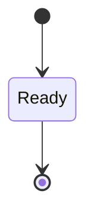
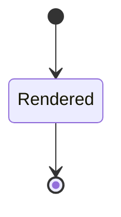
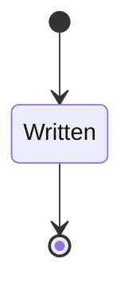

---
# generated by patchback-docs, do not edit
title: "audio domain"
sidebar_label: "audio"
description: "ESS reference for the audio domain, generated from the specification."
custom_edit_url: null
---

<!-- generated by patchback-docs, do not edit -->

Audio clips read from WAV files, clips written back as WAV, and renders of a patch and a note sequence through the native DSP renderer (DESIGN.md sections 3, 5.2, 5.3, 6.1, 11, 12.1, 12.3).

`patchback.audio` is one of patchback's bounded contexts. [All domains](./index.mdx).

## Types

### `AudioClipId`

`patchback.audio.AudioClipId` wraps `Uuid` and is not interchangeable with one: the whole value of naming it separately is the crossings the model then refuses.

### `AudioOrigin`

`patchback.audio.AudioOrigin` is one of `PatchbackSynthesized` and `ExternalRecording`.

### `RenderId`

`patchback.audio.RenderId` wraps `Uuid` and is not interchangeable with one: the whole value of naming it separately is the crossings the model then refuses.

### `WavFileId`

`patchback.audio.WavFileId` wraps `Uuid` and is not interchangeable with one: the whole value of naming it separately is the crossings the model then refuses.

### `WavSampleFormat`

`patchback.audio.WavSampleFormat` is one of `Pcm16` and `Float32`.

## Entities

An entity is what this context is about: something with an identity that outlives any one request, a shape, and a lifecycle. The lifecycle is exhaustive — a move that is not drawn below is a move this specification does not permit, and that is the only way it says so. Every move is labelled with the command that takes it, because a move nothing can trigger is refused rather than drawn.

### `AudioClip`

`patchback.audio.AudioClip`.

An instance is identified by `audio_clip_id`, a `patchback.audio.AudioClipId`. The name is part of the model and not a convention: a view projects the identity under that name, so a projection inventing its own would disagree with the view.

It holds:

- `path` — `String`
- `origin` — `patchback.audio.AudioOrigin`
- `sample_rate_hz` — `Integer`
- `source_channel_count` — `Integer`
- `downmixed` — `Boolean`
- `format_tag` — `Integer`
- `bits_per_sample` — `Integer`
- `frame_count` — `Integer`
- `provenance` — `Optional<String>`, which may be absent
- `licence` — `Optional<String>`, which may be absent
- `render_id` — `Optional<patchback.audio.RenderId>`, which may be absent

It references at most one [`Render`](#render), as `render`, carried by `AudioClip.render_id`.

Every instance satisfies `sample_rate_hz == 48000` and `frame_count > 0` — a predicate over this entity's own fields, checked against them rather than stored as a sentence, so an invariant reading something the entity does not have is refused instead of documented.

Its state is a `patchback.audio.AudioClip.State`, one of `Ready`. That enum is synthesised from the lifecycle rather than declared beside it, so the states a view's filter compares and the states drawn below cannot disagree.

An instance is created in `Ready`. `Ready` is terminal, so an instance may rest there forever. That is declared rather than inferred from having no way out: an entity that cannot leave a state is either finished or stuck, and only its author knows which.

It declares no moves, so nothing changes its state once it exists.

It has one state, so there is no move to permit or to forbid.

One view projects it: [`AudioClips`](#audioclips).

### `Render`

`patchback.audio.Render`.

An instance is identified by `render_id`, a `patchback.audio.RenderId`. The name is part of the model and not a convention: a view projects the identity under that name, so a projection inventing its own would disagree with the view.

It holds:

- `patch_id` — `patchback.patch.PatchId`
- `note_sequence_id` — `patchback.score.NoteSequenceId`
- `sample_rate_hz` — `Integer`
- `block_size_frames` — `Integer`
- `out_path` — `String`
- `limited` — `Boolean`

It references at most one [`patchback.patch.Patch`](patchback-patch.md#patch), as `patch`, carried by `Render.patch_id`. It references at most one [`patchback.score.NoteSequence`](patchback-score.md#notesequence), as `note_sequence`, carried by `Render.note_sequence_id`.

Every instance satisfies `sample_rate_hz == 48000` and `block_size_frames > 0` — a predicate over this entity's own fields, checked against them rather than stored as a sentence, so an invariant reading something the entity does not have is refused instead of documented.

Its state is a `patchback.audio.Render.State`, one of `Rendered`. That enum is synthesised from the lifecycle rather than declared beside it, so the states a view's filter compares and the states drawn below cannot disagree.

An instance is created in `Rendered`. `Rendered` is terminal, so an instance may rest there forever. That is declared rather than inferred from having no way out: an entity that cannot leave a state is either finished or stuck, and only its author knows which.

It declares no moves, so nothing changes its state once it exists.

It has one state, so there is no move to permit or to forbid.

One view projects it: [`Renders`](#renders).

### `WavFile`

`patchback.audio.WavFile`.

An instance is identified by `wav_file_id`, a `patchback.audio.WavFileId`. The name is part of the model and not a convention: a view projects the identity under that name, so a projection inventing its own would disagree with the view.

It holds:

- `audio_clip_id` — `patchback.audio.AudioClipId`
- `path` — `String`
- `sample_format` — `patchback.audio.WavSampleFormat`

It references at most one [`AudioClip`](#audioclip), as `clip`, carried by `WavFile.audio_clip_id`.

No invariant is declared, so nothing here constrains an instance at rest.

Its state is a `patchback.audio.WavFile.State`, one of `Written`. That enum is synthesised from the lifecycle rather than declared beside it, so the states a view's filter compares and the states drawn below cannot disagree.

An instance is created in `Written`. `Written` is terminal, so an instance may rest there forever. That is declared rather than inferred from having no way out: an entity that cannot leave a state is either finished or stuck, and only its author knows which.

It declares no moves, so nothing changes its state once it exists.

It has one state, so there is no move to permit or to forbid.

One view projects it: [`WavFiles`](#wavfiles).

## Views

A view is what the outside world is promised it can observe. Each one says which instances it contains and how soon it reflects a command that has already returned, because "you can read this" without "how soon" is the promise every flaky suite is built on.

### `AudioClips`

`patchback.audio.AudioClips`, shown to a person as "Audio clips" and called `audio-clips` on the wire.

It reads [`AudioClip`](#audioclip).

It contains every instance of that entity: no filter narrows it, which is a decision somebody made and not a line somebody omitted.

It exposes:

- `audio_clip_id` — `patchback.audio.AudioClipId`
- `state` — `patchback.audio.AudioClip.State`
- `path` — `String`
- `origin` — `patchback.audio.AudioOrigin`
- `provenance` — `Optional<String>`, which may be absent
- `licence` — `Optional<String>`, which may be absent
- `render_id` — `Optional<patchback.audio.RenderId>`, which may be absent
- `sample_rate_hz` — `Integer`
- `source_channel_count` — `Integer`
- `downmixed` — `Boolean`
- `format_tag` — `Integer`
- `bits_per_sample` — `Integer`
- `frame_count` — `Integer`

It declares no order, so the rows come back in whatever order the implementation has, and two reads may disagree.

**Read-your-writes**: it is current the moment the command that changed it returns. A caller that has just created an invoice and cannot see it in here has been told a lie about what it did.

A generated scenario asserts it once, immediately after the command: a view promising this and not keeping the promise has to fail the suite rather than be retried until it passes.

### `Renders`

`patchback.audio.Renders`, shown to a person as "Renders" and called `renders` on the wire.

It reads [`Render`](#render).

It contains every instance of that entity: no filter narrows it, which is a decision somebody made and not a line somebody omitted.

It exposes:

- `render_id` — `patchback.audio.RenderId`
- `state` — `patchback.audio.Render.State`
- `patch_id` — `patchback.patch.PatchId`
- `note_sequence_id` — `patchback.score.NoteSequenceId`
- `sample_rate_hz` — `Integer`
- `block_size_frames` — `Integer`
- `out_path` — `String`
- `limited` — `Boolean`

It declares no order, so the rows come back in whatever order the implementation has, and two reads may disagree.

**Read-your-writes**: it is current the moment the command that changed it returns. A caller that has just created an invoice and cannot see it in here has been told a lie about what it did.

A generated scenario asserts it once, immediately after the command: a view promising this and not keeping the promise has to fail the suite rather than be retried until it passes.

### `WavFiles`

`patchback.audio.WavFiles`, shown to a person as "WAV files" and called `wav-files` on the wire.

It reads [`WavFile`](#wavfile).

It contains every instance of that entity: no filter narrows it, which is a decision somebody made and not a line somebody omitted.

It exposes:

- `wav_file_id` — `patchback.audio.WavFileId`
- `state` — `patchback.audio.WavFile.State`
- `audio_clip_id` — `patchback.audio.AudioClipId`
- `path` — `String`
- `sample_format` — `patchback.audio.WavSampleFormat`

It declares no order, so the rows come back in whatever order the implementation has, and two reads may disagree.

**Read-your-writes**: it is current the moment the command that changed it returns. A caller that has just created an invoice and cannot see it in here has been told a lie about what it did.

A generated scenario asserts it once, immediately after the command: a view promising this and not keeping the promise has to fail the suite rather than be retried until it passes.

## Commands

### `ExportWav`

`patchback.audio.ExportWav`, shown to a person as "Export a clip as WAV" and called `export-wav` on the wire.

It takes:

- `audio_clip_id` — `patchback.audio.AudioClipId`
- `path` — `String`
- `sample_format` — `patchback.audio.WavSampleFormat`

It has two outcomes.

**`no-such-clip`** — Taken when no `patchback.audio.AudioClip` carries the identity `input.audio_clip_id` names. No entity in this specification changes. It reports `patchback.audio.ClipNotFound`, carrying `audio_clip_id`. It emits nothing. A test reaches it by arranging the row of the other entity the input names, or its absence, and sending the command for it.

**`exported`** — The default branch, taken when no other outcome's condition matched. It creates a `patchback.audio.WavFile`, which starts in `Written`. The new instance's identity is published as `wav_file_id` on `patchback.audio.WavExported`. It emits `patchback.audio.WavExported`. It sets `audio_clip_id` from `input.audio_clip_id`, `path` from `input.path` and `sample_format` from `input.sample_format`. A test reaches it by constructing an input that satisfies no other outcome's condition.

### `ImportWav`

`patchback.audio.ImportWav`, shown to a person as "Import a WAV file" and called `import-wav` on the wire.

It takes:

- `path` — `String`
- `origin` — `patchback.audio.AudioOrigin`
- `provenance` — `Optional<String>`, which may be absent
- `licence` — `Optional<String>`, which may be absent
- `render_id` — `Optional<patchback.audio.RenderId>`, which may be absent
- `sample_rate_hz` — `Integer`
- `channel_count` — `Integer`
- `format_tag` — `Integer`
- `bits_per_sample` — `Integer`
- `frame_count` — `Integer`

It has 13 outcomes.

**`provenance-missing`** — An external recording without provenance is refused and no clip exists. Taken when `(origin == ExternalRecording and not (defined(provenance)))` holds of the input. No entity in this specification changes. It reports `patchback.audio.ProvenanceMissing`, carrying `path`. It emits nothing. A test reaches it by constructing an input that satisfies that condition.

**`licence-missing`** — An external recording without a licence is refused and no clip exists. Taken when `(origin == ExternalRecording and defined(provenance) and not (defined(licence)))` holds of the input. No entity in this specification changes. It reports `patchback.audio.LicenceMissing`, carrying `path`. It emits nothing. A test reaches it by constructing an input that satisfies that condition.

**`truncated`** — Decided outside the input: the WAV reader finds the RIFF size or a chunk size running past the end of the file. No predicate over the input reaches this branch, and saying `when: false` instead would have claimed it is unreachable, which is a different and false statement. It is decided before the addressed row is read, among the input-guarded refusals: before existence and the held state. No entity in this specification changes. It reports `patchback.audio.TruncatedRiff`, carrying `path`. It emits nothing. A test reaches it by injecting the declared fault, because no input can.

**`corrupt-chunk`** — Decided outside the input: the WAV reader finds a malformed RIFF chunk, a missing fmt or data chunk, or a size over the allocation bound. No predicate over the input reaches this branch, and saying `when: false` instead would have claimed it is unreachable, which is a different and false statement. It is decided before the addressed row is read, among the input-guarded refusals: before existence and the held state. No entity in this specification changes. It reports `patchback.audio.CorruptRiffChunk`, carrying `path`. It emits nothing. A test reaches it by injecting the declared fault, because no input can.

**`unsupported-sample-rate`** — Any rate other than 48000 Hz is refused; no conversion happens. Taken when `sample_rate_hz != 48000` holds of the input. No entity in this specification changes. It reports `patchback.audio.UnsupportedSampleRate`, carrying `sample_rate_hz`. It emits nothing. A test reaches it by constructing an input that satisfies that condition.

**`unsupported-sample-format`** — Taken when `not (((format_tag == 1 and bits_per_sample == 16) or (format_tag == 3 and bits_per_sample == 32)))` holds of the input. No entity in this specification changes. It reports `patchback.audio.UnsupportedSampleFormat`, carrying `format_tag` and `bits_per_sample`. It emits nothing. A test reaches it by constructing an input that satisfies that condition.

**`unsupported-channel-count`** — Taken when `channel_count not in [1, 2]` holds of the input. No entity in this specification changes. It reports `patchback.audio.UnsupportedChannelCount`, carrying `channel_count`. It emits nothing. A test reaches it by constructing an input that satisfies that condition.

**`empty`** — Taken when `frame_count <= 0` holds of the input. No entity in this specification changes. It reports `patchback.audio.EmptyAudio`, carrying `path`. It emits nothing. A test reaches it by constructing an input that satisfies that condition.

**`no-such-render`** — A clip that names a render must name one that exists. Taken when `input.render_id`, checked only when present, names an identity no `patchback.audio.Render` carries. No entity in this specification changes. It reports `patchback.audio.RenderNotFound`, carrying `render_id`. It emits nothing. A test reaches it by arranging the row of the other entity the input names, or its absence, and sending the command for it.

**`too-long`** — Decided outside the input: the frame count exceeds the configured input duration bound. No predicate over the input reaches this branch, and saying `when: false` instead would have claimed it is unreachable, which is a different and false statement. No entity in this specification changes. It reports `patchback.audio.InputTooLong`, carrying `frame_count`. It emits nothing. A test reaches it by injecting the declared fault, because no input can.

**`non-finite`** — Decided outside the input: the WAV reader finds a NaN or infinite float32 sample. No predicate over the input reaches this branch, and saying `when: false` instead would have claimed it is unreachable, which is a different and false statement. No entity in this specification changes. It reports `patchback.audio.NonFiniteSamples`, carrying `path`. It emits nothing. A test reaches it by injecting the declared fault, because no input can.

**`imported-downmixed`** — A stereo file is downmixed to mono and the clip records the downmix. Taken when `channel_count == 2` holds of the input. It creates a `patchback.audio.AudioClip`, which starts in `Ready`. The new instance's identity is published as `audio_clip_id` on `patchback.audio.ClipImported`. It emits `patchback.audio.ClipImported`. It sets `path` from `input.path`, `origin` from `input.origin`, `sample_rate_hz` from `input.sample_rate_hz`, `source_channel_count` from `input.channel_count`, `downmixed` from `"true"`, `format_tag` from `input.format_tag`, `bits_per_sample` from `input.bits_per_sample`, `frame_count` from `input.frame_count`, `provenance` from `input.provenance`, `licence` from `input.licence` and `render_id` from `input.render_id`. A test reaches it by constructing an input that satisfies that condition.

**`imported`** — A mono file becomes a clip unchanged. The default branch, taken when no other outcome's condition matched. It creates a `patchback.audio.AudioClip`, which starts in `Ready`. The new instance's identity is published as `audio_clip_id` on `patchback.audio.ClipImported`. It emits `patchback.audio.ClipImported`. It sets `path` from `input.path`, `origin` from `input.origin`, `sample_rate_hz` from `input.sample_rate_hz`, `source_channel_count` from `input.channel_count`, `downmixed` from `"false"`, `format_tag` from `input.format_tag`, `bits_per_sample` from `input.bits_per_sample`, `frame_count` from `input.frame_count`, `provenance` from `input.provenance`, `licence` from `input.licence` and `render_id` from `input.render_id`. A test reaches it by constructing an input that satisfies no other outcome's condition.

### `RenderPatch`

`patchback.audio.RenderPatch`, shown to a person as "Render a patch" and called `render` on the wire.

It takes:

- `patch_id` — `patchback.patch.PatchId`
- `note_sequence_id` — `patchback.score.NoteSequenceId`
- `sample_rate_hz` — `Integer`
- `block_size_frames` — `Optional<Integer>`, which may be absent
- `out_path` — `String`

It has eight outcomes.

**`unsupported-sample-rate`** — A render at any rate other than 48000 Hz is refused. Taken when `sample_rate_hz != 48000` holds of the input. No entity in this specification changes. It reports `patchback.audio.UnsupportedSampleRate`, carrying `sample_rate_hz`. It emits nothing. A test reaches it by constructing an input that satisfies that condition.

**`invalid-block-size`** — Taken when `{expr: "coalesce(block_size_frames, 256)"} <= 0` holds of the input. No entity in this specification changes. It reports `patchback.audio.InvalidBlockSize`, carrying `block_size_frames`. It emits nothing. A test reaches it by constructing an input that satisfies that condition.

**`no-such-patch`** — Taken when no `patchback.patch.Patch` carries the identity `input.patch_id` names. No entity in this specification changes. It reports `patchback.audio.PatchNotFound`, carrying `patch_id`. It emits nothing. A test reaches it by arranging the row of the other entity the input names, or its absence, and sending the command for it.

**`no-such-note-sequence`** — Taken when no `patchback.score.NoteSequence` carries the identity `input.note_sequence_id` names. No entity in this specification changes. It reports `patchback.audio.NoteSequenceNotFound`, carrying `note_sequence_id`. It emits nothing. A test reaches it by arranging the row of the other entity the input names, or its absence, and sending the command for it.

**`patch-not-compiled`** — A patch that has not been validated and compiled is never executed (DESIGN.md 2 invariant 3). Taken when the `patchback.patch.Patch` that `input.patch_id` names exists and its stored fields satisfy `state != Compiled`. No entity in this specification changes. It reports `patchback.audio.PatchNotCompiled`, carrying `patch_id` and `state`. It emits nothing. A test reaches it by arranging the row of the other entity the input names, or its absence, and sending the command for it.

**`non-finite-output`** — The render fails; no Render is recorded and no WAV is written. Decided outside the input: the renderer produces a NaN or infinite sample. No predicate over the input reaches this branch, and saying `when: false` instead would have claimed it is unreachable, which is a different and false statement. No entity in this specification changes. It reports `patchback.audio.NonFiniteRender`, carrying `patch_id`. It emits nothing. A test reaches it by injecting the declared fault, because no input can.

**`rendered-limited`** — The render succeeds and reports that the protective limiter engaged. Decided outside the input: the protective output limiter engaged on at least one sample. No predicate over the input reaches this branch, and saying `when: false` instead would have claimed it is unreachable, which is a different and false statement. It creates a `patchback.audio.Render`, which starts in `Rendered`. The new instance's identity is published as `render_id` on `patchback.audio.PatchRendered`. It emits `patchback.audio.PatchRendered`. It sets `patch_id` from `input.patch_id`, `note_sequence_id` from `input.note_sequence_id`, `sample_rate_hz` from `input.sample_rate_hz`, `block_size_frames` from `input.block_size_frames, else "256"`, `out_path` from `input.out_path` and `limited` from `"true"`. A test reaches it by injecting the declared fault, because no input can.

**`rendered`** — The render succeeds with no limiting; the WAV is written to out_path. The default branch, taken when no other outcome's condition matched. It creates a `patchback.audio.Render`, which starts in `Rendered`. The new instance's identity is published as `render_id` on `patchback.audio.PatchRendered`. It emits `patchback.audio.PatchRendered`. It sets `patch_id` from `input.patch_id`, `note_sequence_id` from `input.note_sequence_id`, `sample_rate_hz` from `input.sample_rate_hz`, `block_size_frames` from `input.block_size_frames, else "256"`, `out_path` from `input.out_path` and `limited` from `"false"`. A test reaches it by constructing an input that satisfies no other outcome's condition.

## Events

### `ClipImported`

`patchback.audio.ClipImported`.

It carries:

- `audio_clip_id` — `patchback.audio.AudioClipId`
- `path` — `String`
- `origin` — `patchback.audio.AudioOrigin`
- `frame_count` — `Integer`
- `source_channel_count` — `Integer`
- `downmixed` — `Boolean`

Emitted by `patchback.audio.ImportWav` on its `imported-downmixed` and `imported` outcomes.

Nothing in this system reacts to it.

### `PatchRendered`

`patchback.audio.PatchRendered`.

It carries:

- `render_id` — `patchback.audio.RenderId`
- `patch_id` — `patchback.patch.PatchId`
- `note_sequence_id` — `patchback.score.NoteSequenceId`
- `limited` — `Boolean`

Emitted by `patchback.audio.RenderPatch` on its `rendered-limited` and `rendered` outcomes.

Nothing in this system reacts to it.

### `WavExported`

`patchback.audio.WavExported`.

It carries:

- `wav_file_id` — `patchback.audio.WavFileId`
- `audio_clip_id` — `patchback.audio.AudioClipId`
- `path` — `String`
- `sample_format` — `patchback.audio.WavSampleFormat`

Emitted by `patchback.audio.ExportWav` on its `exported` outcome.

Nothing in this system reacts to it.

## Errors

### `ClipNotFound`

No clip carries the identity given.

It carries:

- `audio_clip_id` — `patchback.audio.AudioClipId`

Reported by `patchback.audio.ExportWav` on its `no-such-clip` outcome.

### `CorruptRiffChunk`

A RIFF chunk is malformed (bad chunk id, missing fmt or data chunk, a size that overflows the allocation bound); nothing was read (DESIGN.md 6.1, 12.1).

It carries:

- `path` — `String`

Reported by `patchback.audio.ImportWav` on its `corrupt-chunk` outcome.

### `EmptyAudio`

The data chunk holds no frames (DESIGN.md 12.3).

It carries:

- `path` — `String`

Reported by `patchback.audio.ImportWav` on its `empty` outcome.

### `InputTooLong`

The frame count exceeds the input duration bound (DESIGN.md 6.1, 12.3).

It carries:

- `frame_count` — `Integer`

Reported by `patchback.audio.ImportWav` on its `too-long` outcome.

### `InvalidBlockSize`

The block size is not a positive number of frames.

It carries:

- `block_size_frames` — `Optional<Integer>`, which may be absent

Reported by `patchback.audio.RenderPatch` on its `invalid-block-size` outcome.

### `LicenceMissing`

An external recording was offered without a recorded licence (DESIGN.md 12.3, AGENTS.md).

It carries:

- `path` — `String`

Reported by `patchback.audio.ImportWav` on its `licence-missing` outcome.

### `NonFiniteRender`

The render produced a NaN or infinite sample; it failed and no WAV was written (DESIGN.md 2 invariant 4).

It carries:

- `patch_id` — `patchback.patch.PatchId`

Reported by `patchback.audio.RenderPatch` on its `non-finite-output` outcome.

### `NonFiniteSamples`

A float sample is NaN or infinite (DESIGN.md 2 invariant 4, 6.1).

It carries:

- `path` — `String`

Reported by `patchback.audio.ImportWav` on its `non-finite` outcome.

### `NoteSequenceNotFound`

No note sequence carries the identity given; nothing is rendered.

It carries:

- `note_sequence_id` — `patchback.score.NoteSequenceId`

Reported by `patchback.audio.RenderPatch` on its `no-such-note-sequence` outcome.

### `PatchNotCompiled`

The patch has not been validated and compiled; it is never executed (DESIGN.md 2 invariant 3, 5.1).

It carries:

- `patch_id` — `patchback.patch.PatchId`
- `state` — `patchback.patch.Patch.State`

Reported by `patchback.audio.RenderPatch` on its `patch-not-compiled` outcome.

### `PatchNotFound`

No patch carries the identity given; nothing is rendered.

It carries:

- `patch_id` — `patchback.patch.PatchId`

Reported by `patchback.audio.RenderPatch` on its `no-such-patch` outcome.

### `ProvenanceMissing`

An external recording was offered without recorded provenance (DESIGN.md 12.3).

It carries:

- `path` — `String`

Reported by `patchback.audio.ImportWav` on its `provenance-missing` outcome.

### `RenderNotFound`

The clip names a render that does not exist; no clip is created.

It carries:

- `render_id` — `Optional<patchback.audio.RenderId>`, which may be absent

Reported by `patchback.audio.ImportWav` on its `no-such-render` outcome.

### `TruncatedRiff`

The RIFF size or a chunk size runs past the end of the file; nothing was read.

It carries:

- `path` — `String`

Reported by `patchback.audio.ImportWav` on its `truncated` outcome.

### `UnsupportedChannelCount`

The file has neither one nor two channels (DESIGN.md 6.1).

It carries:

- `channel_count` — `Integer`

Reported by `patchback.audio.ImportWav` on its `unsupported-channel-count` outcome.

### `UnsupportedSampleFormat`

The sample format is neither PCM16 (tag 1, 16 bits) nor IEEE float32 (tag 3, 32 bits).

It carries:

- `format_tag` — `Integer`
- `bits_per_sample` — `Integer`

Reported by `patchback.audio.ImportWav` on its `unsupported-sample-format` outcome.

### `UnsupportedSampleRate`

The sample rate is not 48000 Hz; it is refused, never converted (DESIGN.md 5.3, 6.1).

It carries:

- `sample_rate_hz` — `Integer`

Reported by `patchback.audio.ImportWav` on its `unsupported-sample-rate` outcome.

Reported by `patchback.audio.RenderPatch` on its `unsupported-sample-rate` outcome.

## Actors

An actor is who may ask this context for something. Every grant below points at a command this specification declares — a grant is a resolved reference, so "may invoke" something nobody wrote is not a permission this model can express, and an authorisation that authorises nothing cannot ship quietly.

### `Operator`

`patchback.audio.Operator`, shown to a person as "Operator".

It may invoke [`ExportWav`](#exportwav), [`ImportWav`](#importwav) and [`RenderPatch`](#renderpatch).

---

Generated from patchback v1 · model digest `295086981db1382e7ea73acd85646a026c39afc65e749a0ae7df6d56b197c1a2` · contract digest `slice-sha256/2:65c35a083761b238cb984ad527e2b0433f34bf180d80e1d0f353f1ecba63e513`. Do not edit this file; change the specification and regenerate it with `task docs-generate`.
