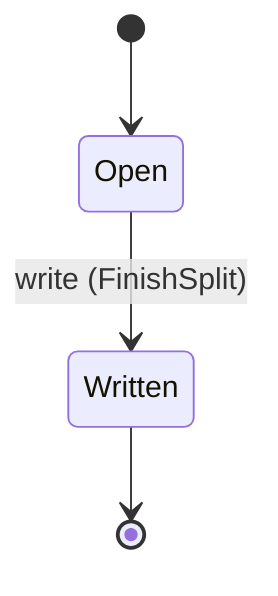
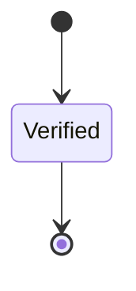
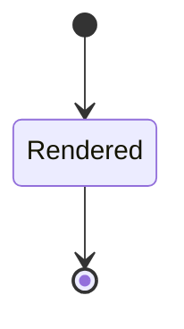
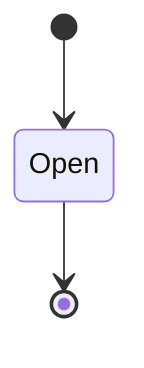
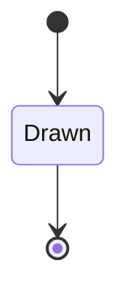

---
# generated by patchback-docs, do not edit
title: "dataset domain"
sidebar_label: "dataset"
description: "ESS reference for the dataset domain, generated from the specification."
custom_edit_url: null
---

<!-- generated by patchback-docs, do not edit -->

Seeded synthetic training data (DESIGN.md § 7): a dataset generated by rendering known patches, its train, validation and test splits, the patch samples in them, the separate diagnostic set of rejection cases, and the ModelSpec dense-data files (x.f32, y.f32, order.u32) of each split.

`patchback.dataset` is one of patchback's bounded contexts. [All domains](./index.mdx).

## Types

### `DatasetId`

`patchback.dataset.DatasetId` wraps `Uuid` and is not interchangeable with one: the whole value of naming it separately is the crossings the model then refuses.

### `DatasetSplitId`

`patchback.dataset.DatasetSplitId` wraps `Uuid` and is not interchangeable with one: the whole value of naming it separately is the crossings the model then refuses.

### `DenseDataFileId`

`patchback.dataset.DenseDataFileId` wraps `Uuid` and is not interchangeable with one: the whole value of naming it separately is the crossings the model then refuses.

### `DenseFileKind`

`patchback.dataset.DenseFileKind` is one of `X`, `Y` and `Order`.

### `DiagnosticExampleId`

`patchback.dataset.DiagnosticExampleId` wraps `Uuid` and is not interchangeable with one: the whole value of naming it separately is the crossings the model then refuses.

### `DiagnosticKind`

`patchback.dataset.DiagnosticKind` is one of `Silence`, `Noise` and `Clipping`.

### `DiagnosticSetId`

`patchback.dataset.DiagnosticSetId` wraps `Uuid` and is not interchangeable with one: the whole value of naming it separately is the crossings the model then refuses.

### `PrngAlgorithm`

`patchback.dataset.PrngAlgorithm` wraps `String` and is not interchangeable with one: the whole value of naming it separately is the crossings the model then refuses.

### `SampleId`

`patchback.dataset.SampleId` wraps `Uuid` and is not interchangeable with one: the whole value of naming it separately is the crossings the model then refuses.

### `SampledPatchId`

`patchback.dataset.SampledPatchId` wraps `Uuid` and is not interchangeable with one: the whole value of naming it separately is the crossings the model then refuses.

### `SplitRole`

`patchback.dataset.SplitRole` is one of `Train`, `Validation` and `Test`.

## Entities

An entity is what this context is about: something with an identity that outlives any one request, a shape, and a lifecycle. The lifecycle is exhaustive — a move that is not drawn below is a move this specification does not permit, and that is the only way it says so. Every move is labelled with the command that takes it, because a move nothing can trigger is refused rather than drawn.

### `Dataset`

`patchback.dataset.Dataset`.

An instance is identified by `dataset_id`, a `patchback.dataset.DatasetId`. The name is part of the model and not a convention: a view projects the identity under that name, so a projection inventing its own would disagree with the view.

It holds:

- `seed` — `Integer`
- `prng_algorithm` — `patchback.dataset.PrngAlgorithm`
- `batch_size` — `Integer`
- `feature_contract_id` — `patchback.analysis.FeatureContractId`
- `topology_id` — `patchback.patch.TopologyId`
- `out_dir` — `String`

It references at most one [`patchback.analysis.FeatureContract`](patchback-analysis.md#featurecontract), as `feature_contract`, carried by `Dataset.feature_contract_id`. It references at most one [`patchback.patch.Topology`](patchback-patch.md#topology), as `topology`, carried by `Dataset.topology_id`.

No invariant is declared, so nothing here constrains an instance at rest.

Its state is a `patchback.dataset.Dataset.State`, one of `Generated`. That enum is synthesised from the lifecycle rather than declared beside it, so the states a view's filter compares and the states drawn below cannot disagree.

An instance is created in `Generated`. `Generated` is terminal, so an instance may rest there forever. That is declared rather than inferred from having no way out: an entity that cannot leave a state is either finished or stuck, and only its author knows which.

It declares no moves, so nothing changes its state once it exists.

It has one state, so there is no move to permit or to forbid.

One view projects it: [`Datasets`](#datasets).

### `DatasetSplit`

`patchback.dataset.DatasetSplit`.

An instance is identified by `dataset_split_id`, a `patchback.dataset.DatasetSplitId`. The name is part of the model and not a convention: a view projects the identity under that name, so a projection inventing its own would disagree with the view.

It holds:

- `dataset_id` — `patchback.dataset.DatasetId`
- `role` — `patchback.dataset.SplitRole`
- `sample_count` — `Integer`

It references at most one [`Dataset`](#dataset), as `dataset`, carried by `DatasetSplit.dataset_id`.

No invariant is declared, so nothing here constrains an instance at rest.

Its state is a `patchback.dataset.DatasetSplit.State`, one of `Open` and `Written`. That enum is synthesised from the lifecycle rather than declared beside it, so the states a view's filter compares and the states drawn below cannot disagree.

An instance is created in `Open`. `Written` is terminal, so an instance may rest there forever. That is declared rather than inferred from having no way out: an entity that cannot leave a state is either finished or stuck, and only its author knows which.

Each move is taken by a declared command outcome, and a move nothing takes is refused as `missing_causation` rather than left as a state change nobody can trigger:

- `write` — taken by `patchback.dataset.FinishSplit` on its `written` outcome

An instance is brought into existence by `patchback.dataset.OpenSplit` on its `opened` outcome.

Illegal transitions are illegal by absence: no rule forbids them, there is simply no arrow, because a rule would be a second place for the same truth to live. A diagram cannot show an absence, so the pairs it does not connect are listed here, derived from the same transitions — anything named below is a move this specification does not permit.

- `Written` may not become `Open`

One view projects it: [`Splits`](#splits).

### `DenseDataFile`

`patchback.dataset.DenseDataFile`.

An instance is identified by `dense_data_file_id`, a `patchback.dataset.DenseDataFileId`. The name is part of the model and not a convention: a view projects the identity under that name, so a projection inventing its own would disagree with the view.

It holds:

- `dataset_split_id` — `patchback.dataset.DatasetSplitId`
- `kind` — `patchback.dataset.DenseFileKind`
- `path` — `String`
- `rows` — `Integer`
- `columns` — `Integer`
- `byte_count` — `Integer`

It references at most one [`DatasetSplit`](#datasetsplit), as `split`, carried by `DenseDataFile.dataset_split_id`.

No invariant is declared, so nothing here constrains an instance at rest.

Its state is a `patchback.dataset.DenseDataFile.State`, one of `Verified`. That enum is synthesised from the lifecycle rather than declared beside it, so the states a view's filter compares and the states drawn below cannot disagree.

An instance is created in `Verified`. `Verified` is terminal, so an instance may rest there forever. That is declared rather than inferred from having no way out: an entity that cannot leave a state is either finished or stuck, and only its author knows which.

It declares no moves, so nothing changes its state once it exists.

It has one state, so there is no move to permit or to forbid.

One view projects it: [`DenseFiles`](#densefiles).

### `DiagnosticExample`

`patchback.dataset.DiagnosticExample`.

An instance is identified by `diagnostic_example_id`, a `patchback.dataset.DiagnosticExampleId`. The name is part of the model and not a convention: a view projects the identity under that name, so a projection inventing its own would disagree with the view.

It holds:

- `diagnostic_set_id` — `patchback.dataset.DiagnosticSetId`
- `kind` — `patchback.dataset.DiagnosticKind`

It references at most one [`DiagnosticSet`](#diagnosticset), as `diagnostic_set`, carried by `DiagnosticExample.diagnostic_set_id`.

No invariant is declared, so nothing here constrains an instance at rest.

Its state is a `patchback.dataset.DiagnosticExample.State`, one of `Rendered`. That enum is synthesised from the lifecycle rather than declared beside it, so the states a view's filter compares and the states drawn below cannot disagree.

An instance is created in `Rendered`. `Rendered` is terminal, so an instance may rest there forever. That is declared rather than inferred from having no way out: an entity that cannot leave a state is either finished or stuck, and only its author knows which.

It declares no moves, so nothing changes its state once it exists.

It has one state, so there is no move to permit or to forbid.

One view projects it: [`DiagnosticExamples`](#diagnosticexamples).

### `DiagnosticSet`

`patchback.dataset.DiagnosticSet`.

An instance is identified by `diagnostic_set_id`, a `patchback.dataset.DiagnosticSetId`. The name is part of the model and not a convention: a view projects the identity under that name, so a projection inventing its own would disagree with the view.

It holds:

- `dataset_id` — `patchback.dataset.DatasetId`

It references at most one [`Dataset`](#dataset), as `dataset`, carried by `DiagnosticSet.dataset_id`.

No invariant is declared, so nothing here constrains an instance at rest.

Its state is a `patchback.dataset.DiagnosticSet.State`, one of `Open`. That enum is synthesised from the lifecycle rather than declared beside it, so the states a view's filter compares and the states drawn below cannot disagree.

An instance is created in `Open`. `Open` is terminal, so an instance may rest there forever. That is declared rather than inferred from having no way out: an entity that cannot leave a state is either finished or stuck, and only its author knows which.

It declares no moves, so nothing changes its state once it exists.

It has one state, so there is no move to permit or to forbid.

One view projects it: [`DiagnosticSets`](#diagnosticsets).

### `Sample`

`patchback.dataset.Sample`.

An instance is identified by `sample_id`, a `patchback.dataset.SampleId`. The name is part of the model and not a convention: a view projects the identity under that name, so a projection inventing its own would disagree with the view.

It holds:

- `sampled_patch_id` — `patchback.dataset.SampledPatchId`
- `midi_note` — `Integer`
- `gate_samples` — `Integer`

It references at most one [`SampledPatch`](#sampledpatch), as `patch`, carried by `Sample.sampled_patch_id`.

No invariant is declared, so nothing here constrains an instance at rest.

Its state is a `patchback.dataset.Sample.State`, one of `Rendered`. That enum is synthesised from the lifecycle rather than declared beside it, so the states a view's filter compares and the states drawn below cannot disagree.

An instance is created in `Rendered`. `Rendered` is terminal, so an instance may rest there forever. That is declared rather than inferred from having no way out: an entity that cannot leave a state is either finished or stuck, and only its author knows which.

It declares no moves, so nothing changes its state once it exists.

It has one state, so there is no move to permit or to forbid.

One view projects it: [`Samples`](#samples).

### `SampledPatch`

`patchback.dataset.SampledPatch`.

An instance is identified by `sampled_patch_id`, a `patchback.dataset.SampledPatchId`. The name is part of the model and not a convention: a view projects the identity under that name, so a projection inventing its own would disagree with the view.

It holds:

- `dataset_id` — `patchback.dataset.DatasetId`
- `dataset_split_id` — `patchback.dataset.DatasetSplitId`
- `patch_seed` — `Integer`

It references at most one [`Dataset`](#dataset), as `dataset`, carried by `SampledPatch.dataset_id`. It references at most one [`DatasetSplit`](#datasetsplit), as `split`, carried by `SampledPatch.dataset_split_id`.

No invariant is declared, so nothing here constrains an instance at rest.

Its state is a `patchback.dataset.SampledPatch.State`, one of `Drawn`. That enum is synthesised from the lifecycle rather than declared beside it, so the states a view's filter compares and the states drawn below cannot disagree.

An instance is created in `Drawn`. `Drawn` is terminal, so an instance may rest there forever. That is declared rather than inferred from having no way out: an entity that cannot leave a state is either finished or stuck, and only its author knows which.

It declares no moves, so nothing changes its state once it exists.

It has one state, so there is no move to permit or to forbid.

One view projects it: [`SampledPatches`](#sampledpatches).

## Views

A view is what the outside world is promised it can observe. Each one says which instances it contains and how soon it reflects a command that has already returned, because "you can read this" without "how soon" is the promise every flaky suite is built on.

### `Datasets`

`patchback.dataset.Datasets`, shown to a person as "Datasets" and called `datasets` on the wire.

It reads [`Dataset`](#dataset).

It contains every instance of that entity: no filter narrows it, which is a decision somebody made and not a line somebody omitted.

It exposes:

- `dataset_id` — `patchback.dataset.DatasetId`
- `state` — `patchback.dataset.Dataset.State`
- `seed` — `Integer`
- `prng_algorithm` — `patchback.dataset.PrngAlgorithm`
- `batch_size` — `Integer`
- `feature_contract_id` — `patchback.analysis.FeatureContractId`
- `topology_id` — `patchback.patch.TopologyId`

It declares no order, so the rows come back in whatever order the implementation has, and two reads may disagree.

**Read-your-writes**: it is current the moment the command that changed it returns. A caller that has just created an invoice and cannot see it in here has been told a lie about what it did.

A generated scenario asserts it once, immediately after the command: a view promising this and not keeping the promise has to fail the suite rather than be retried until it passes.

### `DenseFiles`

`patchback.dataset.DenseFiles`, shown to a person as "Dense-data files" and called `dense-files` on the wire.

It reads [`DenseDataFile`](#densedatafile).

It contains every instance of that entity: no filter narrows it, which is a decision somebody made and not a line somebody omitted.

It exposes:

- `dense_data_file_id` — `patchback.dataset.DenseDataFileId`
- `state` — `patchback.dataset.DenseDataFile.State`
- `dataset_split_id` — `patchback.dataset.DatasetSplitId`
- `kind` — `patchback.dataset.DenseFileKind`
- `rows` — `Integer`
- `columns` — `Integer`
- `byte_count` — `Integer`

It declares no order, so the rows come back in whatever order the implementation has, and two reads may disagree.

**Read-your-writes**: it is current the moment the command that changed it returns. A caller that has just created an invoice and cannot see it in here has been told a lie about what it did.

A generated scenario asserts it once, immediately after the command: a view promising this and not keeping the promise has to fail the suite rather than be retried until it passes.

### `DiagnosticExamples`

`patchback.dataset.DiagnosticExamples`, shown to a person as "Diagnostic examples" and called `diagnostic-examples` on the wire.

It reads [`DiagnosticExample`](#diagnosticexample).

It contains every instance of that entity: no filter narrows it, which is a decision somebody made and not a line somebody omitted.

It exposes:

- `diagnostic_example_id` — `patchback.dataset.DiagnosticExampleId`
- `state` — `patchback.dataset.DiagnosticExample.State`
- `diagnostic_set_id` — `patchback.dataset.DiagnosticSetId`
- `kind` — `patchback.dataset.DiagnosticKind`

It declares no order, so the rows come back in whatever order the implementation has, and two reads may disagree.

**Read-your-writes**: it is current the moment the command that changed it returns. A caller that has just created an invoice and cannot see it in here has been told a lie about what it did.

A generated scenario asserts it once, immediately after the command: a view promising this and not keeping the promise has to fail the suite rather than be retried until it passes.

### `DiagnosticSets`

`patchback.dataset.DiagnosticSets`, shown to a person as "Diagnostic sets" and called `diagnostic-sets` on the wire.

It reads [`DiagnosticSet`](#diagnosticset).

It contains every instance of that entity: no filter narrows it, which is a decision somebody made and not a line somebody omitted.

It exposes:

- `diagnostic_set_id` — `patchback.dataset.DiagnosticSetId`
- `state` — `patchback.dataset.DiagnosticSet.State`
- `dataset_id` — `patchback.dataset.DatasetId`

It declares no order, so the rows come back in whatever order the implementation has, and two reads may disagree.

**Read-your-writes**: it is current the moment the command that changed it returns. A caller that has just created an invoice and cannot see it in here has been told a lie about what it did.

A generated scenario asserts it once, immediately after the command: a view promising this and not keeping the promise has to fail the suite rather than be retried until it passes.

### `SampledPatches`

`patchback.dataset.SampledPatches`, shown to a person as "Sampled patches" and called `sampled-patches` on the wire.

It reads [`SampledPatch`](#sampledpatch).

It contains every instance of that entity: no filter narrows it, which is a decision somebody made and not a line somebody omitted.

It exposes:

- `sampled_patch_id` — `patchback.dataset.SampledPatchId`
- `state` — `patchback.dataset.SampledPatch.State`
- `dataset_id` — `patchback.dataset.DatasetId`
- `dataset_split_id` — `patchback.dataset.DatasetSplitId`
- `patch_seed` — `Integer`

It declares no order, so the rows come back in whatever order the implementation has, and two reads may disagree.

**Read-your-writes**: it is current the moment the command that changed it returns. A caller that has just created an invoice and cannot see it in here has been told a lie about what it did.

A generated scenario asserts it once, immediately after the command: a view promising this and not keeping the promise has to fail the suite rather than be retried until it passes.

### `Samples`

`patchback.dataset.Samples`, shown to a person as "Samples" and called `samples` on the wire.

It reads [`Sample`](#sample).

It contains every instance of that entity: no filter narrows it, which is a decision somebody made and not a line somebody omitted.

It exposes:

- `sample_id` — `patchback.dataset.SampleId`
- `state` — `patchback.dataset.Sample.State`
- `sampled_patch_id` — `patchback.dataset.SampledPatchId`
- `midi_note` — `Integer`
- `gate_samples` — `Integer`

It declares no order, so the rows come back in whatever order the implementation has, and two reads may disagree.

**Read-your-writes**: it is current the moment the command that changed it returns. A caller that has just created an invoice and cannot see it in here has been told a lie about what it did.

A generated scenario asserts it once, immediately after the command: a view promising this and not keeping the promise has to fail the suite rather than be retried until it passes.

### `Splits`

`patchback.dataset.Splits`, shown to a person as "Splits" and called `splits` on the wire.

It reads [`DatasetSplit`](#datasetsplit).

It contains every instance of that entity: no filter narrows it, which is a decision somebody made and not a line somebody omitted.

It exposes:

- `dataset_split_id` — `patchback.dataset.DatasetSplitId`
- `state` — `patchback.dataset.DatasetSplit.State`
- `dataset_id` — `patchback.dataset.DatasetId`
- `role` — `patchback.dataset.SplitRole`
- `sample_count` — `Integer`

It declares no order, so the rows come back in whatever order the implementation has, and two reads may disagree.

**Read-your-writes**: it is current the moment the command that changed it returns. A caller that has just created an invoice and cannot see it in here has been told a lie about what it did.

A generated scenario asserts it once, immediately after the command: a view promising this and not keeping the promise has to fail the suite rather than be retried until it passes.

## Commands

### `AddDiagnosticExample`

`patchback.dataset.AddDiagnosticExample`, shown to a person as "Add a diagnostic example" and called `add-diagnostic-example` on the wire.

It takes:

- `diagnostic_set_id` — `patchback.dataset.DiagnosticSetId`
- `kind` — `patchback.dataset.DiagnosticKind`

It has two outcomes.

**`unknown-diagnostic-set`** — Taken when no `patchback.dataset.DiagnosticSet` carries the identity `input.diagnostic_set_id` names. No entity in this specification changes. It reports `patchback.dataset.UnknownDiagnosticSet`, carrying `diagnostic_set_id`. It emits nothing. A test reaches it by arranging the row of the other entity the input names, or its absence, and sending the command for it.

**`added`** — The rejection case is in the diagnostic set. The default branch, taken when no other outcome's condition matched. It creates a `patchback.dataset.DiagnosticExample`, which starts in `Rendered`. The new instance's identity is published as `diagnostic_example_id` on `patchback.dataset.DiagnosticExampleAdded`. It emits `patchback.dataset.DiagnosticExampleAdded`. It sets `diagnostic_set_id` from `input.diagnostic_set_id` and `kind` from `input.kind`. A test reaches it by constructing an input that satisfies no other outcome's condition.

### `AddSample`

`patchback.dataset.AddSample`, shown to a person as "Add a sample" and called `add-sample` on the wire.

It takes:

- `sampled_patch_id` — `patchback.dataset.SampledPatchId`
- `midi_note` — `Integer`
- `gate_samples` — `Integer`

It has two outcomes.

**`unknown-patch`** — Taken when no `patchback.dataset.SampledPatch` carries the identity `input.sampled_patch_id` names. No entity in this specification changes. It reports `patchback.dataset.UnknownPatch`, carrying `sampled_patch_id`. It emits nothing. A test reaches it by arranging the row of the other entity the input names, or its absence, and sending the command for it.

**`added`** — The pair is in its patch's split. The default branch, taken when no other outcome's condition matched. It creates a `patchback.dataset.Sample`, which starts in `Rendered`. The new instance's identity is published as `sample_id` on `patchback.dataset.SampleAdded`. It emits `patchback.dataset.SampleAdded`. It sets `sampled_patch_id` from `input.sampled_patch_id`, `midi_note` from `input.midi_note` and `gate_samples` from `input.gate_samples`. A test reaches it by constructing an input that satisfies no other outcome's condition.

### `DrawPatch`

`patchback.dataset.DrawPatch`, shown to a person as "Draw a patch" and called `draw-patch` on the wire.

It takes:

- `dataset_id` — `patchback.dataset.DatasetId`
- `dataset_split_id` — `patchback.dataset.DatasetSplitId`
- `patch_seed` — `Integer`

It has two outcomes.

**`patch-already-drawn`** — Taken when, of the `patchback.dataset.SampledPatch` rows whose stored fields satisfy `(dataset_id == input.dataset_id and patch_seed == input.patch_seed)` before the outcome, at least 1 rows are selected. No entity in this specification changes. It reports `patchback.dataset.PatchAlreadyDrawn`, carrying `patch_seed` and `dataset_split_id`. It emits nothing. A test reaches it by arranging the row of the other entity the input names, or its absence, and sending the command for it.

**`drawn`** — The patch exists in exactly one split; every rendering of it stays there. The default branch, taken when no other outcome's condition matched. It creates a `patchback.dataset.SampledPatch`, which starts in `Drawn`. The new instance's identity is published as `sampled_patch_id` on `patchback.dataset.PatchDrawn`. It emits `patchback.dataset.PatchDrawn`. It sets `dataset_id` from `input.dataset_id`, `dataset_split_id` from `input.dataset_split_id` and `patch_seed` from `input.patch_seed`. A test reaches it by constructing an input that satisfies no other outcome's condition.

### `FinishSplit`

`patchback.dataset.FinishSplit`, shown to a person as "Finish a split's dense data" and called `finish-split` on the wire.

It takes:

- `dataset_split_id` — `patchback.dataset.DatasetSplitId`

It has four outcomes.

**`unknown-split`** — Taken when the identity the command names is one no record carries, before any other answer for it. No entity in this specification changes. It reports `patchback.dataset.UnknownSplit`, carrying `dataset_split_id`. It emits nothing. A test reaches it by sending an identity no record carries, arranging nothing.

**`missing-dense-file`** — Decided outside the input: the split has no verified x.f32 or no verified y.f32. No predicate over the input reaches this branch, and saying `when: false` instead would have claimed it is unreachable, which is a different and false statement. No entity in this specification changes. It reports `patchback.dataset.MissingDenseFile`, carrying `dataset_split_id`. It emits nothing. A test reaches it by injecting the declared fault, because no input can.

**`written`** — The split's dense data is complete and may be given to `modelspec train`. The default branch, taken when no other outcome's condition matched. It moves a `patchback.dataset.DatasetSplit` from `Open` to `Written`, along the declared move `write`. The instance is the one named by the input field `dataset_split_id`. It emits `patchback.dataset.SplitWritten`. A test reaches it by constructing an input that satisfies no other outcome's condition.

**`wrong-state`** — Taken when the subject is resting in a state none of this command's moves start from — a `patchback.dataset.DatasetSplit` in `Written`, which is what is left of the lifecycle once this command's own moves are taken away. The document lists none of it. No entity in this specification changes. It reports `patchback.dataset.SplitAlreadyWritten`, carrying `state`. It emits nothing. A test reaches it by driving an instance into one of those states and then issuing the command, because no input selects this branch.

### `GenerateDataset`

`patchback.dataset.GenerateDataset`, shown to a person as "Generate a dataset" and called `generate-dataset` on the wire.

It takes:

- `seed` — `Integer`
- `prng_algorithm` — `patchback.dataset.PrngAlgorithm`
- `batch_size` — `Integer`
- `feature_contract_id` — `patchback.analysis.FeatureContractId`
- `topology_id` — `patchback.patch.TopologyId`
- `out_dir` — `String`

It has one outcome.

**`generated`** — The dataset exists with its seed and PRNG algorithm recorded. The default branch, taken when no other outcome's condition matched. It creates a `patchback.dataset.Dataset`, which starts in `Generated`. The new instance's identity is published as `dataset_id` on `patchback.dataset.DatasetGenerated`. It emits `patchback.dataset.DatasetGenerated`. It sets `seed` from `input.seed`, `prng_algorithm` from `input.prng_algorithm`, `batch_size` from `input.batch_size`, `feature_contract_id` from `input.feature_contract_id`, `topology_id` from `input.topology_id` and `out_dir` from `input.out_dir`. A test reaches it by constructing an input that satisfies no other outcome's condition.

### `OpenDiagnosticSet`

`patchback.dataset.OpenDiagnosticSet`, shown to a person as "Open the diagnostic set" and called `open-diagnostic-set` on the wire.

It takes:

- `dataset_id` — `patchback.dataset.DatasetId`

It has two outcomes.

**`unknown-dataset`** — Taken when no `patchback.dataset.Dataset` carries the identity `input.dataset_id` names. No entity in this specification changes. It reports `patchback.dataset.UnknownDataset`, carrying `dataset_id`. It emits nothing. A test reaches it by arranging the row of the other entity the input names, or its absence, and sending the command for it.

**`opened`** — The diagnostic set exists apart from the train, validation and test splits. The default branch, taken when no other outcome's condition matched. It creates a `patchback.dataset.DiagnosticSet`, which starts in `Open`. The new instance's identity is published as `diagnostic_set_id` on `patchback.dataset.DiagnosticSetOpened`. It emits `patchback.dataset.DiagnosticSetOpened`. It sets `dataset_id` from `input.dataset_id`. A test reaches it by constructing an input that satisfies no other outcome's condition.

### `OpenSplit`

`patchback.dataset.OpenSplit`, shown to a person as "Open a split" and called `open-split` on the wire.

It takes:

- `dataset_id` — `patchback.dataset.DatasetId`
- `role` — `patchback.dataset.SplitRole`
- `sample_count` — `Integer`

It has three outcomes.

**`unknown-dataset`** — Taken when no `patchback.dataset.Dataset` carries the identity `input.dataset_id` names. No entity in this specification changes. It reports `patchback.dataset.UnknownDataset`, carrying `dataset_id`. It emits nothing. A test reaches it by arranging the row of the other entity the input names, or its absence, and sending the command for it.

**`count-not-batch-multiple`** — Decided outside the input: sample_count is not a positive multiple of the dataset's batch_size. No predicate over the input reaches this branch, and saying `when: false` instead would have claimed it is unreachable, which is a different and false statement. No entity in this specification changes. It reports `patchback.dataset.SplitCountNotBatchMultiple`, carrying `role`, `sample_count` and `batch_size`. It emits nothing. A test reaches it by injecting the declared fault, because no input can.

**`opened`** — The split is open and holds no samples yet. The default branch, taken when no other outcome's condition matched. It creates a `patchback.dataset.DatasetSplit`, which starts in `Open`. The new instance's identity is published as `dataset_split_id` on `patchback.dataset.SplitOpened`. It emits `patchback.dataset.SplitOpened`. It sets `dataset_id` from `input.dataset_id`, `role` from `input.role` and `sample_count` from `input.sample_count`. A test reaches it by constructing an input that satisfies no other outcome's condition.

### `WriteDenseFile`

`patchback.dataset.WriteDenseFile`, shown to a person as "Write a dense-data file" and called `write-dense-file` on the wire.

It takes:

- `dataset_split_id` — `patchback.dataset.DatasetSplitId`
- `kind` — `patchback.dataset.DenseFileKind`
- `path` — `String`
- `rows` — `Integer`
- `columns` — `Integer`
- `byte_count` — `Integer`

It has six outcomes.

**`wrong-column-count`** — Taken when `((kind == X and columns != 32) or (kind == Y and columns != 8) or (kind == Order and columns != 1))` holds of the input. No entity in this specification changes. It reports `patchback.dataset.WrongColumnCount`, carrying `kind` and `columns`. It emits nothing. A test reaches it by constructing an input that satisfies that condition.

**`unknown-split`** — Taken when no `patchback.dataset.DatasetSplit` carries the identity `input.dataset_split_id` names. No entity in this specification changes. It reports `patchback.dataset.UnknownSplit`, carrying `dataset_split_id`. It emits nothing. A test reaches it by arranging the row of the other entity the input names, or its absence, and sending the command for it.

**`sample-count-mismatch`** — Taken when the `patchback.dataset.DatasetSplit` that `input.dataset_split_id` names exists and its stored fields satisfy `sample_count != input.rows`. No entity in this specification changes. It reports `patchback.dataset.SampleCountMismatch`, carrying `rows` and `sample_count`. It emits nothing. A test reaches it by arranging the row of the other entity the input names, or its absence, and sending the command for it.

**`byte-count-mismatch`** — Decided outside the input: byte_count is not rows × columns × 4. No predicate over the input reaches this branch, and saying `when: false` instead would have claimed it is unreachable, which is a different and false statement. No entity in this specification changes. It reports `patchback.dataset.ByteCountMismatch`, carrying `byte_count`, `rows` and `columns`. It emits nothing. A test reaches it by injecting the declared fault, because no input can.

**`non-finite-value`** — Decided outside the input: an x.f32 or y.f32 value is NaN or Infinity. No predicate over the input reaches this branch, and saying `when: false` instead would have claimed it is unreachable, which is a different and false statement. No entity in this specification changes. It reports `patchback.dataset.NonFiniteValue`, carrying `kind`. It emits nothing. A test reaches it by injecting the declared fault, because no input can.

**`written`** — The file is written, row-major little-endian, and verified. The default branch, taken when no other outcome's condition matched. It creates a `patchback.dataset.DenseDataFile`, which starts in `Verified`. The new instance's identity is published as `dense_data_file_id` on `patchback.dataset.DenseFileWritten`. It emits `patchback.dataset.DenseFileWritten`. It sets `dataset_split_id` from `input.dataset_split_id`, `kind` from `input.kind`, `path` from `input.path`, `rows` from `input.rows`, `columns` from `input.columns` and `byte_count` from `input.byte_count`. A test reaches it by constructing an input that satisfies no other outcome's condition.

## Events

### `DatasetGenerated`

`patchback.dataset.DatasetGenerated`.

It carries:

- `dataset_id` — `patchback.dataset.DatasetId`
- `seed` — `Integer`
- `prng_algorithm` — `patchback.dataset.PrngAlgorithm`

Emitted by `patchback.dataset.GenerateDataset` on its `generated` outcome.

Nothing in this system reacts to it.

### `DenseFileWritten`

`patchback.dataset.DenseFileWritten`.

It carries:

- `dense_data_file_id` — `patchback.dataset.DenseDataFileId`
- `dataset_split_id` — `patchback.dataset.DatasetSplitId`
- `kind` — `patchback.dataset.DenseFileKind`
- `rows` — `Integer`

Emitted by `patchback.dataset.WriteDenseFile` on its `written` outcome.

Nothing in this system reacts to it.

### `DiagnosticExampleAdded`

`patchback.dataset.DiagnosticExampleAdded`.

It carries:

- `diagnostic_example_id` — `patchback.dataset.DiagnosticExampleId`
- `diagnostic_set_id` — `patchback.dataset.DiagnosticSetId`
- `kind` — `patchback.dataset.DiagnosticKind`

Emitted by `patchback.dataset.AddDiagnosticExample` on its `added` outcome.

Nothing in this system reacts to it.

### `DiagnosticSetOpened`

`patchback.dataset.DiagnosticSetOpened`.

It carries:

- `diagnostic_set_id` — `patchback.dataset.DiagnosticSetId`
- `dataset_id` — `patchback.dataset.DatasetId`

Emitted by `patchback.dataset.OpenDiagnosticSet` on its `opened` outcome.

Nothing in this system reacts to it.

### `PatchDrawn`

`patchback.dataset.PatchDrawn`.

It carries:

- `sampled_patch_id` — `patchback.dataset.SampledPatchId`
- `dataset_split_id` — `patchback.dataset.DatasetSplitId`
- `patch_seed` — `Integer`

Emitted by `patchback.dataset.DrawPatch` on its `drawn` outcome.

Nothing in this system reacts to it.

### `SampleAdded`

`patchback.dataset.SampleAdded`.

It carries:

- `sample_id` — `patchback.dataset.SampleId`
- `sampled_patch_id` — `patchback.dataset.SampledPatchId`

Emitted by `patchback.dataset.AddSample` on its `added` outcome.

Nothing in this system reacts to it.

### `SplitOpened`

`patchback.dataset.SplitOpened`.

It carries:

- `dataset_split_id` — `patchback.dataset.DatasetSplitId`
- `dataset_id` — `patchback.dataset.DatasetId`
- `role` — `patchback.dataset.SplitRole`
- `sample_count` — `Integer`

Emitted by `patchback.dataset.OpenSplit` on its `opened` outcome.

Nothing in this system reacts to it.

### `SplitWritten`

`patchback.dataset.SplitWritten`.

It carries:

- `dataset_split_id` — `patchback.dataset.DatasetSplitId`

Emitted by `patchback.dataset.FinishSplit` on its `written` outcome.

Nothing in this system reacts to it.

## Errors

### `ByteCountMismatch`

The file's byte count is not rows × columns × 4 (§ 7.2).

It carries:

- `byte_count` — `Integer`
- `rows` — `Integer`
- `columns` — `Integer`

Reported by `patchback.dataset.WriteDenseFile` on its `byte-count-mismatch` outcome.

### `MissingDenseFile`

A split is written only once both its x.f32 and its y.f32 are verified (§ 7.2).

It carries:

- `dataset_split_id` — `patchback.dataset.DatasetSplitId`

Reported by `patchback.dataset.FinishSplit` on its `missing-dense-file` outcome.

### `NonFiniteValue`

An f32 value is NaN or Infinity (§ 7.2), so the file is refused.

It carries:

- `kind` — `patchback.dataset.DenseFileKind`

Reported by `patchback.dataset.WriteDenseFile` on its `non-finite-value` outcome.

### `PatchAlreadyDrawn`

This patch seed is already drawn into a split of the dataset; a patch belongs to one split, and its renderings are never placed across splits (§ 7.1).

It carries:

- `patch_seed` — `Integer`
- `dataset_split_id` — `patchback.dataset.DatasetSplitId`

Reported by `patchback.dataset.DrawPatch` on its `patch-already-drawn` outcome.

### `SampleCountMismatch`

The file's row count differs from the split's sample count, so x and y would not pair up (§ 7.2).

It carries:

- `rows` — `Integer`
- `sample_count` — `Integer`

Reported by `patchback.dataset.WriteDenseFile` on its `sample-count-mismatch` outcome.

### `SplitAlreadyWritten`

The split's dense data is already written, so nothing changed.

It carries:

- `state` — `patchback.dataset.DatasetSplit.State`

Reported by `patchback.dataset.FinishSplit` on its `wrong-state` outcome.

### `SplitCountNotBatchMultiple`

The split's sample count is not a multiple of the dataset's batch size (§ 7.1), so no split was opened.

It carries:

- `role` — `patchback.dataset.SplitRole`
- `sample_count` — `Integer`
- `batch_size` — `Integer`

Reported by `patchback.dataset.OpenSplit` on its `count-not-batch-multiple` outcome.

### `UnknownDataset`

No dataset carries this identity.

It carries:

- `dataset_id` — `patchback.dataset.DatasetId`

Reported by `patchback.dataset.OpenDiagnosticSet` on its `unknown-dataset` outcome.

Reported by `patchback.dataset.OpenSplit` on its `unknown-dataset` outcome.

### `UnknownDiagnosticSet`

No diagnostic set carries this identity.

It carries:

- `diagnostic_set_id` — `patchback.dataset.DiagnosticSetId`

Reported by `patchback.dataset.AddDiagnosticExample` on its `unknown-diagnostic-set` outcome.

### `UnknownPatch`

No drawn patch carries this identity.

It carries:

- `sampled_patch_id` — `patchback.dataset.SampledPatchId`

Reported by `patchback.dataset.AddSample` on its `unknown-patch` outcome.

### `UnknownSplit`

No split carries this identity.

It carries:

- `dataset_split_id` — `patchback.dataset.DatasetSplitId`

Reported by `patchback.dataset.FinishSplit` on its `unknown-split` outcome.

Reported by `patchback.dataset.WriteDenseFile` on its `unknown-split` outcome.

### `WrongColumnCount`

x.f32 rows hold 32 values, y.f32 rows 8, order.u32 rows 1 (§ 7.2).

It carries:

- `kind` — `patchback.dataset.DenseFileKind`
- `columns` — `Integer`

Reported by `patchback.dataset.WriteDenseFile` on its `wrong-column-count` outcome.

## Actors

An actor is who may ask this context for something. Every grant below points at a command this specification declares — a grant is a resolved reference, so "may invoke" something nobody wrote is not a permission this model can express, and an authorisation that authorises nothing cannot ship quietly.

### `Operator`

`patchback.dataset.Operator`, shown to a person as "Operator".

It may invoke [`AddDiagnosticExample`](#adddiagnosticexample), [`AddSample`](#addsample), [`DrawPatch`](#drawpatch), [`FinishSplit`](#finishsplit), [`GenerateDataset`](#generatedataset), [`OpenDiagnosticSet`](#opendiagnosticset), [`OpenSplit`](#opensplit) and [`WriteDenseFile`](#writedensefile).

---

Generated from patchback v1 · model digest `dfed68c2b32d82d33aace116ff4c1b275e7bafd1959ccbb6011eb10a8efadb0a` · contract digest `slice-sha256/2:6709bb37d694ae28baf30e88031ef124d3e2b66417e09e79ee60beb5b11365a2`. Do not edit this file; change the specification and regenerate it with `task docs-generate`.
