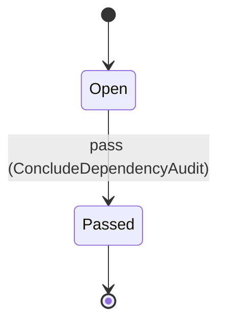

---
# generated by patchback-docs, do not edit
title: "dependency domain"
sidebar_label: "dependency"
description: "ESS reference for the dependency domain, generated from the specification."
custom_edit_url: null
---

<!-- generated by patchback-docs, do not edit -->

The dependency gate (DESIGN.md § 3, § 12.2, invariant 7): an audit of the application-level crates of one revision. Two categories are permitted: external audio I/O, as at most one approved backend behind an optional feature, and CLI parsing, as the one approved `clap`; every other third-party application crate is refused.

`patchback.dependency` is one of patchback's bounded contexts. [All domains](./index.mdx).

## Types

### `CrateCategory`

`patchback.dependency.CrateCategory` is one of `AudioIo`, `CliParsing`, `MachineLearning`, `Tensor`, `Numerical`, `Dsp`, `Mathematics`, `Serialization`, `Prng`, `Testing`, `ApplicationFramework`, `ModelSpec` and `Other`.

### `CrateName`

`patchback.dependency.CrateName` wraps `String` and is not interchangeable with one: the whole value of naming it separately is the crossings the model then refuses.

### `DependencyAuditId`

`patchback.dependency.DependencyAuditId` wraps `Uuid` and is not interchangeable with one: the whole value of naming it separately is the crossings the model then refuses.

## Entities

An entity is what this context is about: something with an identity that outlives any one request, a shape, and a lifecycle. The lifecycle is exhaustive — a move that is not drawn below is a move this specification does not permit, and that is the only way it says so. Every move is labelled with the command that takes it, because a move nothing can trigger is refused rather than drawn.

### `DependencyAudit`

`patchback.dependency.DependencyAudit`.

An instance is identified by `dependency_audit_id`, a `patchback.dependency.DependencyAuditId`. The name is part of the model and not a convention: a view projects the identity under that name, so a projection inventing its own would disagree with the view.

It holds:

- `revision` — `String`
- `audio_backend` — `Optional<patchback.dependency.CrateName>`, which may be absent
- `audio_backend_count` — `Integer`
- `cli_parser` — `Optional<patchback.dependency.CrateName>`, which may be absent

It declares no relation to another entity, and no other entity names it.

No invariant is declared, so nothing here constrains an instance at rest.

Its state is a `patchback.dependency.DependencyAudit.State`, one of `Open` and `Passed`. That enum is synthesised from the lifecycle rather than declared beside it, so the states a view's filter compares and the states drawn below cannot disagree.

An instance is created in `Open`. `Passed` is terminal, so an instance may rest there forever. That is declared rather than inferred from having no way out: an entity that cannot leave a state is either finished or stuck, and only its author knows which.

Each move is taken by a declared command outcome, and a move nothing takes is refused as `missing_causation` rather than left as a state change nobody can trigger:

- `pass` — taken by `patchback.dependency.ConcludeDependencyAudit` on its `passed` outcome

An instance is brought into existence by `patchback.dependency.StartDependencyAudit` on its `started` outcome.

Illegal transitions are illegal by absence: no rule forbids them, there is simply no arrow, because a rule would be a second place for the same truth to live. A diagram cannot show an absence, so the pairs it does not connect are listed here, derived from the same transitions — anything named below is a move this specification does not permit.

- `Passed` may not become `Open`

One view projects it: [`DependencyAudits`](#dependencyaudits).

## Views

A view is what the outside world is promised it can observe. Each one says which instances it contains and how soon it reflects a command that has already returned, because "you can read this" without "how soon" is the promise every flaky suite is built on.

### `DependencyAudits`

`patchback.dependency.DependencyAudits`, shown to a person as "Dependency audits" and called `dependency-audits` on the wire.

It reads [`DependencyAudit`](#dependencyaudit).

It contains every instance of that entity: no filter narrows it, which is a decision somebody made and not a line somebody omitted.

It exposes:

- `dependency_audit_id` — `patchback.dependency.DependencyAuditId`
- `state` — `patchback.dependency.DependencyAudit.State`
- `revision` — `String`
- `audio_backend` — `Optional<patchback.dependency.CrateName>`, which may be absent
- `audio_backend_count` — `Integer`
- `cli_parser` — `Optional<patchback.dependency.CrateName>`, which may be absent

It declares no order, so the rows come back in whatever order the implementation has, and two reads may disagree.

**Read-your-writes**: it is current the moment the command that changed it returns. A caller that has just created an invoice and cannot see it in here has been told a lie about what it did.

A generated scenario asserts it once, immediately after the command: a view promising this and not keeping the promise has to fail the suite rather than be retried until it passes.

## Commands

### `ConcludeDependencyAudit`

`patchback.dependency.ConcludeDependencyAudit`, shown to a person as "Conclude the dependency audit" and called `conclude-dependency-audit` on the wire.

It takes:

- `dependency_audit_id` — `patchback.dependency.DependencyAuditId`

It has three outcomes.

**`unknown-audit`** — Taken when the identity the command names is one no record carries, before any other answer for it. No entity in this specification changes. It reports `patchback.dependency.UnknownAudit`, carrying `dependency_audit_id`. It emits nothing. A test reaches it by sending an identity no record carries, arranging nothing.

**`passed`** — The gate passes; the admitted backend, if any, is published by the view. The default branch, taken when no other outcome's condition matched. It moves a `patchback.dependency.DependencyAudit` from `Open` to `Passed`, along the declared move `pass`. The instance is the one named by the input field `dependency_audit_id`. It emits `patchback.dependency.DependencyAuditPassed`. A test reaches it by constructing an input that satisfies no other outcome's condition.

**`wrong-state`** — Taken when the subject is resting in a state none of this command's moves start from — a `patchback.dependency.DependencyAudit` in `Passed`, which is what is left of the lifecycle once this command's own moves are taken away. The document lists none of it. No entity in this specification changes. It reports `patchback.dependency.AuditConcluded`, carrying `state`. It emits nothing. A test reaches it by driving an instance into one of those states and then issuing the command, because no input selects this branch.

### `RecordCrate`

`patchback.dependency.RecordCrate`, shown to a person as "Record a crate" and called `record-crate` on the wire.

It takes:

- `dependency_audit_id` — `patchback.dependency.DependencyAuditId`
- `crate_name` — `patchback.dependency.CrateName`
- `category` — `patchback.dependency.CrateCategory`
- `approved` — `Boolean`
- `behind_optional_feature` — `Boolean`

It has nine outcomes.

**`forbidden-crate`** — Taken when `(category != AudioIo and category != CliParsing)` holds of the input. No entity in this specification changes. It reports `patchback.dependency.ForbiddenCrate`, carrying `crate_name` and `category`. It emits nothing. A test reaches it by constructing an input that satisfies that condition.

**`cli-parser-not-clap`** — `clap` is the one reviewed CLI-parsing crate (§ 3); any other is refused, approved or not. Taken when `(category == CliParsing and crate_name != clap)` holds of the input. No entity in this specification changes. It reports `patchback.dependency.ForbiddenCrate`, carrying `crate_name` and `category`. It emits nothing. A test reaches it by constructing an input that satisfies that condition.

**`unapproved-crate`** — Taken when `approved == false` holds of the input. No entity in this specification changes. It reports `patchback.dependency.UnapprovedCrate`, carrying `crate_name`. It emits nothing. A test reaches it by constructing an input that satisfies that condition.

**`not-optional`** — Taken when `(category == AudioIo and behind_optional_feature == false)` holds of the input. No entity in this specification changes. It reports `patchback.dependency.AudioBackendNotOptional`, carrying `crate_name`. It emits nothing. A test reaches it by constructing an input that satisfies that condition.

**`unknown-audit`** — Taken when the identity the command names is one no record carries, before any other answer for it. No entity in this specification changes. It reports `patchback.dependency.UnknownAudit`, carrying `dependency_audit_id`. It emits nothing. A test reaches it by sending an identity no record carries, arranging nothing.

**`audit-concluded`** — Taken when the existing subject's stored fields satisfy `state == Passed`. No entity in this specification changes. It reports `patchback.dependency.AuditConcluded`, carrying `state`. It emits nothing. A test establishes and independently observes the subject enum fact before selecting this branch.

**`second-audio-backend`** — Taken when the existing subject's stored fields satisfy `audio_backend_count >= 1`, and `category == AudioIo` holds of the input. No entity in this specification changes. It reports `patchback.dependency.SecondAudioBackend`, carrying `crate_name` and `audio_backend`. It emits nothing. A test establishes and independently observes the subject enum fact before selecting this branch.

**`cli-parser-admitted`** — The approved `clap` is admitted. It is not an audio backend, so it neither counts toward nor is refused by the one-backend limit, and it needs no optional feature. Taken when `category == CliParsing` holds of the input. It changes a `patchback.dependency.DependencyAudit` without moving it along its lifecycle. The instance is the one named by the input field `dependency_audit_id`. It emits `patchback.dependency.CliParserAdmitted`. It sets `cli_parser` from `input.crate_name`. A test reaches it by constructing an input that satisfies that condition.

**`audio-backend-admitted`** — The approved, optional audio I/O backend is admitted. The default branch, taken when no other outcome's condition matched. It changes a `patchback.dependency.DependencyAudit` without moving it along its lifecycle. The instance is the one named by the input field `dependency_audit_id`. It emits `patchback.dependency.AudioBackendAdmitted`. It sets `audio_backend` from `input.crate_name` and `audio_backend_count` from `its previous value plus 1`. A test reaches it by constructing an input that satisfies no other outcome's condition.

### `StartDependencyAudit`

`patchback.dependency.StartDependencyAudit`, shown to a person as "Start a dependency audit" and called `start-dependency-audit` on the wire.

It takes:

- `revision` — `String`

It has one outcome.

**`started`** — The audit is open with no crate admitted. The default branch, taken when no other outcome's condition matched. It creates a `patchback.dependency.DependencyAudit`, which starts in `Open`. The new instance's identity is published as `dependency_audit_id` on `patchback.dependency.DependencyAuditStarted`. It emits `patchback.dependency.DependencyAuditStarted`. It sets `revision` from `input.revision`, `audio_backend` cleared, `audio_backend_count` from `"0"` and `cli_parser` cleared. A test reaches it by constructing an input that satisfies no other outcome's condition.

## Events

### `AudioBackendAdmitted`

`patchback.dependency.AudioBackendAdmitted`.

It carries:

- `dependency_audit_id` — `patchback.dependency.DependencyAuditId`
- `crate_name` — `patchback.dependency.CrateName`

Emitted by `patchback.dependency.RecordCrate` on its `audio-backend-admitted` outcome.

Nothing in this system reacts to it.

### `CliParserAdmitted`

`patchback.dependency.CliParserAdmitted`.

It carries:

- `dependency_audit_id` — `patchback.dependency.DependencyAuditId`
- `crate_name` — `patchback.dependency.CrateName`

Emitted by `patchback.dependency.RecordCrate` on its `cli-parser-admitted` outcome.

Nothing in this system reacts to it.

### `DependencyAuditPassed`

`patchback.dependency.DependencyAuditPassed`.

It carries:

- `dependency_audit_id` — `patchback.dependency.DependencyAuditId`

Emitted by `patchback.dependency.ConcludeDependencyAudit` on its `passed` outcome.

Nothing in this system reacts to it.

### `DependencyAuditStarted`

`patchback.dependency.DependencyAuditStarted`.

It carries:

- `dependency_audit_id` — `patchback.dependency.DependencyAuditId`
- `revision` — `String`

Emitted by `patchback.dependency.StartDependencyAudit` on its `started` outcome.

Nothing in this system reacts to it.

## Errors

### `AudioBackendNotOptional`

The audio I/O backend is not isolated behind an optional feature (§ 3).

It carries:

- `crate_name` — `patchback.dependency.CrateName`

Reported by `patchback.dependency.RecordCrate` on its `not-optional` outcome.

### `AuditConcluded`

The audit has passed, so it takes no more crates and nothing changed.

It carries:

- `state` — `patchback.dependency.DependencyAudit.State`

Reported by `patchback.dependency.ConcludeDependencyAudit` on its `wrong-state` outcome.

Reported by `patchback.dependency.RecordCrate` on its `audit-concluded` outcome.

### `ForbiddenCrate`

A third-party application crate outside the permitted categories: ML, tensor, numerical, DSP, mathematics, serialization, PRNG, test or application-framework crates are internal Rust modules or `std` only (§ 1, § 3, invariant 7), the one CLI-parsing crate is `clap`, and a ModelSpec crate is never admitted because ModelSpec runs as a subprocess (§ 8.2).

It carries:

- `crate_name` — `patchback.dependency.CrateName`
- `category` — `patchback.dependency.CrateCategory`

Reported by `patchback.dependency.RecordCrate` on its `forbidden-crate` and `cli-parser-not-clap` outcomes.

### `SecondAudioBackend`

The audit already admitted an audio I/O backend; at most one is allowed (§ 3).

It carries:

- `crate_name` — `patchback.dependency.CrateName`
- `audio_backend` — `Optional<patchback.dependency.CrateName>`, which may be absent

Reported by `patchback.dependency.RecordCrate` on its `second-audio-backend` outcome.

### `UnapprovedCrate`

An audio I/O or CLI-parsing crate that is not explicitly approved; CI rejects unreviewed additions (§ 3, § 12.2).

It carries:

- `crate_name` — `patchback.dependency.CrateName`

Reported by `patchback.dependency.RecordCrate` on its `unapproved-crate` outcome.

### `UnknownAudit`

No dependency audit carries this identity.

It carries:

- `dependency_audit_id` — `patchback.dependency.DependencyAuditId`

Reported by `patchback.dependency.ConcludeDependencyAudit` on its `unknown-audit` outcome.

Reported by `patchback.dependency.RecordCrate` on its `unknown-audit` outcome.

## Actors

An actor is who may ask this context for something. Every grant below points at a command this specification declares — a grant is a resolved reference, so "may invoke" something nobody wrote is not a permission this model can express, and an authorisation that authorises nothing cannot ship quietly.

### `Auditor`

`patchback.dependency.Auditor`, shown to a person as "Auditor".

It may invoke [`ConcludeDependencyAudit`](#concludedependencyaudit), [`RecordCrate`](#recordcrate) and [`StartDependencyAudit`](#startdependencyaudit).

---

Generated from patchback v1 · model digest `94c2caae824138b76626d834c924bce74700ae430e0ed9e7e803bba98ea2fec6` · contract digest `slice-sha256/2:34ff86575b92e905d70af23ccf7d42824ccecc8fe92ab4305b7a87ff742689de`. Do not edit this file; change the specification and regenerate it with `task docs-generate`.
