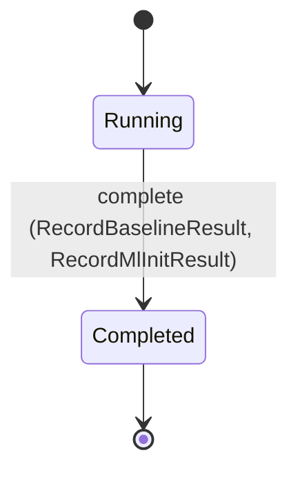
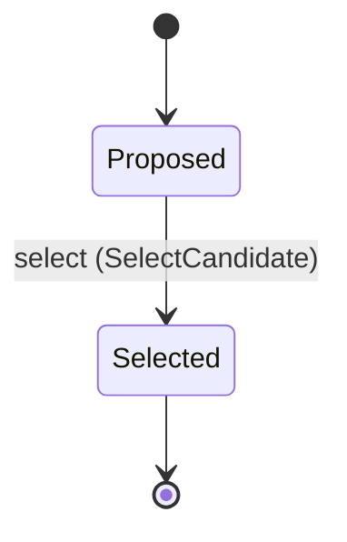
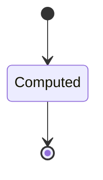
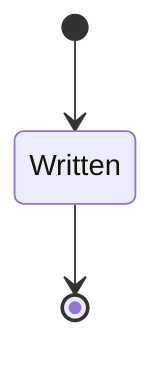
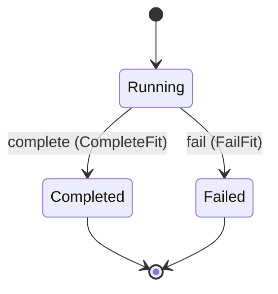

---
# generated by patchback-docs, do not edit
title: "fit domain"
sidebar_label: "fit"
description: "ESS reference for the fit domain, generated from the specification."
custom_edit_url: null
---

<!-- generated by patchback-docs, do not edit -->

Closed-loop inverse synthesis: comparisons of a rendering with a reference, bounded derivative-free fit runs, ranked topology candidates, the artifacts a fit run writes, and the benchmarks that judge the optimizer (DESIGN.md sections 9, 10, 11, 12, 13, 15).

`patchback.fit` is one of patchback's bounded contexts. [All domains](./index.mdx).

## Types

### `BenchmarkId`

`patchback.fit.BenchmarkId` wraps `Uuid` and is not interchangeable with one: the whole value of naming it separately is the crossings the model then refuses.

### `BenchmarkKind`

`patchback.fit.BenchmarkKind` is one of `EngineBaseline` and `MlInit`.

### `CandidateId`

`patchback.fit.CandidateId` wraps `Uuid` and is not interchangeable with one: the whole value of naming it separately is the crossings the model then refuses.

### `ComparisonId`

`patchback.fit.ComparisonId` wraps `Uuid` and is not interchangeable with one: the whole value of naming it separately is the crossings the model then refuses.

### `FailureReason`

`patchback.fit.FailureReason` is one of `NoValidCandidate` and `RendererFault`.

### `FitResultsId`

`patchback.fit.FitResultsId` wraps `Uuid` and is not interchangeable with one: the whole value of naming it separately is the crossings the model then refuses.

### `FitRunId`

`patchback.fit.FitRunId` wraps `Uuid` and is not interchangeable with one: the whole value of naming it separately is the crossings the model then refuses.

### `FitScope`

`patchback.fit.FitScope` is one of `SingleNote` and `Phrase`.

### `InitSource`

`patchback.fit.InitSource` is one of `DefaultPatch` and `RegressorPrediction`.

### `LossComponents`

`patchback.fit.LossComponents` is a record of four fields:

- `log_spectral` — `Decimal`
- `envelope` — `Decimal`
- `transient` — `Decimal`
- `band_energy` — `Decimal`

### `LossWeights`

`patchback.fit.LossWeights` is a record of four fields:

- `log_spectral` — `Decimal`
- `envelope` — `Decimal`
- `transient` — `Decimal`
- `band_energy` — `Decimal`

### `NoteSource`

`patchback.fit.NoteSource` is one of `Known` and `Estimated`.

### `SearchBound`

`patchback.fit.SearchBound` is one of `RenderEvaluations`, `WallTime` and `Restarts`.

### `StopReason`

`patchback.fit.StopReason` is one of `RenderBudgetExhausted`, `TimeBudgetExhausted`, `RestartsExhausted` and `ImprovementBelowThreshold`.

### `TargetVerdict`

`patchback.fit.TargetVerdict` is one of `Met` and `NotMet`.

## Entities

An entity is what this context is about: something with an identity that outlives any one request, a shape, and a lifecycle. The lifecycle is exhaustive — a move that is not drawn below is a move this specification does not permit, and that is the only way it says so. Every move is labelled with the command that takes it, because a move nothing can trigger is refused rather than drawn.

### `Benchmark`

`patchback.fit.Benchmark`.

An instance is identified by `benchmark_id`, a `patchback.fit.BenchmarkId`. The name is part of the model and not a convention: a view projects the identity under that name, so a projection inventing its own would disagree with the view.

It holds:

- `kind` — `patchback.fit.BenchmarkKind`
- `holdout_split_id` — `patchback.dataset.DatasetSplitId`
- `seed` — `Integer`
- `example_count` — `Integer`
- `weight_artifact_id` — `Optional<patchback.model.WeightArtifactId>`, which may be absent
- `default_median_loss` — `Optional<Decimal>`, which may be absent
- `default_search_median_loss` — `Optional<Decimal>`, which may be absent
- `raw_regressor_median_loss` — `Optional<Decimal>`, which may be absent
- `regressor_search_median_loss` — `Optional<Decimal>`, which may be absent
- `median_loss_reduction_percent` — `Optional<Decimal>`, which may be absent
- `target_verdict` — `Optional<patchback.fit.TargetVerdict>`, which may be absent
- `default_search_median_evaluations` — `Optional<Integer>`, which may be absent
- `regressor_search_median_evaluations` — `Optional<Integer>`, which may be absent
- `wall_time_ms` — `Optional<Integer>`, which may be absent
- `listening_examples` — `Optional<List<String>>`, which may be absent

It references at most one [`patchback.dataset.DatasetSplit`](patchback-dataset.md#datasetsplit), as `holdout`, carried by `Benchmark.holdout_split_id`. It references at most one [`patchback.model.WeightArtifact`](patchback-model.md#weightartifact), as `weight_artifact`, carried by `Benchmark.weight_artifact_id`.

Every instance satisfies `example_count > 0` — a predicate over this entity's own fields, checked against them rather than stored as a sentence, so an invariant reading something the entity does not have is refused instead of documented.

Its state is a `patchback.fit.Benchmark.State`, one of `Completed` and `Running`. That enum is synthesised from the lifecycle rather than declared beside it, so the states a view's filter compares and the states drawn below cannot disagree.

An instance is created in `Running`. `Completed` is terminal, so an instance may rest there forever. That is declared rather than inferred from having no way out: an entity that cannot leave a state is either finished or stuck, and only its author knows which.

Each move is taken by a declared command outcome, and a move nothing takes is refused as `missing_causation` rather than left as a state change nobody can trigger:

- `complete` — taken by `patchback.fit.RecordBaselineResult` on its `target-met` outcome, `patchback.fit.RecordBaselineResult` on its `target-not-met` outcome and `patchback.fit.RecordMlInitResult` on its `recorded` outcome

An instance is brought into existence by `patchback.fit.StartBenchmark` on its `started` outcome.

Illegal transitions are illegal by absence: no rule forbids them, there is simply no arrow, because a rule would be a second place for the same truth to live. A diagram cannot show an absence, so the pairs it does not connect are listed here, derived from the same transitions — anything named below is a move this specification does not permit.

- `Completed` may not become `Running`

One view projects it: [`Benchmarks`](#benchmarks).

### `Candidate`

`patchback.fit.Candidate`.

An instance is identified by `candidate_id`, a `patchback.fit.CandidateId`. The name is part of the model and not a convention: a view projects the identity under that name, so a projection inventing its own would disagree with the view.

It holds:

- `fit_run_id` — `patchback.fit.FitRunId`
- `topology_id` — `patchback.patch.TopologyId`
- `patch_id` — `patchback.patch.PatchId`
- `loss` — `Decimal`
- `node_count` — `Integer`
- `edge_count` — `Integer`
- `control_route_count` — `Integer`
- `complexity_penalty` — `Decimal`
- `score` — `Decimal`

It references at most one [`FitRun`](#fitrun), as `fit_run`, carried by `Candidate.fit_run_id`. It references at most one [`patchback.patch.Topology`](patchback-patch.md#topology), as `topology`, carried by `Candidate.topology_id`. It references at most one [`patchback.patch.Patch`](patchback-patch.md#patch), as `patch`, carried by `Candidate.patch_id`.

Every instance satisfies `node_count > 0`, `edge_count >= 0` and `control_route_count >= 0` — a predicate over this entity's own fields, checked against them rather than stored as a sentence, so an invariant reading something the entity does not have is refused instead of documented.

Its state is a `patchback.fit.Candidate.State`, one of `Proposed` and `Selected`. That enum is synthesised from the lifecycle rather than declared beside it, so the states a view's filter compares and the states drawn below cannot disagree.

An instance is created in `Proposed`. `Selected` is terminal, so an instance may rest there forever. That is declared rather than inferred from having no way out: an entity that cannot leave a state is either finished or stuck, and only its author knows which.

Each move is taken by a declared command outcome, and a move nothing takes is refused as `missing_causation` rather than left as a state change nobody can trigger:

- `select` — taken by `patchback.fit.SelectCandidate` on its `selected` outcome

An instance is brought into existence by `patchback.fit.ProposeCandidate` on its `proposed` outcome.

Illegal transitions are illegal by absence: no rule forbids them, there is simply no arrow, because a rule would be a second place for the same truth to live. A diagram cannot show an absence, so the pairs it does not connect are listed here, derived from the same transitions — anything named below is a move this specification does not permit.

- `Selected` may not become `Proposed`

One view projects it: [`Candidates`](#candidates).

### `Comparison`

`patchback.fit.Comparison`.

An instance is identified by `comparison_id`, a `patchback.fit.ComparisonId`. The name is part of the model and not a convention: a view projects the identity under that name, so a projection inventing its own would disagree with the view.

It holds:

- `reference_clip_id` — `patchback.audio.AudioClipId`
- `candidate_clip_id` — `patchback.audio.AudioClipId`
- `components` — `patchback.fit.LossComponents`
- `weights` — `patchback.fit.LossWeights`
- `total_loss` — `Decimal`

It references at most one [`patchback.audio.AudioClip`](patchback-audio.md#audioclip), as `reference`, carried by `Comparison.reference_clip_id`. It references at most one [`patchback.audio.AudioClip`](patchback-audio.md#audioclip), as `candidate`, carried by `Comparison.candidate_clip_id`.

No invariant is declared, so nothing here constrains an instance at rest.

Its state is a `patchback.fit.Comparison.State`, one of `Computed`. That enum is synthesised from the lifecycle rather than declared beside it, so the states a view's filter compares and the states drawn below cannot disagree.

An instance is created in `Computed`. `Computed` is terminal, so an instance may rest there forever. That is declared rather than inferred from having no way out: an entity that cannot leave a state is either finished or stuck, and only its author knows which.

It declares no moves, so nothing changes its state once it exists.

It has one state, so there is no move to permit or to forbid.

One view projects it: [`Comparisons`](#comparisons).

### `FitResults`

`patchback.fit.FitResults`.

An instance is identified by `fit_results_id`, a `patchback.fit.FitResultsId`. The name is part of the model and not a convention: a view projects the identity under that name, so a projection inventing its own would disagree with the view.

It holds:

- `fit_run_id` — `patchback.fit.FitRunId`
- `out_dir` — `String`
- `recovered_patch_id` — `Optional<patchback.patch.PatchId>`, which may be absent
- `reconstructed_wav_id` — `patchback.audio.WavFileId`
- `warnings` — `List<String>`

It references at most one [`FitRun`](#fitrun), as `fit_run`, carried by `FitResults.fit_run_id`. It references at most one [`patchback.patch.Patch`](patchback-patch.md#patch), as `recovered_patch`, carried by `FitResults.recovered_patch_id`. It references at most one [`patchback.audio.WavFile`](patchback-audio.md#wavfile), as `reconstructed_wav`, carried by `FitResults.reconstructed_wav_id`.

No invariant is declared, so nothing here constrains an instance at rest.

Its state is a `patchback.fit.FitResults.State`, one of `Written`. That enum is synthesised from the lifecycle rather than declared beside it, so the states a view's filter compares and the states drawn below cannot disagree.

An instance is created in `Written`. `Written` is terminal, so an instance may rest there forever. That is declared rather than inferred from having no way out: an entity that cannot leave a state is either finished or stuck, and only its author knows which.

It declares no moves, so nothing changes its state once it exists.

It has one state, so there is no move to permit or to forbid.

One view projects it: [`FitResultsDirectories`](#fitresultsdirectories).

### `FitRun`

`patchback.fit.FitRun`.

An instance is identified by `fit_run_id`, a `patchback.fit.FitRunId`. The name is part of the model and not a convention: a view projects the identity under that name, so a projection inventing its own would disagree with the view.

It holds:

- `reference_clip_id` — `patchback.audio.AudioClipId`
- `reference_origin` — `patchback.audio.AudioOrigin`
- `reference_provenance` — `Optional<String>`, which may be absent
- `note_sequence_id` — `patchback.score.NoteSequenceId`
- `note_source` — `patchback.fit.NoteSource`
- `note_confidence` — `Optional<Decimal>`, which may be absent
- `scope` — `patchback.fit.FitScope`
- `topology_id` — `patchback.patch.TopologyId`
- `init` — `patchback.fit.InitSource`
- `weight_artifact_id` — `Optional<patchback.model.WeightArtifactId>`, which may be absent
- `analysis_id` — `Optional<patchback.analysis.AnalysisId>`, which may be absent
- `seed` — `Integer`
- `max_renders` — `Integer`
- `max_wall_time_ms` — `Integer`
- `max_restarts` — `Integer`
- `improvement_threshold` — `Decimal`
- `evaluations` — `Integer`
- `initial_loss` — `Optional<Decimal>`, which may be absent
- `best_loss` — `Optional<Decimal>`, which may be absent
- `best_patch_id` — `Optional<patchback.patch.PatchId>`, which may be absent
- `best_render_id` — `Optional<patchback.audio.RenderId>`, which may be absent
- `best_components` — `Optional<patchback.fit.LossComponents>`, which may be absent
- `stop_reason` — `Optional<patchback.fit.StopReason>`, which may be absent
- `failure_reason` — `Optional<patchback.fit.FailureReason>`, which may be absent
- `wall_time_ms` — `Optional<Integer>`, which may be absent

It references at most one [`patchback.audio.AudioClip`](patchback-audio.md#audioclip), as `reference`, carried by `FitRun.reference_clip_id`. It references at most one [`patchback.score.NoteSequence`](patchback-score.md#notesequence), as `note_sequence`, carried by `FitRun.note_sequence_id`. It references at most one [`patchback.patch.Topology`](patchback-patch.md#topology), as `topology`, carried by `FitRun.topology_id`. It references at most one [`patchback.model.WeightArtifact`](patchback-model.md#weightartifact), as `weight_artifact`, carried by `FitRun.weight_artifact_id`. It references at most one [`patchback.analysis.Analysis`](patchback-analysis.md#analysis), as `analysis`, carried by `FitRun.analysis_id`. It references at most one [`patchback.patch.Patch`](patchback-patch.md#patch), as `best_patch`, carried by `FitRun.best_patch_id`. It references at most one [`patchback.audio.Render`](patchback-audio.md#render), as `best_render`, carried by `FitRun.best_render_id`.

Every instance satisfies `max_renders > 0`, `max_wall_time_ms > 0`, `max_restarts > 0`, `evaluations >= 0` and `evaluations <= max_renders` — a predicate over this entity's own fields, checked against them rather than stored as a sentence, so an invariant reading something the entity does not have is refused instead of documented.

Its state is a `patchback.fit.FitRun.State`, one of `Completed`, `Failed` and `Running`. That enum is synthesised from the lifecycle rather than declared beside it, so the states a view's filter compares and the states drawn below cannot disagree.

An instance is created in `Running`. `Completed` and `Failed` are terminal, so an instance may rest there forever. That is declared rather than inferred from having no way out: an entity that cannot leave a state is either finished or stuck, and only its author knows which.

Each move is taken by a declared command outcome, and a move nothing takes is refused as `missing_causation` rather than left as a state change nobody can trigger:

- `complete` — taken by `patchback.fit.CompleteFit` on its `completed` outcome
- `fail` — taken by `patchback.fit.FailFit` on its `failed` outcome

An instance is brought into existence by `patchback.fit.StartFit` on its `started-seeded` outcome and `patchback.fit.StartFit` on its `started` outcome.

Illegal transitions are illegal by absence: no rule forbids them, there is simply no arrow, because a rule would be a second place for the same truth to live. A diagram cannot show an absence, so the pairs it does not connect are listed here, derived from the same transitions — anything named below is a move this specification does not permit.

- `Completed` may not become `Failed`
- `Completed` may not become `Running`
- `Failed` may not become `Completed`
- `Failed` may not become `Running`

One view projects it: [`FitRuns`](#fitruns).

## Views

A view is what the outside world is promised it can observe. Each one says which instances it contains and how soon it reflects a command that has already returned, because "you can read this" without "how soon" is the promise every flaky suite is built on.

### `Benchmarks`

`patchback.fit.Benchmarks`, shown to a person as "Benchmarks" and called `benchmarks` on the wire.

It reads [`Benchmark`](#benchmark).

It contains every instance of that entity: no filter narrows it, which is a decision somebody made and not a line somebody omitted.

It exposes:

- `benchmark_id` — `patchback.fit.BenchmarkId`
- `state` — `patchback.fit.Benchmark.State`
- `kind` — `patchback.fit.BenchmarkKind`
- `holdout_split_id` — `patchback.dataset.DatasetSplitId`
- `seed` — `Integer`
- `example_count` — `Integer`
- `target_verdict` — `Optional<patchback.fit.TargetVerdict>`, which may be absent
- `default_search_median_evaluations` — `Optional<Integer>`, which may be absent
- `regressor_search_median_evaluations` — `Optional<Integer>`, which may be absent
- `wall_time_ms` — `Optional<Integer>`, which may be absent
- `listening_examples` — `Optional<List<String>>`, which may be absent

It declares no order, so the rows come back in whatever order the implementation has, and two reads may disagree.

**Read-your-writes**: it is current the moment the command that changed it returns. A caller that has just created an invoice and cannot see it in here has been told a lie about what it did.

A generated scenario asserts it once, immediately after the command: a view promising this and not keeping the promise has to fail the suite rather than be retried until it passes.

### `Candidates`

`patchback.fit.Candidates`, shown to a person as "Topology candidates" and called `candidates` on the wire.

It reads [`Candidate`](#candidate).

It contains every instance of that entity: no filter narrows it, which is a decision somebody made and not a line somebody omitted.

It exposes:

- `candidate_id` — `patchback.fit.CandidateId`
- `state` — `patchback.fit.Candidate.State`
- `fit_run_id` — `patchback.fit.FitRunId`
- `topology_id` — `patchback.patch.TopologyId`
- `patch_id` — `patchback.patch.PatchId`
- `node_count` — `Integer`
- `edge_count` — `Integer`
- `control_route_count` — `Integer`

It declares no order, so the rows come back in whatever order the implementation has, and two reads may disagree.

**Read-your-writes**: it is current the moment the command that changed it returns. A caller that has just created an invoice and cannot see it in here has been told a lie about what it did.

A generated scenario asserts it once, immediately after the command: a view promising this and not keeping the promise has to fail the suite rather than be retried until it passes.

### `Comparisons`

`patchback.fit.Comparisons`, shown to a person as "Comparisons" and called `comparisons` on the wire.

It reads [`Comparison`](#comparison).

It contains every instance of that entity: no filter narrows it, which is a decision somebody made and not a line somebody omitted.

It exposes:

- `comparison_id` — `patchback.fit.ComparisonId`
- `reference_clip_id` — `patchback.audio.AudioClipId`
- `candidate_clip_id` — `patchback.audio.AudioClipId`
- `components` — `patchback.fit.LossComponents`
- `weights` — `patchback.fit.LossWeights`
- `total_loss` — `Decimal`

It declares no order, so the rows come back in whatever order the implementation has, and two reads may disagree.

**Read-your-writes**: it is current the moment the command that changed it returns. A caller that has just created an invoice and cannot see it in here has been told a lie about what it did.

A generated scenario asserts it once, immediately after the command: a view promising this and not keeping the promise has to fail the suite rather than be retried until it passes.

### `FitResultsDirectories`

`patchback.fit.FitResultsDirectories`, shown to a person as "Fit results" and called `fit-results` on the wire.

It reads [`FitResults`](#fitresults).

It contains every instance of that entity: no filter narrows it, which is a decision somebody made and not a line somebody omitted.

It exposes:

- `fit_results_id` — `patchback.fit.FitResultsId`
- `fit_run_id` — `patchback.fit.FitRunId`
- `out_dir` — `String`
- `recovered_patch_id` — `Optional<patchback.patch.PatchId>`, which may be absent
- `reconstructed_wav_id` — `patchback.audio.WavFileId`
- `warnings` — `List<String>`

It declares no order, so the rows come back in whatever order the implementation has, and two reads may disagree.

**Read-your-writes**: it is current the moment the command that changed it returns. A caller that has just created an invoice and cannot see it in here has been told a lie about what it did.

A generated scenario asserts it once, immediately after the command: a view promising this and not keeping the promise has to fail the suite rather than be retried until it passes.

### `FitRuns`

`patchback.fit.FitRuns`, shown to a person as "Fit runs" and called `fit-runs` on the wire.

It reads [`FitRun`](#fitrun).

It contains every instance of that entity: no filter narrows it, which is a decision somebody made and not a line somebody omitted.

It exposes:

- `fit_run_id` — `patchback.fit.FitRunId`
- `state` — `patchback.fit.FitRun.State`
- `reference_clip_id` — `patchback.audio.AudioClipId`
- `reference_provenance` — `Optional<String>`, which may be absent
- `note_source` — `patchback.fit.NoteSource`
- `scope` — `patchback.fit.FitScope`
- `init` — `patchback.fit.InitSource`
- `seed` — `Integer`
- `max_renders` — `Integer`
- `max_wall_time_ms` — `Integer`
- `max_restarts` — `Integer`
- `evaluations` — `Integer`
- `best_patch_id` — `Optional<patchback.patch.PatchId>`, which may be absent
- `stop_reason` — `Optional<patchback.fit.StopReason>`, which may be absent
- `failure_reason` — `Optional<patchback.fit.FailureReason>`, which may be absent
- `wall_time_ms` — `Optional<Integer>`, which may be absent

It declares no order, so the rows come back in whatever order the implementation has, and two reads may disagree.

**Read-your-writes**: it is current the moment the command that changed it returns. A caller that has just created an invoice and cannot see it in here has been told a lie about what it did.

A generated scenario asserts it once, immediately after the command: a view promising this and not keeping the promise has to fail the suite rather than be retried until it passes.

## Commands

### `CompareAudio`

`patchback.fit.CompareAudio`, shown to a person as "Compare audio" and called `compare` on the wire.

It takes:

- `reference_clip_id` — `patchback.audio.AudioClipId`
- `candidate_clip_id` — `patchback.audio.AudioClipId`
- `weights` — `patchback.fit.LossWeights`

It has five outcomes.

**`unknown-reference`** — Taken when no `patchback.audio.AudioClip` carries the identity `input.reference_clip_id` names. No entity in this specification changes. It reports `patchback.fit.ClipNotFound`, carrying `audio_clip_id`. It emits nothing. A test reaches it by arranging the row of the other entity the input names, or its absence, and sending the command for it.

**`unknown-candidate`** — Taken when no `patchback.audio.AudioClip` carries the identity `input.candidate_clip_id` names. No entity in this specification changes. It reports `patchback.fit.ClipNotFound`, carrying `audio_clip_id`. It emits nothing. A test reaches it by arranging the row of the other entity the input names, or its absence, and sending the command for it.

**`sample-rate-mismatch`** — Nothing is compared; no Comparison is recorded. Decided outside the input: the reference and candidate clips carry different sample rates. No predicate over the input reaches this branch, and saying `when: false` instead would have claimed it is unreachable, which is a different and false statement. No entity in this specification changes. It reports `patchback.fit.SampleRateMismatch`, carrying `reference_clip_id` and `candidate_clip_id`. It emits nothing. A test reaches it by injecting the declared fault, because no input can.

**`length-outside-alignment`** — Nothing is compared; no Comparison is recorded. Decided outside the input: the clip lengths differ by more than the alignment rule absorbs. No predicate over the input reaches this branch, and saying `when: false` instead would have claimed it is unreachable, which is a different and false statement. No entity in this specification changes. It reports `patchback.fit.LengthOutsideAlignment`, carrying `reference_clip_id` and `candidate_clip_id`. It emits nothing. A test reaches it by injecting the declared fault, because no input can.

**`compared`** — The Comparison records every component, the weights used and the weighted total. The default branch, taken when no other outcome's condition matched. It creates a `patchback.fit.Comparison`, which starts in `Computed`. The new instance's identity is published as `comparison_id` on `patchback.fit.AudioCompared`. It emits `patchback.fit.AudioCompared`. It sets `reference_clip_id` from `input.reference_clip_id`, `candidate_clip_id` from `input.candidate_clip_id`, `components` from `implementation-generated`, `weights` from `input.weights` and `total_loss` from `implementation-generated`. A test reaches it by constructing an input that satisfies no other outcome's condition.

### `CompleteFit`

`patchback.fit.CompleteFit`, shown to a person as "Complete a fit" and called `complete-fit` on the wire.

It takes:

- `fit_run_id` — `patchback.fit.FitRunId`
- `stop_reason` — `patchback.fit.StopReason`
- `wall_time_ms` — `Integer`

It has four outcomes.

**`no-such-run`** — Taken when the identity the command names is one no record carries, before any other answer for it. No entity in this specification changes. It reports `patchback.fit.FitRunNotFound`, carrying `fit_run_id`. It emits nothing. A test reaches it by sending an identity no record carries, arranging nothing.

**`no-valid-candidate`** — A run with no valid candidate cannot complete; it fails instead. Taken when the existing subject's stored fields satisfy `(state == Running and not (defined(best_loss)))`. No entity in this specification changes. It reports `patchback.fit.NoValidCandidate`, carrying `fit_run_id`. It emits nothing. A test establishes and independently observes the subject enum fact before selecting this branch.

**`completed`** — The run is Completed at its bound, with the reason recorded. The default branch, taken when no other outcome's condition matched. It moves a `patchback.fit.FitRun` from `Running` to `Completed`, along the declared move `complete`. The instance is the one named by the input field `fit_run_id`. It emits `patchback.fit.FitCompleted`. It sets `stop_reason` from `input.stop_reason` and `wall_time_ms` from `input.wall_time_ms`. A test reaches it by constructing an input that satisfies no other outcome's condition.

**`wrong-state`** — Taken when the subject is resting in a state none of this command's moves start from — a `patchback.fit.FitRun` in `Completed` and `Failed`, which is what is left of the lifecycle once this command's own moves are taken away. The document lists none of it. No entity in this specification changes. It reports `patchback.fit.FitNotRunning`, carrying `fit_run_id` and `state`. It emits nothing. A test reaches it by driving an instance into one of those states and then issuing the command, because no input selects this branch.

### `EvaluateCandidate`

`patchback.fit.EvaluateCandidate`, shown to a person as "Evaluate a candidate" and called `evaluate-candidate` on the wire.

It takes:

- `fit_run_id` — `patchback.fit.FitRunId`
- `patch_id` — `patchback.patch.PatchId`
- `render_id` — `patchback.audio.RenderId`
- `components` — `patchback.fit.LossComponents`
- `total_loss` — `Decimal`

It has six outcomes.

**`no-such-run`** — Taken when the identity the command names is one no record carries, before any other answer for it. No entity in this specification changes. It reports `patchback.fit.FitRunNotFound`, carrying `fit_run_id`. It emits nothing. A test reaches it by sending an identity no record carries, arranging nothing.

**`not-running`** — Taken when the existing subject's stored fields satisfy `state != Running`. No entity in this specification changes. It reports `patchback.fit.FitNotRunning`, carrying `fit_run_id` and `state`. It emits nothing. A test establishes and independently observes the subject enum fact before selecting this branch.

**`budget-exhausted`** — The evaluation bound holds; the candidate is not counted and the best is unchanged. Taken when the existing subject's stored fields satisfy `evaluations >= {fact: max_renders}`. No entity in this specification changes. It reports `patchback.fit.RenderBudgetExhausted`, carrying `fit_run_id`. It emits nothing. A test establishes and independently observes the subject enum fact before selecting this branch.

**`first-retained`** — The first valid candidate becomes both the loss before and the retained best. Taken when the existing subject's stored fields satisfy `not (defined(best_loss))`. It changes a `patchback.fit.FitRun` without moving it along its lifecycle. The instance is the one named by the input field `fit_run_id`. It emits `patchback.fit.CandidateEvaluated`. It sets `evaluations` from `its previous value plus 1`, `initial_loss` from `input.total_loss`, `best_loss` from `input.total_loss`, `best_patch_id` from `input.patch_id`, `best_render_id` from `input.render_id` and `best_components` from `input.components`. A test establishes and independently observes the subject enum fact before selecting this branch.

**`improved`** — A strictly lower loss replaces the retained best. Taken when the existing subject's stored fields satisfy `best_loss > input.total_loss`. It changes a `patchback.fit.FitRun` without moving it along its lifecycle. The instance is the one named by the input field `fit_run_id`. It emits `patchback.fit.CandidateEvaluated`. It sets `evaluations` from `its previous value plus 1`, `best_loss` from `input.total_loss`, `best_patch_id` from `input.patch_id`, `best_render_id` from `input.render_id` and `best_components` from `input.components`. A test establishes and independently observes the subject enum fact before selecting this branch.

**`not-improved`** — An equal or higher loss is counted and logged; the retained best is unchanged. The default branch, taken when no other outcome's condition matched. It changes a `patchback.fit.FitRun` without moving it along its lifecycle. The instance is the one named by the input field `fit_run_id`. It emits `patchback.fit.CandidateEvaluated`. It sets `evaluations` from `its previous value plus 1`. A test reaches it by constructing an input that satisfies no other outcome's condition.

### `FailFit`

`patchback.fit.FailFit`, shown to a person as "Fail a fit" and called `fail-fit` on the wire.

It takes:

- `fit_run_id` — `patchback.fit.FitRunId`
- `failure_reason` — `patchback.fit.FailureReason`
- `wall_time_ms` — `Integer`

It has three outcomes.

**`no-such-run`** — Taken when the identity the command names is one no record carries, before any other answer for it. No entity in this specification changes. It reports `patchback.fit.FitRunNotFound`, carrying `fit_run_id`. It emits nothing. A test reaches it by sending an identity no record carries, arranging nothing.

**`failed`** — The run is Failed with its reason recorded. The default branch, taken when no other outcome's condition matched. It moves a `patchback.fit.FitRun` from `Running` to `Failed`, along the declared move `fail`. The instance is the one named by the input field `fit_run_id`. It emits `patchback.fit.FitFailed`. It sets `failure_reason` from `input.failure_reason` and `wall_time_ms` from `input.wall_time_ms`. A test reaches it by constructing an input that satisfies no other outcome's condition.

**`wrong-state`** — Taken when the subject is resting in a state none of this command's moves start from — a `patchback.fit.FitRun` in `Completed` and `Failed`, which is what is left of the lifecycle once this command's own moves are taken away. The document lists none of it. No entity in this specification changes. It reports `patchback.fit.FitNotRunning`, carrying `fit_run_id` and `state`. It emits nothing. A test reaches it by driving an instance into one of those states and then issuing the command, because no input selects this branch.

### `ProposeCandidate`

`patchback.fit.ProposeCandidate`, shown to a person as "Propose a topology candidate" and called `propose-candidate` on the wire.

It takes:

- `fit_run_id` — `patchback.fit.FitRunId`
- `topology_id` — `patchback.patch.TopologyId`
- `patch_id` — `patchback.patch.PatchId`
- `loss` — `Decimal`
- `node_count` — `Integer`
- `edge_count` — `Integer`
- `control_route_count` — `Integer`
- `complexity_penalty` — `Decimal`

It has four outcomes.

**`invalid-graph`** — Taken when `(node_count <= 0 or edge_count < 0 or control_route_count < 0)` holds of the input. No entity in this specification changes. It reports `patchback.fit.InvalidCandidateGraph`, carrying `node_count`. It emits nothing. A test reaches it by constructing an input that satisfies that condition.

**`no-such-run`** — Taken when no `patchback.fit.FitRun` carries the identity `input.fit_run_id` names. No entity in this specification changes. It reports `patchback.fit.FitRunNotFound`, carrying `fit_run_id`. It emits nothing. A test reaches it by arranging the row of the other entity the input names, or its absence, and sending the command for it.

**`not-running`** — Taken when the `patchback.fit.FitRun` that `input.fit_run_id` names exists and its stored fields satisfy `state != Running`. No entity in this specification changes. It reports `patchback.fit.FitNotRunning`, carrying `fit_run_id` and `state`. It emits nothing. A test reaches it by arranging the row of the other entity the input names, or its absence, and sending the command for it.

**`proposed`** — The candidate is ranked by score; a simpler graph carries a smaller penalty. The default branch, taken when no other outcome's condition matched. It creates a `patchback.fit.Candidate`, which starts in `Proposed`. The new instance's identity is published as `candidate_id` on `patchback.fit.CandidateProposed`. It emits `patchback.fit.CandidateProposed`. It sets `fit_run_id` from `input.fit_run_id`, `topology_id` from `input.topology_id`, `patch_id` from `input.patch_id`, `loss` from `input.loss`, `node_count` from `input.node_count`, `edge_count` from `input.edge_count`, `control_route_count` from `input.control_route_count`, `complexity_penalty` from `input.complexity_penalty` and `score` from `{expr: "input.loss + input.complexity_penalty"}`. A test reaches it by constructing an input that satisfies no other outcome's condition.

### `RecordBaselineResult`

`patchback.fit.RecordBaselineResult`, shown to a person as "Record the engine baseline result" and called `record-baseline-result` on the wire.

It takes:

- `benchmark_id` — `patchback.fit.BenchmarkId`
- `default_median_loss` — `Decimal`
- `default_search_median_loss` — `Decimal`
- `median_loss_reduction_percent` — `Decimal`
- `default_search_median_evaluations` — `Integer`
- `wall_time_ms` — `Integer`
- `listening_examples` — `List<String>`

It has five outcomes.

**`no-such-benchmark`** — Taken when the identity the command names is one no record carries, before any other answer for it. No entity in this specification changes. It reports `patchback.fit.BenchmarkNotFound`, carrying `benchmark_id`. It emits nothing. A test reaches it by sending an identity no record carries, arranging nothing.

**`kind-mismatch`** — Taken when the existing subject's stored fields satisfy `kind != EngineBaseline`. No entity in this specification changes. It reports `patchback.fit.BenchmarkKindMismatch`, carrying `benchmark_id` and `kind`. It emits nothing. A test establishes and independently observes the subject enum fact before selecting this branch.

**`target-met`** — The benchmark completes and records the target as met. Taken when `median_loss_reduction_percent >= 20` holds of the input. It moves a `patchback.fit.Benchmark` from `Running` to `Completed`, along the declared move `complete`. The instance is the one named by the input field `benchmark_id`. It emits `patchback.fit.BenchmarkCompleted`. It sets `default_median_loss` from `input.default_median_loss`, `default_search_median_loss` from `input.default_search_median_loss`, `median_loss_reduction_percent` from `input.median_loss_reduction_percent`, `target_verdict` from `"Met"`, `default_search_median_evaluations` from `input.default_search_median_evaluations`, `wall_time_ms` from `input.wall_time_ms` and `listening_examples` from `input.listening_examples`. A test reaches it by constructing an input that satisfies that condition.

**`target-not-met`** — The benchmark completes and records the target as not met; this is a result, not a failure. The default branch, taken when no other outcome's condition matched. It moves a `patchback.fit.Benchmark` from `Running` to `Completed`, along the declared move `complete`. The instance is the one named by the input field `benchmark_id`. It emits `patchback.fit.BenchmarkCompleted`. It sets `default_median_loss` from `input.default_median_loss`, `default_search_median_loss` from `input.default_search_median_loss`, `median_loss_reduction_percent` from `input.median_loss_reduction_percent`, `target_verdict` from `"NotMet"`, `default_search_median_evaluations` from `input.default_search_median_evaluations`, `wall_time_ms` from `input.wall_time_ms` and `listening_examples` from `input.listening_examples`. A test reaches it by constructing an input that satisfies no other outcome's condition.

**`wrong-state`** — Taken when the subject is resting in a state none of this command's moves start from — a `patchback.fit.Benchmark` in `Completed`, which is what is left of the lifecycle once this command's own moves are taken away. The document lists none of it. No entity in this specification changes. It reports `patchback.fit.BenchmarkStateConflict`, carrying `benchmark_id` and `state`. It emits nothing. A test reaches it by driving an instance into one of those states and then issuing the command, because no input selects this branch.

### `RecordMlInitResult`

`patchback.fit.RecordMlInitResult`, shown to a person as "Record the ML-init comparison" and called `record-ml-init-result` on the wire.

It takes:

- `benchmark_id` — `patchback.fit.BenchmarkId`
- `default_median_loss` — `Decimal`
- `default_search_median_loss` — `Decimal`
- `raw_regressor_median_loss` — `Decimal`
- `regressor_search_median_loss` — `Decimal`
- `default_search_median_evaluations` — `Integer`
- `regressor_search_median_evaluations` — `Integer`
- `wall_time_ms` — `Integer`
- `listening_examples` — `List<String>`

It has four outcomes.

**`no-such-benchmark`** — Taken when the identity the command names is one no record carries, before any other answer for it. No entity in this specification changes. It reports `patchback.fit.BenchmarkNotFound`, carrying `benchmark_id`. It emits nothing. A test reaches it by sending an identity no record carries, arranging nothing.

**`kind-mismatch`** — Taken when the existing subject's stored fields satisfy `kind != MlInit`. No entity in this specification changes. It reports `patchback.fit.BenchmarkKindMismatch`, carrying `benchmark_id` and `kind`. It emits nothing. A test establishes and independently observes the subject enum fact before selecting this branch.

**`recorded`** — All four arms, the raw-model-only arm included, are recorded on the same holdout. The default branch, taken when no other outcome's condition matched. It moves a `patchback.fit.Benchmark` from `Running` to `Completed`, along the declared move `complete`. The instance is the one named by the input field `benchmark_id`. It emits `patchback.fit.MlInitCompared`. It sets `default_median_loss` from `input.default_median_loss`, `default_search_median_loss` from `input.default_search_median_loss`, `raw_regressor_median_loss` from `input.raw_regressor_median_loss`, `regressor_search_median_loss` from `input.regressor_search_median_loss`, `default_search_median_evaluations` from `input.default_search_median_evaluations`, `regressor_search_median_evaluations` from `input.regressor_search_median_evaluations`, `wall_time_ms` from `input.wall_time_ms` and `listening_examples` from `input.listening_examples`. A test reaches it by constructing an input that satisfies no other outcome's condition.

**`wrong-state`** — Taken when the subject is resting in a state none of this command's moves start from — a `patchback.fit.Benchmark` in `Completed`, which is what is left of the lifecycle once this command's own moves are taken away. The document lists none of it. No entity in this specification changes. It reports `patchback.fit.BenchmarkStateConflict`, carrying `benchmark_id` and `state`. It emits nothing. A test reaches it by driving an instance into one of those states and then issuing the command, because no input selects this branch.

### `RejectCandidate`

`patchback.fit.RejectCandidate`, shown to a person as "Reject an invalid candidate" and called `reject-candidate` on the wire.

It takes:

- `fit_run_id` — `patchback.fit.FitRunId`
- `patch_id` — `patchback.patch.PatchId`

It has four outcomes.

**`no-such-run`** — Taken when the identity the command names is one no record carries, before any other answer for it. No entity in this specification changes. It reports `patchback.fit.FitRunNotFound`, carrying `fit_run_id`. It emits nothing. A test reaches it by sending an identity no record carries, arranging nothing.

**`not-running`** — Taken when the existing subject's stored fields satisfy `state != Running`. No entity in this specification changes. It reports `patchback.fit.FitNotRunning`, carrying `fit_run_id` and `state`. It emits nothing. A test establishes and independently observes the subject enum fact before selecting this branch.

**`budget-exhausted`** — Taken when the existing subject's stored fields satisfy `evaluations >= {fact: max_renders}`. No entity in this specification changes. It reports `patchback.fit.RenderBudgetExhausted`, carrying `fit_run_id`. It emits nothing. A test establishes and independently observes the subject enum fact before selecting this branch.

**`rejected`** — The invalid candidate is counted and logged; the retained best is unchanged. The default branch, taken when no other outcome's condition matched. It changes a `patchback.fit.FitRun` without moving it along its lifecycle. The instance is the one named by the input field `fit_run_id`. It emits `patchback.fit.CandidateRejected`. It sets `evaluations` from `its previous value plus 1`. A test reaches it by constructing an input that satisfies no other outcome's condition.

### `SelectCandidate`

`patchback.fit.SelectCandidate`, shown to a person as "Select a topology candidate" and called `select-candidate` on the wire.

It takes:

- `candidate_id` — `patchback.fit.CandidateId`

It has four outcomes.

**`no-such-candidate`** — Taken when the identity the command names is one no record carries, before any other answer for it. No entity in this specification changes. It reports `patchback.fit.CandidateNotFound`, carrying `candidate_id`. It emits nothing. A test reaches it by sending an identity no record carries, arranging nothing.

**`outranked`** — A candidate with a lower score in the same run outranks this one. Taken when, of the `patchback.fit.Candidate` rows whose stored fields satisfy `(fit_run_id == subject.fit_run_id and score < subject.score)` before the outcome, at least one row is selected. No entity in this specification changes. It reports `patchback.fit.BetterCandidateExists`, carrying `candidate_id`. It emits nothing. A test reaches it by arranging the row of the other entity the input names, or its absence, and sending the command for it.

**`selected`** — The best-ranked candidate is Selected. The default branch, taken when no other outcome's condition matched. It moves a `patchback.fit.Candidate` from `Proposed` to `Selected`, along the declared move `select`. The instance is the one named by the input field `candidate_id`. It emits `patchback.fit.CandidateSelected`. A test reaches it by constructing an input that satisfies no other outcome's condition.

**`wrong-state`** — Taken when the subject is resting in a state none of this command's moves start from — a `patchback.fit.Candidate` in `Selected`, which is what is left of the lifecycle once this command's own moves are taken away. The document lists none of it. No entity in this specification changes. It reports `patchback.fit.CandidateStateConflict`, carrying `candidate_id` and `state`. It emits nothing. A test reaches it by driving an instance into one of those states and then issuing the command, because no input selects this branch.

### `StartBenchmark`

`patchback.fit.StartBenchmark`, shown to a person as "Start a benchmark" and called `start-benchmark` on the wire.

It takes:

- `kind` — `patchback.fit.BenchmarkKind`
- `holdout_split_id` — `patchback.dataset.DatasetSplitId`
- `seed` — `Integer`
- `example_count` — `Integer`
- `weight_artifact_id` — `Optional<patchback.model.WeightArtifactId>`, which may be absent

It has three outcomes.

**`invalid-holdout-size`** — Taken when `example_count <= 0` holds of the input. No entity in this specification changes. It reports `patchback.fit.InvalidHoldoutSize`, carrying `example_count`. It emits nothing. A test reaches it by constructing an input that satisfies that condition.

**`weight-artifact-required`** — Taken when `(kind == MlInit and not (defined(weight_artifact_id)))` holds of the input. No entity in this specification changes. It reports `patchback.fit.WeightArtifactRequired`, carrying `holdout_split_id`. It emits nothing. A test reaches it by constructing an input that satisfies that condition.

**`started`** — The default branch, taken when no other outcome's condition matched. It creates a `patchback.fit.Benchmark`, which starts in `Running`. The new instance's identity is published as `benchmark_id` on `patchback.fit.BenchmarkStarted`. It emits `patchback.fit.BenchmarkStarted`. It sets `kind` from `input.kind`, `holdout_split_id` from `input.holdout_split_id`, `seed` from `input.seed`, `example_count` from `input.example_count` and `weight_artifact_id` from `input.weight_artifact_id`. A test reaches it by constructing an input that satisfies no other outcome's condition.

### `StartFit`

`patchback.fit.StartFit`, shown to a person as "Start a fit" and called `fit` on the wire.

It takes:

- `reference_clip_id` — `patchback.audio.AudioClipId`
- `note_sequence_id` — `patchback.score.NoteSequenceId`
- `note_source` — `patchback.fit.NoteSource`
- `note_confidence` — `Optional<Decimal>`, which may be absent
- `scope` — `patchback.fit.FitScope`
- `topology_id` — `patchback.patch.TopologyId`
- `weight_artifact_id` — `Optional<patchback.model.WeightArtifactId>`, which may be absent
- `analysis_id` — `Optional<patchback.analysis.AnalysisId>`, which may be absent
- `seed` — `Integer`
- `max_renders` — `Integer`
- `max_wall_time_ms` — `Integer`
- `max_restarts` — `Integer`
- `improvement_threshold` — `Decimal`

It has 14 outcomes.

**`invalid-render-bound`** — Taken when `max_renders <= 0` holds of the input. No entity in this specification changes. It reports `patchback.fit.InvalidSearchBound`, carrying `bound` and `value`. It emits nothing. A test reaches it by constructing an input that satisfies that condition.

**`invalid-time-bound`** — Taken when `max_wall_time_ms <= 0` holds of the input. No entity in this specification changes. It reports `patchback.fit.InvalidSearchBound`, carrying `bound` and `value`. It emits nothing. A test reaches it by constructing an input that satisfies that condition.

**`invalid-restart-bound`** — Taken when `max_restarts <= 0` holds of the input. No entity in this specification changes. It reports `patchback.fit.InvalidSearchBound`, carrying `bound` and `value`. It emits nothing. A test reaches it by constructing an input that satisfies that condition.

**`note-confidence-missing`** — Taken when `(note_source == Estimated and not (defined(note_confidence)))` holds of the input. No entity in this specification changes. It reports `patchback.fit.NoteConfidenceMissing`, carrying `note_sequence_id`. It emits nothing. A test reaches it by constructing an input that satisfies that condition.

**`analysis-required`** — Taken when `(defined(weight_artifact_id) and not (defined(analysis_id)))` holds of the input. No entity in this specification changes. It reports `patchback.fit.AnalysisRequired`, carrying `weight_artifact_id`. It emits nothing. A test reaches it by constructing an input that satisfies that condition.

**`unknown-reference`** — The reference must be an imported clip; no run starts. Taken when no `patchback.audio.AudioClip` carries the identity `input.reference_clip_id` names. No entity in this specification changes. It reports `patchback.fit.ClipNotFound`, carrying `audio_clip_id`. It emits nothing. A test reaches it by arranging the row of the other entity the input names, or its absence, and sending the command for it.

**`unknown-note-sequence`** — Taken when no `patchback.score.NoteSequence` carries the identity `input.note_sequence_id` names. No entity in this specification changes. It reports `patchback.fit.NoteSequenceNotFound`, carrying `note_sequence_id`. It emits nothing. A test reaches it by arranging the row of the other entity the input names, or its absence, and sending the command for it.

**`unknown-topology`** — Taken when no `patchback.patch.Topology` carries the identity `input.topology_id` names. No entity in this specification changes. It reports `patchback.fit.TopologyNotFound`, carrying `topology_id`. It emits nothing. A test reaches it by arranging the row of the other entity the input names, or its absence, and sending the command for it.

**`unknown-analysis`** — Taken when `input.analysis_id`, checked only when present, names an identity no `patchback.analysis.Analysis` carries. No entity in this specification changes. It reports `patchback.fit.AnalysisNotFound`, carrying `analysis_id`. It emits nothing. A test reaches it by arranging the row of the other entity the input names, or its absence, and sending the command for it.

**`feature-contract-mismatch`** — A regressor-seeded fit across feature-contract versions is refused; no run starts. Eligible when defined(weight_artifact_id); externally decided: the weight artifact's feature-contract version differs from the analysis's. No entity in this specification changes. It reports `patchback.fit.FeatureContractMismatch`, carrying `weight_artifact_id` and `analysis_id`. It emits nothing. A test reaches it by injecting the declared fault, because no input can.

**`silent-reference`** — Silence is a typed outcome; no run starts and no patch is invented. Decided outside the input: silence detection finds no note in the reference. No predicate over the input reaches this branch, and saying `when: false` instead would have claimed it is unreachable, which is a different and false statement. No entity in this specification changes. It reports `patchback.fit.ReferenceSilent`, carrying `reference_clip_id`. It emits nothing. A test reaches it by injecting the declared fault, because no input can.

**`pitch-ambiguous`** — Pitch ambiguity is a typed outcome; no run starts and no pitch is guessed. Decided outside the input: the fundamental-frequency estimate falls below its confidence threshold. No predicate over the input reaches this branch, and saying `when: false` instead would have claimed it is unreachable, which is a different and false statement. No entity in this specification changes. It reports `patchback.fit.PitchAmbiguous`, carrying `reference_clip_id`. It emits nothing. A test reaches it by injecting the declared fault, because no input can.

**`started-seeded`** — The run starts Running from the weight artifact's predicted patch (DESIGN.md 9.2 step 1). Taken when `defined(weight_artifact_id)` holds of the input. It creates a `patchback.fit.FitRun`, which starts in `Running`. The new instance's identity is published as `fit_run_id` on `patchback.fit.FitStarted`. It emits `patchback.fit.FitStarted`. It sets `reference_clip_id` from `input.reference_clip_id`, `reference_origin` from `patchback.audio.AudioClip.origin of the row input.reference_clip_id names`, `reference_provenance` from `patchback.audio.AudioClip.provenance of the row input.reference_clip_id names`, `note_sequence_id` from `input.note_sequence_id`, `note_source` from `input.note_source`, `note_confidence` from `input.note_confidence`, `scope` from `input.scope`, `topology_id` from `input.topology_id`, `init` from `"RegressorPrediction"`, `weight_artifact_id` from `input.weight_artifact_id`, `analysis_id` from `input.analysis_id`, `seed` from `input.seed`, `max_renders` from `input.max_renders`, `max_wall_time_ms` from `input.max_wall_time_ms`, `max_restarts` from `input.max_restarts`, `improvement_threshold` from `input.improvement_threshold` and `evaluations` from `"0"`. A test reaches it by constructing an input that satisfies that condition.

**`started`** — With no weight artifact the run starts Running from the fixed safe default patch (DESIGN.md 9.2 step 1). The default branch, taken when no other outcome's condition matched. It creates a `patchback.fit.FitRun`, which starts in `Running`. The new instance's identity is published as `fit_run_id` on `patchback.fit.FitStarted`. It emits `patchback.fit.FitStarted`. It sets `reference_clip_id` from `input.reference_clip_id`, `reference_origin` from `patchback.audio.AudioClip.origin of the row input.reference_clip_id names`, `reference_provenance` from `patchback.audio.AudioClip.provenance of the row input.reference_clip_id names`, `note_sequence_id` from `input.note_sequence_id`, `note_source` from `input.note_source`, `note_confidence` from `input.note_confidence`, `scope` from `input.scope`, `topology_id` from `input.topology_id`, `init` from `"DefaultPatch"`, `weight_artifact_id` from `input.weight_artifact_id`, `analysis_id` from `input.analysis_id`, `seed` from `input.seed`, `max_renders` from `input.max_renders`, `max_wall_time_ms` from `input.max_wall_time_ms`, `max_restarts` from `input.max_restarts`, `improvement_threshold` from `input.improvement_threshold` and `evaluations` from `"0"`. A test reaches it by constructing an input that satisfies no other outcome's condition.

### `WriteFitResults`

`patchback.fit.WriteFitResults`, shown to a person as "Write fit results" and called `write-fit-results` on the wire.

It takes:

- `fit_run_id` — `patchback.fit.FitRunId`
- `out_dir` — `String`
- `reconstructed_wav_id` — `patchback.audio.WavFileId`
- `warnings` — `List<String>`

It has four outcomes.

**`no-such-run`** — Taken when no `patchback.fit.FitRun` carries the identity `input.fit_run_id` names. No entity in this specification changes. It reports `patchback.fit.FitRunNotFound`, carrying `fit_run_id`. It emits nothing. A test reaches it by arranging the row of the other entity the input names, or its absence, and sending the command for it.

**`failed-run`** — A failed run writes no recovered patch; nothing is written. Taken when the `patchback.fit.FitRun` that `input.fit_run_id` names exists and its stored fields satisfy `state == Failed`. No entity in this specification changes. It reports `patchback.fit.FailedRunHasNoPatch`, carrying `fit_run_id`. It emits nothing. A test reaches it by arranging the row of the other entity the input names, or its absence, and sending the command for it.

**`still-running`** — Taken when the `patchback.fit.FitRun` that `input.fit_run_id` names exists and its stored fields satisfy `state == Running`. No entity in this specification changes. It reports `patchback.fit.FitStillRunning`, carrying `fit_run_id`. It emits nothing. A test reaches it by arranging the row of the other entity the input names, or its absence, and sending the command for it.

**`written`** — The results of the completed run are written, its best patch as the recovered patch. The default branch, taken when no other outcome's condition matched. It creates a `patchback.fit.FitResults`, which starts in `Written`. The new instance's identity is published as `fit_results_id` on `patchback.fit.FitResultsWritten`. It emits `patchback.fit.FitResultsWritten`. It sets `fit_run_id` from `input.fit_run_id`, `out_dir` from `input.out_dir`, `recovered_patch_id` from `patchback.fit.FitRun.best_patch_id of the row input.fit_run_id names`, `reconstructed_wav_id` from `input.reconstructed_wav_id` and `warnings` from `input.warnings`. A test reaches it by constructing an input that satisfies no other outcome's condition.

## Events

### `AudioCompared`

`patchback.fit.AudioCompared`.

It carries:

- `comparison_id` — `patchback.fit.ComparisonId`
- `reference_clip_id` — `patchback.audio.AudioClipId`
- `candidate_clip_id` — `patchback.audio.AudioClipId`
- `weights` — `patchback.fit.LossWeights`

Emitted by `patchback.fit.CompareAudio` on its `compared` outcome.

Nothing in this system reacts to it.

### `BenchmarkCompleted`

`patchback.fit.BenchmarkCompleted`.

It carries:

- `benchmark_id` — `patchback.fit.BenchmarkId`
- `target_verdict` — `patchback.fit.TargetVerdict`

Emitted by `patchback.fit.RecordBaselineResult` on its `target-met` and `target-not-met` outcomes.

Nothing in this system reacts to it.

### `BenchmarkStarted`

`patchback.fit.BenchmarkStarted`.

It carries:

- `benchmark_id` — `patchback.fit.BenchmarkId`
- `kind` — `patchback.fit.BenchmarkKind`
- `holdout_split_id` — `patchback.dataset.DatasetSplitId`
- `seed` — `Integer`

Emitted by `patchback.fit.StartBenchmark` on its `started` outcome.

Nothing in this system reacts to it.

### `CandidateEvaluated`

`patchback.fit.CandidateEvaluated`.

It carries:

- `fit_run_id` — `patchback.fit.FitRunId`
- `patch_id` — `patchback.patch.PatchId`
- `components` — `patchback.fit.LossComponents`
- `total_loss` — `Decimal`
- `retained` — `Boolean`

Emitted by `patchback.fit.EvaluateCandidate` on its `first-retained`, `improved` and `not-improved` outcomes.

Nothing in this system reacts to it.

### `CandidateProposed`

`patchback.fit.CandidateProposed`.

It carries:

- `candidate_id` — `patchback.fit.CandidateId`
- `fit_run_id` — `patchback.fit.FitRunId`
- `topology_id` — `patchback.patch.TopologyId`
- `loss` — `Decimal`
- `complexity_penalty` — `Decimal`
- `score` — `Decimal`

Emitted by `patchback.fit.ProposeCandidate` on its `proposed` outcome.

Nothing in this system reacts to it.

### `CandidateRejected`

`patchback.fit.CandidateRejected`.

It carries:

- `fit_run_id` — `patchback.fit.FitRunId`
- `patch_id` — `patchback.patch.PatchId`

Emitted by `patchback.fit.RejectCandidate` on its `rejected` outcome.

Nothing in this system reacts to it.

### `CandidateSelected`

`patchback.fit.CandidateSelected`.

It carries:

- `candidate_id` — `patchback.fit.CandidateId`
- `fit_run_id` — `patchback.fit.FitRunId`

Emitted by `patchback.fit.SelectCandidate` on its `selected` outcome.

Nothing in this system reacts to it.

### `FitCompleted`

`patchback.fit.FitCompleted`.

It carries:

- `fit_run_id` — `patchback.fit.FitRunId`
- `stop_reason` — `patchback.fit.StopReason`
- `evaluations` — `Integer`
- `wall_time_ms` — `Integer`

Emitted by `patchback.fit.CompleteFit` on its `completed` outcome.

Nothing in this system reacts to it.

### `FitFailed`

`patchback.fit.FitFailed`.

It carries:

- `fit_run_id` — `patchback.fit.FitRunId`
- `failure_reason` — `patchback.fit.FailureReason`

Emitted by `patchback.fit.FailFit` on its `failed` outcome.

Nothing in this system reacts to it.

### `FitResultsWritten`

`patchback.fit.FitResultsWritten`.

It carries:

- `fit_results_id` — `patchback.fit.FitResultsId`
- `fit_run_id` — `patchback.fit.FitRunId`
- `out_dir` — `String`

Emitted by `patchback.fit.WriteFitResults` on its `written` outcome.

Nothing in this system reacts to it.

### `FitStarted`

`patchback.fit.FitStarted`.

It carries:

- `fit_run_id` — `patchback.fit.FitRunId`
- `reference_clip_id` — `patchback.audio.AudioClipId`
- `init` — `patchback.fit.InitSource`

Emitted by `patchback.fit.StartFit` on its `started-seeded` and `started` outcomes.

Nothing in this system reacts to it.

### `MlInitCompared`

`patchback.fit.MlInitCompared`.

It carries:

- `benchmark_id` — `patchback.fit.BenchmarkId`
- `default_median_loss` — `Decimal`
- `default_search_median_loss` — `Decimal`
- `raw_regressor_median_loss` — `Decimal`
- `regressor_search_median_loss` — `Decimal`

Emitted by `patchback.fit.RecordMlInitResult` on its `recorded` outcome.

Nothing in this system reacts to it.

## Errors

### `AnalysisNotFound`

It carries:

- `analysis_id` — `Optional<patchback.analysis.AnalysisId>`, which may be absent

Reported by `patchback.fit.StartFit` on its `unknown-analysis` outcome.

### `AnalysisRequired`

A regressor-seeded fit names a weight artifact but no analysis to take the feature vector from (DESIGN.md 6.3, 8.2).

It carries:

- `weight_artifact_id` — `patchback.model.WeightArtifactId`

Reported by `patchback.fit.StartFit` on its `analysis-required` outcome.

### `BenchmarkKindMismatch`

The result recorded is for the other kind of benchmark.

It carries:

- `benchmark_id` — `patchback.fit.BenchmarkId`
- `kind` — `patchback.fit.BenchmarkKind`

Reported by `patchback.fit.RecordBaselineResult` on its `kind-mismatch` outcome.

Reported by `patchback.fit.RecordMlInitResult` on its `kind-mismatch` outcome.

### `BenchmarkNotFound`

No benchmark carries this identity.

It carries:

- `benchmark_id` — `patchback.fit.BenchmarkId`

Reported by `patchback.fit.RecordBaselineResult` on its `no-such-benchmark` outcome.

Reported by `patchback.fit.RecordMlInitResult` on its `no-such-benchmark` outcome.

### `BenchmarkStateConflict`

The benchmark already holds its result.

It carries:

- `benchmark_id` — `patchback.fit.BenchmarkId`
- `state` — `patchback.fit.Benchmark.State`

Reported by `patchback.fit.RecordBaselineResult` on its `wrong-state` outcome.

Reported by `patchback.fit.RecordMlInitResult` on its `wrong-state` outcome.

### `BetterCandidateExists`

Another candidate of the same run ranks above this one (lower score), so this one cannot be selected (DESIGN.md 9.3, ADR-009).

It carries:

- `candidate_id` — `patchback.fit.CandidateId`

Reported by `patchback.fit.SelectCandidate` on its `outranked` outcome.

### `CandidateNotFound`

No candidate carries this identity.

It carries:

- `candidate_id` — `patchback.fit.CandidateId`

Reported by `patchback.fit.SelectCandidate` on its `no-such-candidate` outcome.

### `CandidateStateConflict`

The candidate is already selected.

It carries:

- `candidate_id` — `patchback.fit.CandidateId`
- `state` — `patchback.fit.Candidate.State`

Reported by `patchback.fit.SelectCandidate` on its `wrong-state` outcome.

### `ClipNotFound`

No imported clip has this identity; nothing is fitted or compared.

It carries:

- `audio_clip_id` — `patchback.audio.AudioClipId`

Reported by `patchback.fit.CompareAudio` on its `unknown-reference` and `unknown-candidate` outcomes.

Reported by `patchback.fit.StartFit` on its `unknown-reference` outcome.

### `FailedRunHasNoPatch`

A failed fit run writes no recovered patch and no reconstruction (DESIGN.md 9.2 step 5).

It carries:

- `fit_run_id` — `patchback.fit.FitRunId`

Reported by `patchback.fit.WriteFitResults` on its `failed-run` outcome.

### `FeatureContractMismatch`

The weight artifact was trained against another feature-contract version than the analysis was computed with (DESIGN.md 6.3, 8.2 step 3).

It carries:

- `weight_artifact_id` — `Optional<patchback.model.WeightArtifactId>`, which may be absent
- `analysis_id` — `Optional<patchback.analysis.AnalysisId>`, which may be absent

Reported by `patchback.fit.StartFit` on its `feature-contract-mismatch` outcome.

### `FitNotRunning`

The fit run has ended, so it takes no further candidate and no second ending.

It carries:

- `fit_run_id` — `patchback.fit.FitRunId`
- `state` — `patchback.fit.FitRun.State`

Reported by `patchback.fit.CompleteFit` on its `wrong-state` outcome.

Reported by `patchback.fit.EvaluateCandidate` on its `not-running` outcome.

Reported by `patchback.fit.FailFit` on its `wrong-state` outcome.

Reported by `patchback.fit.ProposeCandidate` on its `not-running` outcome.

Reported by `patchback.fit.RejectCandidate` on its `not-running` outcome.

### `FitRunNotFound`

No fit run carries this identity.

It carries:

- `fit_run_id` — `patchback.fit.FitRunId`

Reported by `patchback.fit.CompleteFit` on its `no-such-run` outcome.

Reported by `patchback.fit.EvaluateCandidate` on its `no-such-run` outcome.

Reported by `patchback.fit.FailFit` on its `no-such-run` outcome.

Reported by `patchback.fit.ProposeCandidate` on its `no-such-run` outcome.

Reported by `patchback.fit.RejectCandidate` on its `no-such-run` outcome.

Reported by `patchback.fit.WriteFitResults` on its `no-such-run` outcome.

### `FitStillRunning`

The fit run has not ended, so it has no final patch to write.

It carries:

- `fit_run_id` — `patchback.fit.FitRunId`

Reported by `patchback.fit.WriteFitResults` on its `still-running` outcome.

### `InvalidCandidateGraph`

A candidate's graph counts are impossible (no node, or a negative count).

It carries:

- `node_count` — `Integer`

Reported by `patchback.fit.ProposeCandidate` on its `invalid-graph` outcome.

### `InvalidHoldoutSize`

The holdout set holds no example.

It carries:

- `example_count` — `Integer`

Reported by `patchback.fit.StartBenchmark` on its `invalid-holdout-size` outcome.

### `InvalidSearchBound`

A search bound is not positive; a fit runs only within explicit bounds (DESIGN.md 9.2, 12.3).

It carries:

- `bound` — `patchback.fit.SearchBound`
- `value` — `Integer`

Reported by `patchback.fit.StartFit` on its `invalid-render-bound`, `invalid-time-bound` and `invalid-restart-bound` outcomes.

### `LengthOutsideAlignment`

The reference and the candidate differ in length by more than time alignment absorbs (DESIGN.md 9.1: alignment before the losses).

It carries:

- `reference_clip_id` — `patchback.audio.AudioClipId`
- `candidate_clip_id` — `patchback.audio.AudioClipId`

Reported by `patchback.fit.CompareAudio` on its `length-outside-alignment` outcome.

### `NoValidCandidate`

The run holds no valid candidate, so it cannot complete with a recovered patch; it can only fail (DESIGN.md 9.2 step 5).

It carries:

- `fit_run_id` — `patchback.fit.FitRunId`

Reported by `patchback.fit.CompleteFit` on its `no-valid-candidate` outcome.

### `NoteConfidenceMissing`

An estimated note sequence was offered without its confidence; estimation uncertainty must be carried, not dropped (DESIGN.md 6.1, 10, 13 Milestone C).

It carries:

- `note_sequence_id` — `patchback.score.NoteSequenceId`

Reported by `patchback.fit.StartFit` on its `note-confidence-missing` outcome.

### `NoteSequenceNotFound`

It carries:

- `note_sequence_id` — `patchback.score.NoteSequenceId`

Reported by `patchback.fit.StartFit` on its `unknown-note-sequence` outcome.

### `PitchAmbiguous`

The fundamental of the reference cannot be estimated with enough confidence; the limitation is surfaced rather than guessed away (DESIGN.md 6.2, 12.1).

It carries:

- `reference_clip_id` — `patchback.audio.AudioClipId`

Reported by `patchback.fit.StartFit` on its `pitch-ambiguous` outcome.

### `ReferenceSilent`

The reference holds no note above the silence threshold; nothing is fitted (DESIGN.md 6.2, 12.1).

It carries:

- `reference_clip_id` — `patchback.audio.AudioClipId`

Reported by `patchback.fit.StartFit` on its `silent-reference` outcome.

### `RenderBudgetExhausted`

The run has spent max_renders render evaluations; no further candidate is evaluated (DESIGN.md 9.2 step 4, 12.1 bounded evaluations).

It carries:

- `fit_run_id` — `patchback.fit.FitRunId`

Reported by `patchback.fit.EvaluateCandidate` on its `budget-exhausted` outcome.

Reported by `patchback.fit.RejectCandidate` on its `budget-exhausted` outcome.

### `SampleRateMismatch`

The reference and the candidate are not at the same sample rate (DESIGN.md 5.3, no silent conversion).

It carries:

- `reference_clip_id` — `patchback.audio.AudioClipId`
- `candidate_clip_id` — `patchback.audio.AudioClipId`

Reported by `patchback.fit.CompareAudio` on its `sample-rate-mismatch` outcome.

### `TopologyNotFound`

It carries:

- `topology_id` — `patchback.patch.TopologyId`

Reported by `patchback.fit.StartFit` on its `unknown-topology` outcome.

### `WeightArtifactRequired`

An ML-init benchmark names no weight artifact to predict from (DESIGN.md 13 B).

It carries:

- `holdout_split_id` — `patchback.dataset.DatasetSplitId`

Reported by `patchback.fit.StartBenchmark` on its `weight-artifact-required` outcome.

## Actors

An actor is who may ask this context for something. Every grant below points at a command this specification declares — a grant is a resolved reference, so "may invoke" something nobody wrote is not a permission this model can express, and an authorisation that authorises nothing cannot ship quietly.

### `Operator`

`patchback.fit.Operator`, shown to a person as "Operator".

It may invoke [`CompareAudio`](#compareaudio), [`RecordBaselineResult`](#recordbaselineresult), [`RecordMlInitResult`](#recordmlinitresult), [`SelectCandidate`](#selectcandidate), [`StartBenchmark`](#startbenchmark), [`StartFit`](#startfit) and [`WriteFitResults`](#writefitresults).

### `Optimizer`

`patchback.fit.Optimizer`, shown to a person as "Optimizer".

It may invoke [`CompleteFit`](#completefit), [`EvaluateCandidate`](#evaluatecandidate), [`FailFit`](#failfit), [`ProposeCandidate`](#proposecandidate) and [`RejectCandidate`](#rejectcandidate).

---

Generated from patchback v1 · model digest `a03455491d93253435737b807519c31aa2948237c8a689adc39284f70014cea8` · contract digest `slice-sha256/2:b69f64f7e8739c3e42cfa023ce5fac15fe1d8e5cb1b4abfffc1c02cb4f1a3f98`. Do not edit this file; change the specification and regenerate it with `task docs-generate`.
