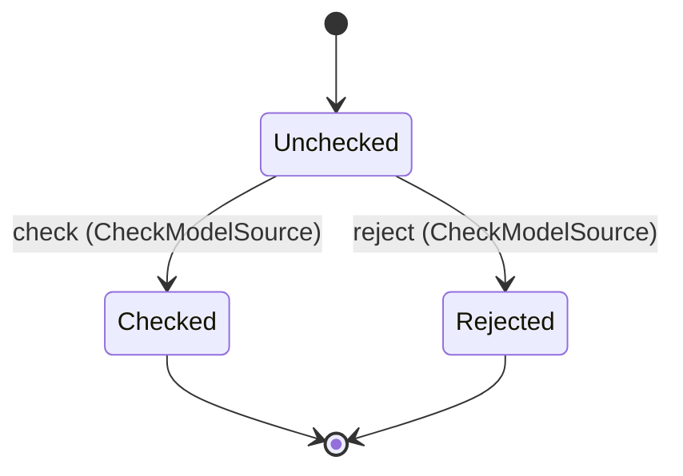
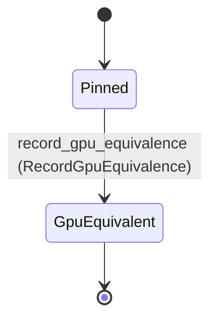
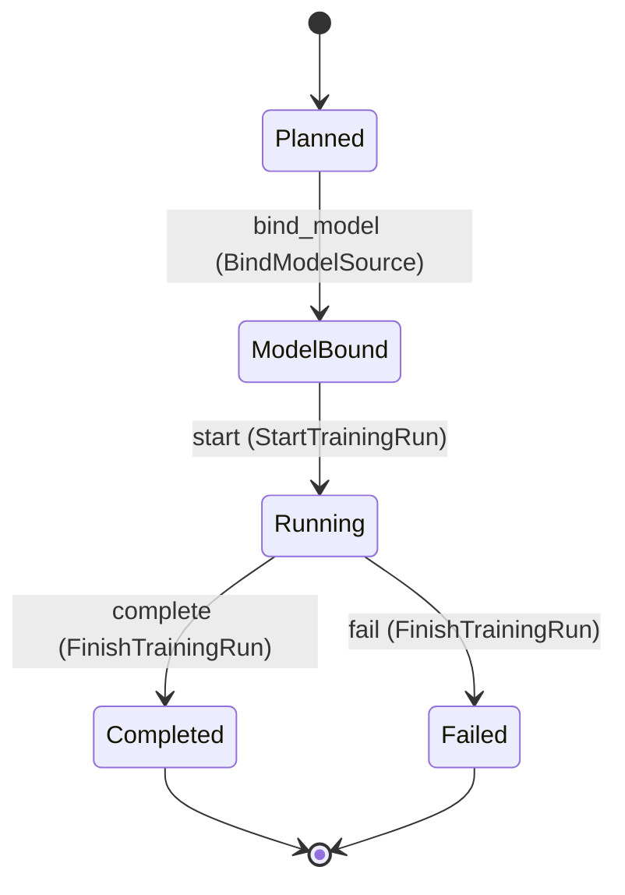
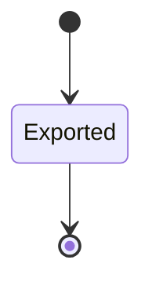

---
# generated by patchback-docs, do not edit
title: "model domain"
sidebar_label: "model"
description: "ESS reference for the model domain, generated from the specification."
custom_edit_url: null
---

<!-- generated by patchback-docs, do not edit -->

The ModelSpec bridge (DESIGN.md § 1.1, § 8): the pinned ModelSpec release, the checked `.mspec` source, `modelspec train` runs as subprocesses, the version-locked weight export and the native two-layer predictor that reads it.

`patchback.model` is one of patchback's bounded contexts. [All domains](./index.mdx).

## Types

### `Backend`

`patchback.model.Backend` is one of `Cpu` and `Vulkan`.

### `GitCommit`

`patchback.model.GitCommit` wraps `String` and is not interchangeable with one: the whole value of naming it separately is the crossings the model then refuses.

### `ModelSourceId`

`patchback.model.ModelSourceId` wraps `Uuid` and is not interchangeable with one: the whole value of naming it separately is the crossings the model then refuses.

### `ModelSpecPinId`

`patchback.model.ModelSpecPinId` wraps `Uuid` and is not interchangeable with one: the whole value of naming it separately is the crossings the model then refuses.

### `ModelSpecVersion`

`patchback.model.ModelSpecVersion` wraps `String` and is not interchangeable with one: the whole value of naming it separately is the crossings the model then refuses.

### `TrainingRunId`

`patchback.model.TrainingRunId` wraps `Uuid` and is not interchangeable with one: the whole value of naming it separately is the crossings the model then refuses.

### `WeightArtifactId`

`patchback.model.WeightArtifactId` wraps `Uuid` and is not interchangeable with one: the whole value of naming it separately is the crossings the model then refuses.

### `WeightChecksum`

`patchback.model.WeightChecksum` wraps `String` and is not interchangeable with one: the whole value of naming it separately is the crossings the model then refuses.

## Entities

An entity is what this context is about: something with an identity that outlives any one request, a shape, and a lifecycle. The lifecycle is exhaustive — a move that is not drawn below is a move this specification does not permit, and that is the only way it says so. Every move is labelled with the command that takes it, because a move nothing can trigger is refused rather than drawn.

### `ModelSource`

`patchback.model.ModelSource`.

An instance is identified by `model_source_id`, a `patchback.model.ModelSourceId`. The name is part of the model and not a convention: a view projects the identity under that name, so a projection inventing its own would disagree with the view.

It holds:

- `path` — `String`
- `model_name` — `String`
- `batch_size` — `Integer`
- `model_spec_pin_id` — `patchback.model.ModelSpecPinId`

It references at most one [`ModelSpecPin`](#modelspecpin), as `model_spec_pin`, carried by `ModelSource.model_spec_pin_id`.

No invariant is declared, so nothing here constrains an instance at rest.

Its state is a `patchback.model.ModelSource.State`, one of `Checked`, `Rejected` and `Unchecked`. That enum is synthesised from the lifecycle rather than declared beside it, so the states a view's filter compares and the states drawn below cannot disagree.

An instance is created in `Unchecked`. `Checked` and `Rejected` are terminal, so an instance may rest there forever. That is declared rather than inferred from having no way out: an entity that cannot leave a state is either finished or stuck, and only its author knows which.

Each move is taken by a declared command outcome, and a move nothing takes is refused as `missing_causation` rather than left as a state change nobody can trigger:

- `check` — taken by `patchback.model.CheckModelSource` on its `checked` outcome
- `reject` — taken by `patchback.model.CheckModelSource` on its `rejected` outcome

An instance is brought into existence by `patchback.model.RegisterModelSource` on its `registered` outcome.

Illegal transitions are illegal by absence: no rule forbids them, there is simply no arrow, because a rule would be a second place for the same truth to live. A diagram cannot show an absence, so the pairs it does not connect are listed here, derived from the same transitions — anything named below is a move this specification does not permit.

- `Checked` may not become `Rejected`
- `Checked` may not become `Unchecked`
- `Rejected` may not become `Checked`
- `Rejected` may not become `Unchecked`

One view projects it: [`ModelSources`](#modelsources).

### `ModelSpecPin`

`patchback.model.ModelSpecPin`.

An instance is identified by `model_spec_pin_id`, a `patchback.model.ModelSpecPinId`. The name is part of the model and not a convention: a view projects the identity under that name, so a projection inventing its own would disagree with the view.

It holds:

- `version` — `patchback.model.ModelSpecVersion`
- `commit` — `patchback.model.GitCommit`
- `vulkan_backend_shipped` — `Boolean`

It declares no relation to another entity, and no other entity names it.

No invariant is declared, so nothing here constrains an instance at rest.

Its state is a `patchback.model.ModelSpecPin.State`, one of `GpuEquivalent` and `Pinned`. That enum is synthesised from the lifecycle rather than declared beside it, so the states a view's filter compares and the states drawn below cannot disagree.

An instance is created in `Pinned`. `GpuEquivalent` is terminal, so an instance may rest there forever. That is declared rather than inferred from having no way out: an entity that cannot leave a state is either finished or stuck, and only its author knows which.

Each move is taken by a declared command outcome, and a move nothing takes is refused as `missing_causation` rather than left as a state change nobody can trigger:

- `record_gpu_equivalence` — taken by `patchback.model.RecordGpuEquivalence` on its `recorded` outcome

An instance is brought into existence by `patchback.model.PinModelSpec` on its `pinned` outcome.

Illegal transitions are illegal by absence: no rule forbids them, there is simply no arrow, because a rule would be a second place for the same truth to live. A diagram cannot show an absence, so the pairs it does not connect are listed here, derived from the same transitions — anything named below is a move this specification does not permit.

- `GpuEquivalent` may not become `Pinned`

One view projects it: [`ModelSpecPins`](#modelspecpins).

### `TrainingRun`

`patchback.model.TrainingRun`.

An instance is identified by `training_run_id`, a `patchback.model.TrainingRunId`. The name is part of the model and not a convention: a view projects the identity under that name, so a projection inventing its own would disagree with the view.

It holds:

- `model_source_id` — `Optional<patchback.model.ModelSourceId>`, which may be absent
- `model_spec_pin_id` — `patchback.model.ModelSpecPinId`
- `backend` — `patchback.model.Backend`
- `data_split_id` — `Optional<patchback.dataset.DatasetSplitId>`, which may be absent
- `eval_split_id` — `Optional<patchback.dataset.DatasetSplitId>`, which may be absent
- `exit_status` — `Optional<Integer>`, which may be absent

It references at most one [`ModelSource`](#modelsource), as `model_source`, carried by `TrainingRun.model_source_id`. It references at most one [`ModelSpecPin`](#modelspecpin), as `model_spec_pin`, carried by `TrainingRun.model_spec_pin_id`. It references at most one [`patchback.dataset.DatasetSplit`](patchback-dataset.md#datasetsplit), as `data_split`, carried by `TrainingRun.data_split_id`. It references at most one [`patchback.dataset.DatasetSplit`](patchback-dataset.md#datasetsplit), as `eval_split`, carried by `TrainingRun.eval_split_id`.

No invariant is declared, so nothing here constrains an instance at rest.

Its state is a `patchback.model.TrainingRun.State`, one of `Completed`, `Failed`, `ModelBound`, `Planned` and `Running`. That enum is synthesised from the lifecycle rather than declared beside it, so the states a view's filter compares and the states drawn below cannot disagree.

An instance is created in `Planned`. `Completed` and `Failed` are terminal, so an instance may rest there forever. That is declared rather than inferred from having no way out: an entity that cannot leave a state is either finished or stuck, and only its author knows which.

Each move is taken by a declared command outcome, and a move nothing takes is refused as `missing_causation` rather than left as a state change nobody can trigger:

- `bind_model` — taken by `patchback.model.BindModelSource` on its `bound` outcome
- `start` — taken by `patchback.model.StartTrainingRun` on its `started` outcome
- `complete` — taken by `patchback.model.FinishTrainingRun` on its `completed` outcome
- `fail` — taken by `patchback.model.FinishTrainingRun` on its `failed` outcome

An instance is brought into existence by `patchback.model.PlanTrainingRun` on its `planned` outcome.

Illegal transitions are illegal by absence: no rule forbids them, there is simply no arrow, because a rule would be a second place for the same truth to live. A diagram cannot show an absence, so the pairs it does not connect are listed here, derived from the same transitions — anything named below is a move this specification does not permit.

- `Completed` may not become `Failed`
- `Completed` may not become `ModelBound`
- `Completed` may not become `Planned`
- `Completed` may not become `Running`
- `Failed` may not become `Completed`
- `Failed` may not become `ModelBound`
- `Failed` may not become `Planned`
- `Failed` may not become `Running`
- `ModelBound` may not become `Completed`
- `ModelBound` may not become `Failed`
- `ModelBound` may not become `Planned`
- `Planned` may not become `Completed`
- `Planned` may not become `Failed`
- `Planned` may not become `Running`
- `Running` may not become `ModelBound`
- `Running` may not become `Planned`

One view projects it: [`TrainingRuns`](#trainingruns).

### `WeightArtifact`

`patchback.model.WeightArtifact`.

An instance is identified by `weight_artifact_id`, a `patchback.model.WeightArtifactId`. The name is part of the model and not a convention: a view projects the identity under that name, so a projection inventing its own would disagree with the view.

It holds:

- `training_run_id` — `patchback.model.TrainingRunId`
- `model_spec_pin_id` — `patchback.model.ModelSpecPinId`
- `feature_contract_id` — `patchback.analysis.FeatureContractId`
- `checksum` — `patchback.model.WeightChecksum`
- `clamped_predictions` — `Integer`

It references at most one [`TrainingRun`](#trainingrun), as `training_run`, carried by `WeightArtifact.training_run_id`. It references at most one [`ModelSpecPin`](#modelspecpin), as `model_spec_pin`, carried by `WeightArtifact.model_spec_pin_id`. It references at most one [`patchback.analysis.FeatureContract`](patchback-analysis.md#featurecontract), as `feature_contract`, carried by `WeightArtifact.feature_contract_id`.

No invariant is declared, so nothing here constrains an instance at rest.

Its state is a `patchback.model.WeightArtifact.State`, one of `Exported`. That enum is synthesised from the lifecycle rather than declared beside it, so the states a view's filter compares and the states drawn below cannot disagree.

An instance is created in `Exported`. `Exported` is terminal, so an instance may rest there forever. That is declared rather than inferred from having no way out: an entity that cannot leave a state is either finished or stuck, and only its author knows which.

It declares no moves, so nothing changes its state once it exists.

It has one state, so there is no move to permit or to forbid.

One view projects it: [`WeightArtifacts`](#weightartifacts).

## Views

A view is what the outside world is promised it can observe. Each one says which instances it contains and how soon it reflects a command that has already returned, because "you can read this" without "how soon" is the promise every flaky suite is built on.

### `ModelSources`

`patchback.model.ModelSources`, shown to a person as "Model sources" and called `model-sources` on the wire.

It reads [`ModelSource`](#modelsource).

It contains every instance of that entity: no filter narrows it, which is a decision somebody made and not a line somebody omitted.

It exposes:

- `model_source_id` — `patchback.model.ModelSourceId`
- `state` — `patchback.model.ModelSource.State`
- `path` — `String`
- `model_name` — `String`
- `batch_size` — `Integer`
- `model_spec_pin_id` — `patchback.model.ModelSpecPinId`

It declares no order, so the rows come back in whatever order the implementation has, and two reads may disagree.

**Read-your-writes**: it is current the moment the command that changed it returns. A caller that has just created an invoice and cannot see it in here has been told a lie about what it did.

A generated scenario asserts it once, immediately after the command: a view promising this and not keeping the promise has to fail the suite rather than be retried until it passes.

### `ModelSpecPins`

`patchback.model.ModelSpecPins`, shown to a person as "ModelSpec pins" and called `model-spec-pins` on the wire.

It reads [`ModelSpecPin`](#modelspecpin).

It contains every instance of that entity: no filter narrows it, which is a decision somebody made and not a line somebody omitted.

It exposes:

- `model_spec_pin_id` — `patchback.model.ModelSpecPinId`
- `state` — `patchback.model.ModelSpecPin.State`
- `version` — `patchback.model.ModelSpecVersion`
- `commit` — `patchback.model.GitCommit`
- `vulkan_backend_shipped` — `Boolean`

It declares no order, so the rows come back in whatever order the implementation has, and two reads may disagree.

**Read-your-writes**: it is current the moment the command that changed it returns. A caller that has just created an invoice and cannot see it in here has been told a lie about what it did.

A generated scenario asserts it once, immediately after the command: a view promising this and not keeping the promise has to fail the suite rather than be retried until it passes.

### `TrainingRuns`

`patchback.model.TrainingRuns`, shown to a person as "Training runs" and called `training-runs` on the wire.

It reads [`TrainingRun`](#trainingrun).

It contains every instance of that entity: no filter narrows it, which is a decision somebody made and not a line somebody omitted.

It exposes:

- `training_run_id` — `patchback.model.TrainingRunId`
- `state` — `patchback.model.TrainingRun.State`
- `model_source_id` — `Optional<patchback.model.ModelSourceId>`, which may be absent
- `model_spec_pin_id` — `patchback.model.ModelSpecPinId`
- `backend` — `patchback.model.Backend`
- `data_split_id` — `Optional<patchback.dataset.DatasetSplitId>`, which may be absent
- `eval_split_id` — `Optional<patchback.dataset.DatasetSplitId>`, which may be absent
- `exit_status` — `Optional<Integer>`, which may be absent

It declares no order, so the rows come back in whatever order the implementation has, and two reads may disagree.

**Read-your-writes**: it is current the moment the command that changed it returns. A caller that has just created an invoice and cannot see it in here has been told a lie about what it did.

A generated scenario asserts it once, immediately after the command: a view promising this and not keeping the promise has to fail the suite rather than be retried until it passes.

### `WeightArtifacts`

`patchback.model.WeightArtifacts`, shown to a person as "Weight artifacts" and called `weight-artifacts` on the wire.

It reads [`WeightArtifact`](#weightartifact).

It contains every instance of that entity: no filter narrows it, which is a decision somebody made and not a line somebody omitted.

It exposes:

- `weight_artifact_id` — `patchback.model.WeightArtifactId`
- `state` — `patchback.model.WeightArtifact.State`
- `training_run_id` — `patchback.model.TrainingRunId`
- `model_spec_pin_id` — `patchback.model.ModelSpecPinId`
- `feature_contract_id` — `patchback.analysis.FeatureContractId`
- `checksum` — `patchback.model.WeightChecksum`
- `clamped_predictions` — `Integer`

It declares no order, so the rows come back in whatever order the implementation has, and two reads may disagree.

**Read-your-writes**: it is current the moment the command that changed it returns. A caller that has just created an invoice and cannot see it in here has been told a lie about what it did.

A generated scenario asserts it once, immediately after the command: a view promising this and not keeping the promise has to fail the suite rather than be retried until it passes.

## Commands

### `BindModelSource`

`patchback.model.BindModelSource`, shown to a person as "Bind the model source" and called `bind-model-source` on the wire.

It takes:

- `training_run_id` — `patchback.model.TrainingRunId`
- `model_source_id` — `patchback.model.ModelSourceId`

It has six outcomes.

**`unknown-run`** — Taken when the identity the command names is one no record carries, before any other answer for it. No entity in this specification changes. It reports `patchback.model.UnknownTrainingRun`, carrying `training_run_id`. It emits nothing. A test reaches it by sending an identity no record carries, arranging nothing.

**`unknown-source`** — Taken when no `patchback.model.ModelSource` carries the identity `input.model_source_id` names. No entity in this specification changes. It reports `patchback.model.UnknownModelSource`, carrying `model_source_id`. It emits nothing. A test reaches it by arranging the row of the other entity the input names, or its absence, and sending the command for it.

**`model-not-checked`** — Taken when the `patchback.model.ModelSource` that `input.model_source_id` names exists and its stored fields satisfy `state != Checked`. No entity in this specification changes. It reports `patchback.model.ModelNotChecked`, carrying `model_source_id` and `state`. It emits nothing. A test reaches it by arranging the row of the other entity the input names, or its absence, and sending the command for it.

**`pin-mismatch`** — Decided outside the input: the source was checked under another ModelSpec pin than the run's. No predicate over the input reaches this branch, and saying `when: false` instead would have claimed it is unreachable, which is a different and false statement. No entity in this specification changes. It reports `patchback.model.PinMismatch`, carrying `model_source_id` and `model_spec_pin_id`. It emits nothing. A test reaches it by injecting the declared fault, because no input can.

**`bound`** — The run trains this checked source. The default branch, taken when no other outcome's condition matched. It moves a `patchback.model.TrainingRun` from `Planned` to `ModelBound`, along the declared move `bind_model`. The instance is the one named by the input field `training_run_id`. It emits `patchback.model.ModelSourceBound`. It sets `model_source_id` from `input.model_source_id`. A test reaches it by constructing an input that satisfies no other outcome's condition.

**`wrong-state`** — Taken when the subject is resting in a state none of this command's moves start from — a `patchback.model.TrainingRun` in `Completed`, `Failed`, `ModelBound` and `Running`, which is what is left of the lifecycle once this command's own moves are taken away. The document lists none of it. No entity in this specification changes. It reports `patchback.model.TrainingRunPastPlanning`, carrying `state`. It emits nothing. A test reaches it by driving an instance into one of those states and then issuing the command, because no input selects this branch.

### `CheckModelSource`

`patchback.model.CheckModelSource`, shown to a person as "Check the model source" and called `check-model-source` on the wire.

It takes:

- `model_source_id` — `patchback.model.ModelSourceId`

It has four outcomes.

**`unknown-source`** — Taken when the identity the command names is one no record carries, before any other answer for it. No entity in this specification changes. It reports `patchback.model.UnknownModelSource`, carrying `model_source_id`. It emits nothing. A test reaches it by sending an identity no record carries, arranging nothing.

**`rejected`** — The refusal is recorded; the source cannot be trained. Decided outside the input: `modelspec check` exits with a non-zero status. No predicate over the input reaches this branch, and saying `when: false` instead would have claimed it is unreachable, which is a different and false statement. It moves a `patchback.model.ModelSource` from `Unchecked` to `Rejected`, along the declared move `reject`. The instance is the one named by the input field `model_source_id`. It emits `patchback.model.ModelSourceRejected`. A test reaches it by injecting the declared fault, because no input can.

**`checked`** — The pinned binary accepts the source; it may be trained. The default branch, taken when no other outcome's condition matched. It moves a `patchback.model.ModelSource` from `Unchecked` to `Checked`, along the declared move `check`. The instance is the one named by the input field `model_source_id`. It emits `patchback.model.ModelSourceChecked`. A test reaches it by constructing an input that satisfies no other outcome's condition.

**`wrong-state`** — Taken when the subject is resting in a state none of this command's moves start from — a `patchback.model.ModelSource` in `Checked` and `Rejected`, which is what is left of the lifecycle once this command's own moves are taken away. The document lists none of it. No entity in this specification changes. It reports `patchback.model.ModelSourceAlreadyChecked`, carrying `state`. It emits nothing. A test reaches it by driving an instance into one of those states and then issuing the command, because no input selects this branch.

### `ExportWeights`

`patchback.model.ExportWeights`, shown to a person as "Export weights" and called `export-weights` on the wire.

It takes:

- `training_run_id` — `patchback.model.TrainingRunId`
- `feature_contract_id` — `patchback.analysis.FeatureContractId`
- `w1_name` — `String`
- `w1_rows` — `Integer`
- `w1_columns` — `Integer`
- `w1_elements` — `Integer`
- `w2_name` — `String`
- `w2_rows` — `Integer`
- `w2_columns` — `Integer`
- `w2_elements` — `Integer`

It has eight outcomes.

**`wrong-shape`** — Taken when `(w1_rows != 32 or w1_columns != 64 or w2_rows != 64 or w2_columns != 8)` holds of the input. No entity in this specification changes. It reports `patchback.model.WrongWeightShape`, carrying `w1_rows`, `w1_columns`, `w2_rows` and `w2_columns`. It emits nothing. A test reaches it by constructing an input that satisfies that condition.

**`wrong-element-count`** — Taken when `(w1_elements != 2048 or w2_elements != 512)` holds of the input. No entity in this specification changes. It reports `patchback.model.WrongElementCount`, carrying `w1_elements` and `w2_elements`. It emits nothing. A test reaches it by constructing an input that satisfies that condition.

**`unknown-run`** — Taken when no `patchback.model.TrainingRun` carries the identity `input.training_run_id` names. No entity in this specification changes. It reports `patchback.model.UnknownTrainingRun`, carrying `training_run_id`. It emits nothing. A test reaches it by arranging the row of the other entity the input names, or its absence, and sending the command for it.

**`run-not-completed`** — Taken when the `patchback.model.TrainingRun` that `input.training_run_id` names exists and its stored fields satisfy `state != Completed`. No entity in this specification changes. It reports `patchback.model.TrainingNotCompleted`, carrying `training_run_id` and `state`. It emits nothing. A test reaches it by arranging the row of the other entity the input names, or its absence, and sending the command for it.

**`unrecognized-parameter`** — Decided outside the input: a parameter block names something other than `@PatchRegressor.w1` or `@PatchRegressor.w2`. No predicate over the input reaches this branch, and saying `when: false` instead would have claimed it is unreachable, which is a different and false statement. No entity in this specification changes. It reports `patchback.model.UnrecognizedParameter`, carrying `w1_name` and `w2_name`. It emits nothing. A test reaches it by injecting the declared fault, because no input can.

**`unrecognized-output`** — Decided outside the input: the run's output holds a line that is not part of a recognized `param @PatchRegressor.w1` or `.w2` block of the pinned version. No predicate over the input reaches this branch, and saying `when: false` instead would have claimed it is unreachable, which is a different and false statement. No entity in this specification changes. It reports `patchback.model.UnrecognizedTrainingOutput`, carrying `training_run_id`. It emits nothing. A test reaches it by injecting the declared fault, because no input can.

**`non-finite-weight`** — Decided outside the input: a w1 or w2 value is NaN or Infinity. No predicate over the input reaches this branch, and saying `when: false` instead would have claimed it is unreachable, which is a different and false statement. No entity in this specification changes. It reports `patchback.model.NonFiniteWeight`, carrying `training_run_id`. It emits nothing. A test reaches it by injecting the declared fault, because no input can.

**`exported`** — The artifact is written with its checksum, model and feature-contract versions. The default branch, taken when no other outcome's condition matched. It creates a `patchback.model.WeightArtifact`, which starts in `Exported`. The new instance's identity is published as `weight_artifact_id` on `patchback.model.WeightsExported`. It emits `patchback.model.WeightsExported`. It sets `training_run_id` from `input.training_run_id`, `model_spec_pin_id` from `patchback.model.TrainingRun.model_spec_pin_id of the row input.training_run_id names`, `feature_contract_id` from `input.feature_contract_id`, `checksum` from `implementation-generated` and `clamped_predictions` from `"0"`. A test reaches it by constructing an input that satisfies no other outcome's condition.

### `FinishTrainingRun`

`patchback.model.FinishTrainingRun`, shown to a person as "Finish a training run" and called `finish-training-run` on the wire.

It takes:

- `training_run_id` — `patchback.model.TrainingRunId`
- `exit_status` — `Integer`

It has four outcomes.

**`unknown-run`** — Taken when the identity the command names is one no record carries, before any other answer for it. No entity in this specification changes. It reports `patchback.model.UnknownTrainingRun`, carrying `training_run_id`. It emits nothing. A test reaches it by sending an identity no record carries, arranging nothing.

**`failed`** — The run failed; no weights may be exported from it. Taken when `exit_status != 0` holds of the input. It moves a `patchback.model.TrainingRun` from `Running` to `Failed`, along the declared move `fail`. The instance is the one named by the input field `training_run_id`. It emits `patchback.model.TrainingRunFailed`. It sets `exit_status` from `input.exit_status`. A test reaches it by constructing an input that satisfies that condition.

**`completed`** — The run exited with status 0; its output may be exported. The default branch, taken when no other outcome's condition matched. It moves a `patchback.model.TrainingRun` from `Running` to `Completed`, along the declared move `complete`. The instance is the one named by the input field `training_run_id`. It emits `patchback.model.TrainingRunCompleted`. It sets `exit_status` from `input.exit_status`. A test reaches it by constructing an input that satisfies no other outcome's condition.

**`wrong-state`** — Taken when the subject is resting in a state none of this command's moves start from — a `patchback.model.TrainingRun` in `Completed`, `Failed`, `ModelBound` and `Planned`, which is what is left of the lifecycle once this command's own moves are taken away. The document lists none of it. No entity in this specification changes. It reports `patchback.model.TrainingRunFinished`, carrying `state`. It emits nothing. A test reaches it by driving an instance into one of those states and then issuing the command, because no input selects this branch.

### `PinModelSpec`

`patchback.model.PinModelSpec`, shown to a person as "Pin ModelSpec" and called `pin-model-spec` on the wire.

It takes:

- `version` — `patchback.model.ModelSpecVersion`
- `commit` — `patchback.model.GitCommit`
- `vulkan_backend_shipped` — `Boolean`

It has one outcome.

**`pinned`** — The pin is recorded; nothing it does not list as shipped is assumed. The default branch, taken when no other outcome's condition matched. It creates a `patchback.model.ModelSpecPin`, which starts in `Pinned`. The new instance's identity is published as `model_spec_pin_id` on `patchback.model.ModelSpecPinned`. It emits `patchback.model.ModelSpecPinned`. It sets `version` from `input.version`, `commit` from `input.commit` and `vulkan_backend_shipped` from `input.vulkan_backend_shipped`. A test reaches it by constructing an input that satisfies no other outcome's condition.

### `PlanTrainingRun`

`patchback.model.PlanTrainingRun`, shown to a person as "Plan a training run" and called `plan-training-run` on the wire.

It takes:

- `model_spec_pin_id` — `patchback.model.ModelSpecPinId`
- `backend` — `patchback.model.Backend`

It has four outcomes.

**`unknown-pin`** — Taken when no `patchback.model.ModelSpecPin` carries the identity `input.model_spec_pin_id` names. No entity in this specification changes. It reports `patchback.model.UnknownPin`, carrying `model_spec_pin_id`. It emits nothing. A test reaches it by arranging the row of the other entity the input names, or its absence, and sending the command for it.

**`backend-not-shipped`** — Taken when the `patchback.model.ModelSpecPin` that `input.model_spec_pin_id` names exists and its stored fields satisfy `vulkan_backend_shipped == false`, and `backend == Vulkan` holds of the input. No entity in this specification changes. It reports `patchback.model.BackendNotShipped`, carrying `model_spec_pin_id` and `backend`. It emits nothing. A test reaches it by arranging the row of the other entity the input names, or its absence, and sending the command for it.

**`gpu-equivalence-not-recorded`** — Taken when the `patchback.model.ModelSpecPin` that `input.model_spec_pin_id` names exists and its stored fields satisfy `state == Pinned`, and `backend == Vulkan` holds of the input. No entity in this specification changes. It reports `patchback.model.GpuEquivalenceNotRecorded`, carrying `model_spec_pin_id`. It emits nothing. A test reaches it by arranging the row of the other entity the input names, or its absence, and sending the command for it.

**`planned`** — The run is planned on a backend the pin supports. The default branch, taken when no other outcome's condition matched. It creates a `patchback.model.TrainingRun`, which starts in `Planned`. The new instance's identity is published as `training_run_id` on `patchback.model.TrainingRunPlanned`. It emits `patchback.model.TrainingRunPlanned`. It sets `model_source_id` cleared, `model_spec_pin_id` from `input.model_spec_pin_id`, `backend` from `input.backend`, `data_split_id` cleared, `eval_split_id` cleared and `exit_status` cleared. A test reaches it by constructing an input that satisfies no other outcome's condition.

### `Predict`

`patchback.model.Predict`, shown to a person as "Predict parameters" and called `predict` on the wire.

It takes:

- `weight_artifact_id` — `patchback.model.WeightArtifactId`
- `feature_contract_id` — `patchback.analysis.FeatureContractId`
- `feature_count` — `Integer`

It has seven outcomes.

**`wrong-feature-count`** — Taken when `feature_count != 32` holds of the input. No entity in this specification changes. It reports `patchback.model.WrongFeatureCount`, carrying `count`. It emits nothing. A test reaches it by constructing an input that satisfies that condition.

**`unknown-artifact`** — Taken when the identity the command names is one no record carries, before any other answer for it. No entity in this specification changes. It reports `patchback.model.UnknownWeightArtifact`, carrying `weight_artifact_id`. It emits nothing. A test reaches it by sending an identity no record carries, arranging nothing.

**`feature-contract-mismatch`** — Taken when the existing subject's stored fields satisfy `feature_contract_id != input.feature_contract_id`. No entity in this specification changes. It reports `patchback.model.FeatureContractMismatch`, carrying `weight_artifact_id` and `feature_contract_id`. It emits nothing. A test establishes and independently observes the subject enum fact before selecting this branch.

**`corrupt-artifact`** — Decided outside the input: the artifact's bytes do not match its checksum. No predicate over the input reaches this branch, and saying `when: false` instead would have claimed it is unreachable, which is a different and false statement. No entity in this specification changes. It reports `patchback.model.CorruptWeightArtifact`, carrying `weight_artifact_id`. It emits nothing. A test reaches it by injecting the declared fault, because no input can.

**`non-finite-feature`** — Decided outside the input: a feature value is NaN or Infinity. No predicate over the input reaches this branch, and saying `when: false` instead would have claimed it is unreachable, which is a different and false statement. No entity in this specification changes. It reports `patchback.model.NonFiniteFeature`, carrying `weight_artifact_id`. It emits nothing. A test reaches it by injecting the declared fault, because no input can.

**`predicted-clamped`** — The outputs are clamped to [0, 1], the clamp is counted and a warning is emitted. Decided outside the input: one or more of the eight outputs fall outside [0, 1]. No predicate over the input reaches this branch, and saying `when: false` instead would have claimed it is unreachable, which is a different and false statement. It changes a `patchback.model.WeightArtifact` without moving it along its lifecycle. The instance is the one named by the input field `weight_artifact_id`. It emits `patchback.model.PredictionClamped`. It sets `clamped_predictions` from `its previous value plus 1`. A test reaches it by injecting the declared fault, because no input can.

**`predicted`** — All eight outputs are in [0, 1] and returned unchanged. The default branch, taken when no other outcome's condition matched. It preserves the existing subject, without an error or event. The instance is the one named by the input field `weight_artifact_id`. It emits nothing. A test reaches it by constructing an input that satisfies no other outcome's condition.

### `RecordGpuEquivalence`

`patchback.model.RecordGpuEquivalence`, shown to a person as "Record CPU/GPU equivalence" and called `record-gpu-equivalence` on the wire.

It takes:

- `model_spec_pin_id` — `patchback.model.ModelSpecPinId`
- `equivalent` — `Boolean`

It has five outcomes.

**`not-equivalent`** — Taken when `equivalent == false` holds of the input. No entity in this specification changes. It reports `patchback.model.GpuNotEquivalent`, carrying `model_spec_pin_id`. It emits nothing. A test reaches it by constructing an input that satisfies that condition.

**`unknown-pin`** — Taken when the identity the command names is one no record carries, before any other answer for it. No entity in this specification changes. It reports `patchback.model.UnknownPin`, carrying `model_spec_pin_id`. It emits nothing. A test reaches it by sending an identity no record carries, arranging nothing.

**`backend-not-shipped`** — Taken when the existing subject's stored fields satisfy `vulkan_backend_shipped == false`. No entity in this specification changes. It reports `patchback.model.BackendNotShipped`, carrying `model_spec_pin_id` and `backend`. It emits nothing. A test establishes and independently observes the subject enum fact before selecting this branch.

**`recorded`** — GPU training may now use the Vulkan backend of this pin. The default branch, taken when no other outcome's condition matched. It moves a `patchback.model.ModelSpecPin` from `Pinned` to `GpuEquivalent`, along the declared move `record_gpu_equivalence`. The instance is the one named by the input field `model_spec_pin_id`. It emits `patchback.model.GpuEquivalenceRecorded`. A test reaches it by constructing an input that satisfies no other outcome's condition.

**`wrong-state`** — Taken when the subject is resting in a state none of this command's moves start from — a `patchback.model.ModelSpecPin` in `GpuEquivalent`, which is what is left of the lifecycle once this command's own moves are taken away. The document lists none of it. No entity in this specification changes. It reports `patchback.model.GpuEquivalenceAlreadyRecorded`, carrying `state`. It emits nothing. A test reaches it by driving an instance into one of those states and then issuing the command, because no input selects this branch.

### `RegisterModelSource`

`patchback.model.RegisterModelSource`, shown to a person as "Register a model source" and called `register-model-source` on the wire.

It takes:

- `path` — `String`
- `model_name` — `String`
- `batch_size` — `Integer`
- `model_spec_pin_id` — `patchback.model.ModelSpecPinId`

It has two outcomes.

**`unknown-pin`** — Taken when no `patchback.model.ModelSpecPin` carries the identity `input.model_spec_pin_id` names. No entity in this specification changes. It reports `patchback.model.UnknownPin`, carrying `model_spec_pin_id`. It emits nothing. A test reaches it by arranging the row of the other entity the input names, or its absence, and sending the command for it.

**`registered`** — The source is registered and not yet checked. The default branch, taken when no other outcome's condition matched. It creates a `patchback.model.ModelSource`, which starts in `Unchecked`. The new instance's identity is published as `model_source_id` on `patchback.model.ModelSourceRegistered`. It emits `patchback.model.ModelSourceRegistered`. It sets `path` from `input.path`, `model_name` from `input.model_name`, `batch_size` from `input.batch_size` and `model_spec_pin_id` from `input.model_spec_pin_id`. A test reaches it by constructing an input that satisfies no other outcome's condition.

### `StartTrainingRun`

`patchback.model.StartTrainingRun`, shown to a person as "Start a training run" and called `start-training-run` on the wire.

It takes:

- `training_run_id` — `patchback.model.TrainingRunId`
- `data_split_id` — `patchback.dataset.DatasetSplitId`
- `eval_split_id` — `Optional<patchback.dataset.DatasetSplitId>`, which may be absent

It has seven outcomes.

**`unknown-run`** — Taken when the identity the command names is one no record carries, before any other answer for it. No entity in this specification changes. It reports `patchback.model.UnknownTrainingRun`, carrying `training_run_id`. It emits nothing. A test reaches it by sending an identity no record carries, arranging nothing.

**`unknown-data`** — Taken when no `patchback.dataset.DatasetSplit` carries the identity `input.data_split_id` names. No entity in this specification changes. It reports `patchback.model.UnknownDataSplit`, carrying `dataset_split_id`. It emits nothing. A test reaches it by arranging the row of the other entity the input names, or its absence, and sending the command for it.

**`data-not-written`** — Taken when the `patchback.dataset.DatasetSplit` that `input.data_split_id` names exists and its stored fields satisfy `state != Written`. No entity in this specification changes. It reports `patchback.model.DataNotWritten`, carrying `dataset_split_id` and `state`. It emits nothing. A test reaches it by arranging the row of the other entity the input names, or its absence, and sending the command for it.

**`eval-not-written`** — Decided outside the input: `--eval` names an unknown split or one whose dense data is not written. No predicate over the input reaches this branch, and saying `when: false` instead would have claimed it is unreachable, which is a different and false statement. No entity in this specification changes. It reports `patchback.model.EvalNotWritten`, carrying `eval_split_id`. It emits nothing. A test reaches it by injecting the declared fault, because no input can.

**`eval-count-not-batch-multiple`** — Decided outside the input: `--eval` names a split whose sample count is not a multiple of the source's batch_size. No predicate over the input reaches this branch, and saying `when: false` instead would have claimed it is unreachable, which is a different and false statement. No entity in this specification changes. It reports `patchback.model.EvalCountNotBatchMultiple`, carrying `eval_split_id` and `training_run_id`. It emits nothing. A test reaches it by injecting the declared fault, because no input can.

**`started`** — The subprocess is running. The default branch, taken when no other outcome's condition matched. It moves a `patchback.model.TrainingRun` from `ModelBound` to `Running`, along the declared move `start`. The instance is the one named by the input field `training_run_id`. It emits `patchback.model.TrainingRunStarted`. It sets `data_split_id` from `input.data_split_id` and `eval_split_id` from `input.eval_split_id`. A test reaches it by constructing an input that satisfies no other outcome's condition.

**`wrong-state`** — Taken when the subject is resting in a state none of this command's moves start from — a `patchback.model.TrainingRun` in `Completed`, `Failed`, `Planned` and `Running`, which is what is left of the lifecycle once this command's own moves are taken away. The document lists none of it. No entity in this specification changes. It reports `patchback.model.TrainingRunNotReady`, carrying `state`. It emits nothing. A test reaches it by driving an instance into one of those states and then issuing the command, because no input selects this branch.

## Events

### `GpuEquivalenceRecorded`

`patchback.model.GpuEquivalenceRecorded`.

It carries:

- `model_spec_pin_id` — `patchback.model.ModelSpecPinId`

Emitted by `patchback.model.RecordGpuEquivalence` on its `recorded` outcome.

Nothing in this system reacts to it.

### `ModelSourceBound`

`patchback.model.ModelSourceBound`.

It carries:

- `training_run_id` — `patchback.model.TrainingRunId`
- `model_source_id` — `patchback.model.ModelSourceId`

Emitted by `patchback.model.BindModelSource` on its `bound` outcome.

Nothing in this system reacts to it.

### `ModelSourceChecked`

`patchback.model.ModelSourceChecked`.

It carries:

- `model_source_id` — `patchback.model.ModelSourceId`

Emitted by `patchback.model.CheckModelSource` on its `checked` outcome.

Nothing in this system reacts to it.

### `ModelSourceRegistered`

`patchback.model.ModelSourceRegistered`.

It carries:

- `model_source_id` — `patchback.model.ModelSourceId`
- `path` — `String`

Emitted by `patchback.model.RegisterModelSource` on its `registered` outcome.

Nothing in this system reacts to it.

### `ModelSourceRejected`

`patchback.model.ModelSourceRejected`.

It carries:

- `model_source_id` — `patchback.model.ModelSourceId`

Emitted by `patchback.model.CheckModelSource` on its `rejected` outcome.

Nothing in this system reacts to it.

### `ModelSpecPinned`

`patchback.model.ModelSpecPinned`.

It carries:

- `model_spec_pin_id` — `patchback.model.ModelSpecPinId`
- `version` — `patchback.model.ModelSpecVersion`
- `commit` — `patchback.model.GitCommit`

Emitted by `patchback.model.PinModelSpec` on its `pinned` outcome.

Nothing in this system reacts to it.

### `PredictionClamped`

`patchback.model.PredictionClamped`.

It carries:

- `weight_artifact_id` — `patchback.model.WeightArtifactId`

Emitted by `patchback.model.Predict` on its `predicted-clamped` outcome.

Nothing in this system reacts to it.

### `TrainingRunCompleted`

`patchback.model.TrainingRunCompleted`.

It carries:

- `training_run_id` — `patchback.model.TrainingRunId`

Emitted by `patchback.model.FinishTrainingRun` on its `completed` outcome.

Nothing in this system reacts to it.

### `TrainingRunFailed`

`patchback.model.TrainingRunFailed`.

It carries:

- `training_run_id` — `patchback.model.TrainingRunId`
- `exit_status` — `Integer`

Emitted by `patchback.model.FinishTrainingRun` on its `failed` outcome.

Nothing in this system reacts to it.

### `TrainingRunPlanned`

`patchback.model.TrainingRunPlanned`.

It carries:

- `training_run_id` — `patchback.model.TrainingRunId`
- `model_spec_pin_id` — `patchback.model.ModelSpecPinId`
- `backend` — `patchback.model.Backend`

Emitted by `patchback.model.PlanTrainingRun` on its `planned` outcome.

Nothing in this system reacts to it.

### `TrainingRunStarted`

`patchback.model.TrainingRunStarted`.

It carries:

- `training_run_id` — `patchback.model.TrainingRunId`
- `data_split_id` — `patchback.dataset.DatasetSplitId`

Emitted by `patchback.model.StartTrainingRun` on its `started` outcome.

Nothing in this system reacts to it.

### `WeightsExported`

`patchback.model.WeightsExported`.

It carries:

- `weight_artifact_id` — `patchback.model.WeightArtifactId`
- `training_run_id` — `patchback.model.TrainingRunId`
- `feature_contract_id` — `patchback.analysis.FeatureContractId`

Emitted by `patchback.model.ExportWeights` on its `exported` outcome.

Nothing in this system reacts to it.

## Errors

### `BackendNotShipped`

The pinned ModelSpec release does not list the Vulkan backend as shipped, so no GPU work is assumed to run (§ 1.1, ADR-010).

It carries:

- `model_spec_pin_id` — `patchback.model.ModelSpecPinId`
- `backend` — `patchback.model.Backend`

Reported by `patchback.model.PlanTrainingRun` on its `backend-not-shipped` outcome.

Reported by `patchback.model.RecordGpuEquivalence` on its `backend-not-shipped` outcome.

### `CorruptWeightArtifact`

The artifact's bytes do not match its checksum (§ 8.2 step 3, § 12.3 "Reject corrupt models").

It carries:

- `weight_artifact_id` — `patchback.model.WeightArtifactId`

Reported by `patchback.model.Predict` on its `corrupt-artifact` outcome.

### `DataNotWritten`

The `--data` or `--eval` split's dense data is not written and verified (§ 7.2).

It carries:

- `dataset_split_id` — `patchback.dataset.DatasetSplitId`
- `state` — `patchback.dataset.DatasetSplit.State`

Reported by `patchback.model.StartTrainingRun` on its `data-not-written` outcome.

### `EvalCountNotBatchMultiple`

The `--eval` split's sample count is not a multiple of the model source's batch size (§ 7.2).

It carries:

- `eval_split_id` — `Optional<patchback.dataset.DatasetSplitId>`, which may be absent
- `training_run_id` — `patchback.model.TrainingRunId`

Reported by `patchback.model.StartTrainingRun` on its `eval-count-not-batch-multiple` outcome.

### `EvalNotWritten`

The `--eval` split is unknown or its dense data is not written and verified (§ 7.2).

It carries:

- `eval_split_id` — `Optional<patchback.dataset.DatasetSplitId>`, which may be absent

Reported by `patchback.model.StartTrainingRun` on its `eval-not-written` outcome.

### `FeatureContractMismatch`

The feature vector was computed under another feature-contract version than the one the artifact was trained for (§ 6.3, § 8.2 step 3).

It carries:

- `weight_artifact_id` — `patchback.model.WeightArtifactId`
- `feature_contract_id` — `patchback.analysis.FeatureContractId`

Reported by `patchback.model.Predict` on its `feature-contract-mismatch` outcome.

### `GpuEquivalenceAlreadyRecorded`

Equivalence is already recorded on this pin, so nothing changed.

It carries:

- `state` — `patchback.model.ModelSpecPin.State`

Reported by `patchback.model.RecordGpuEquivalence` on its `wrong-state` outcome.

### `GpuEquivalenceNotRecorded`

GPU training waits for recorded CPU/GPU equivalence on the pinned release (ADR-010, § 13 Milestone E).

It carries:

- `model_spec_pin_id` — `patchback.model.ModelSpecPinId`

Reported by `patchback.model.PlanTrainingRun` on its `gpu-equivalence-not-recorded` outcome.

### `GpuNotEquivalent`

The CPU/GPU equivalence tests did not pass, so nothing was recorded (ADR-010).

It carries:

- `model_spec_pin_id` — `patchback.model.ModelSpecPinId`

Reported by `patchback.model.RecordGpuEquivalence` on its `not-equivalent` outcome.

### `ModelNotChecked`

`modelspec train` runs only a source `modelspec check` accepted with the pinned binary (§ 8.1, "Validate it with the pinned ModelSpec binary before implementation work proceeds").

It carries:

- `model_source_id` — `patchback.model.ModelSourceId`
- `state` — `patchback.model.ModelSource.State`

Reported by `patchback.model.BindModelSource` on its `model-not-checked` outcome.

### `ModelSourceAlreadyChecked`

The source already carries a check result, so nothing changed.

It carries:

- `state` — `patchback.model.ModelSource.State`

Reported by `patchback.model.CheckModelSource` on its `wrong-state` outcome.

### `NonFiniteFeature`

A feature value is NaN or Infinity (§ 12.3, "Reject … non-finite features").

It carries:

- `weight_artifact_id` — `patchback.model.WeightArtifactId`

Reported by `patchback.model.Predict` on its `non-finite-feature` outcome.

### `NonFiniteWeight`

A weight value is NaN or Infinity (§ 8.2 step 2).

It carries:

- `training_run_id` — `patchback.model.TrainingRunId`

Reported by `patchback.model.ExportWeights` on its `non-finite-weight` outcome.

### `PinMismatch`

The source was checked under another ModelSpec pin than the one this run uses.

It carries:

- `model_source_id` — `patchback.model.ModelSourceId`
- `model_spec_pin_id` — `patchback.model.ModelSpecPinId`

Reported by `patchback.model.BindModelSource` on its `pin-mismatch` outcome.

### `TrainingNotCompleted`

Weights are exported only from a run that exited with status 0 (§ 8.2 step 2); a run still Running or Failed is refused.

It carries:

- `training_run_id` — `patchback.model.TrainingRunId`
- `state` — `patchback.model.TrainingRun.State`

Reported by `patchback.model.ExportWeights` on its `run-not-completed` outcome.

### `TrainingRunFinished`

Only a Running run takes an exit status, so nothing changed.

It carries:

- `state` — `patchback.model.TrainingRun.State`

Reported by `patchback.model.FinishTrainingRun` on its `wrong-state` outcome.

### `TrainingRunNotReady`

Only a run with a bound model source and not yet started can start.

It carries:

- `state` — `patchback.model.TrainingRun.State`

Reported by `patchback.model.StartTrainingRun` on its `wrong-state` outcome.

### `TrainingRunPastPlanning`

The run already has its model source bound, so nothing changed.

It carries:

- `state` — `patchback.model.TrainingRun.State`

Reported by `patchback.model.BindModelSource` on its `wrong-state` outcome.

### `UnknownDataSplit`

No dataset split carries the identity given as `--data` or `--eval`.

It carries:

- `dataset_split_id` — `patchback.dataset.DatasetSplitId`

Reported by `patchback.model.StartTrainingRun` on its `unknown-data` outcome.

### `UnknownModelSource`

No model source carries this identity.

It carries:

- `model_source_id` — `patchback.model.ModelSourceId`

Reported by `patchback.model.BindModelSource` on its `unknown-source` outcome.

Reported by `patchback.model.CheckModelSource` on its `unknown-source` outcome.

### `UnknownPin`

No ModelSpec pin carries this identity.

It carries:

- `model_spec_pin_id` — `patchback.model.ModelSpecPinId`

Reported by `patchback.model.PlanTrainingRun` on its `unknown-pin` outcome.

Reported by `patchback.model.RecordGpuEquivalence` on its `unknown-pin` outcome.

Reported by `patchback.model.RegisterModelSource` on its `unknown-pin` outcome.

### `UnknownTrainingRun`

No training run carries this identity.

It carries:

- `training_run_id` — `patchback.model.TrainingRunId`

Reported by `patchback.model.BindModelSource` on its `unknown-run` outcome.

Reported by `patchback.model.ExportWeights` on its `unknown-run` outcome.

Reported by `patchback.model.FinishTrainingRun` on its `unknown-run` outcome.

Reported by `patchback.model.StartTrainingRun` on its `unknown-run` outcome.

### `UnknownWeightArtifact`

No weight artifact carries this identity.

It carries:

- `weight_artifact_id` — `patchback.model.WeightArtifactId`

Reported by `patchback.model.Predict` on its `unknown-artifact` outcome.

### `UnrecognizedParameter`

A parameter block names another parameter than `@PatchRegressor.w1` / `.w2` (§ 8.2 step 2).

It carries:

- `w1_name` — `String`
- `w2_name` — `String`

Reported by `patchback.model.ExportWeights` on its `unrecognized-parameter` outcome.

### `UnrecognizedTrainingOutput`

The training output holds something other than the documented `param @PatchRegressor.w1` and `.w2` blocks of the pinned version; it is rejected, never approximated (§ 8.2 steps 2–3).

It carries:

- `training_run_id` — `patchback.model.TrainingRunId`

Reported by `patchback.model.ExportWeights` on its `unrecognized-output` outcome.

### `WrongElementCount`

w1 holds exactly 2,048 values and w2 exactly 512 (§ 8.2 step 2).

It carries:

- `w1_elements` — `Integer`
- `w2_elements` — `Integer`

Reported by `patchback.model.ExportWeights` on its `wrong-element-count` outcome.

### `WrongFeatureCount`

A `features/1` vector holds exactly 32 values (§ 6.3).

It carries:

- `count` — `Integer`

Reported by `patchback.model.Predict` on its `wrong-feature-count` outcome.

### `WrongWeightShape`

w1 must be [32, 64] and w2 [64, 8] (§ 8.1, § 12.1).

It carries:

- `w1_rows` — `Integer`
- `w1_columns` — `Integer`
- `w2_rows` — `Integer`
- `w2_columns` — `Integer`

Reported by `patchback.model.ExportWeights` on its `wrong-shape` outcome.

## Actors

An actor is who may ask this context for something. Every grant below points at a command this specification declares — a grant is a resolved reference, so "may invoke" something nobody wrote is not a permission this model can express, and an authorisation that authorises nothing cannot ship quietly.

### `Operator`

`patchback.model.Operator`, shown to a person as "Operator".

It may invoke [`BindModelSource`](#bindmodelsource), [`CheckModelSource`](#checkmodelsource), [`ExportWeights`](#exportweights), [`FinishTrainingRun`](#finishtrainingrun), [`PinModelSpec`](#pinmodelspec), [`PlanTrainingRun`](#plantrainingrun), [`Predict`](#predict), [`RecordGpuEquivalence`](#recordgpuequivalence), [`RegisterModelSource`](#registermodelsource) and [`StartTrainingRun`](#starttrainingrun).

---

Generated from patchback v1 · model digest `0b3fb3cda81e0a3a08049de49e426cc1d5caff4f94f1bcb6725c1772dc5faa61` · contract digest `slice-sha256/2:f613f3e0405136105cdb9c32205eca5def01a7e472873452c3014bcd052b0a73`. Do not edit this file; change the specification and regenerate it with `task docs-generate`.
