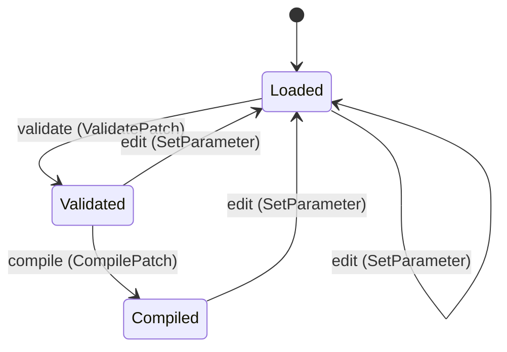
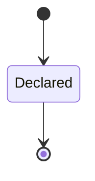

---
# generated by patchback-docs, do not edit
title: "patch domain"
sidebar_label: "patch"
description: "ESS reference for the patch domain, generated from the specification."
custom_edit_url: null
---

<!-- generated by patchback-docs, do not edit -->

The editable DSP program Patchback infers: a versioned patch of typed nodes and rate-checked edges, validated before it is compiled, and the topology whose module catalogue and parameter contracts it is checked against (DESIGN.md sections 2, 5 and 11).

`patchback.patch` is one of patchback's bounded contexts. [All domains](./index.mdx).

## Types

### `ClampPolicy`

`patchback.patch.ClampPolicy` is one of `ClampToUnitInterval`.

### `EdgeDecl`

`patchback.patch.EdgeDecl` is a record of six fields:

- `from_node` — `Integer`
- `from_port` — `patchback.patch.PortName`
- `from_rate` — `patchback.patch.PortRate`
- `to_node` — `Integer`
- `to_port` — `patchback.patch.PortName`
- `to_rate` — `patchback.patch.PortRate`

### `ModuleFamily`

`patchback.patch.ModuleFamily` is one of `SquareSine`, `HighpassBandpass`, `Lfo`, `Delay` and `Noise`.

### `NodeDecl`

`patchback.patch.NodeDecl` is a record of three fields:

- `id` — `Integer`
- `kind` — `patchback.patch.NodeKind`
- `parameters` — `List<patchback.patch.ParameterValue>`

### `NodeKind`

`patchback.patch.NodeKind` is one of `NoteInput`, `SawOscillator`, `Drive`, `LowpassFilter`, `AdsrEnvelope`, `Vca`, `Output`, `SquareOscillator`, `SineOscillator`, `HighpassFilter`, `BandpassFilter`, `Lfo`, `Delay` and `Noise`.

### `ParameterContract`

`patchback.patch.ParameterContract` is a record of eight fields:

- `path` — `patchback.patch.ParameterPath`
- `index` — `Integer`
- `unit` — `patchback.patch.ParameterUnit`
- `mapping` — `patchback.patch.ParameterMapping`
- `physical_at_zero` — `Decimal`
- `physical_at_one` — `Decimal`
- `default_normalized` — `Decimal`
- `clamp` — `patchback.patch.ClampPolicy`

### `ParameterMapping`

`patchback.patch.ParameterMapping` is one of `Exponential` and `Linear`.

### `ParameterName`

`patchback.patch.ParameterName` wraps `String` and is not interchangeable with one: the whole value of naming it separately is the crossings the model then refuses.

### `ParameterPath`

`patchback.patch.ParameterPath` wraps `String` and is not interchangeable with one: the whole value of naming it separately is the crossings the model then refuses.

### `ParameterUnit`

`patchback.patch.ParameterUnit` is one of `Seconds`, `LinearAmplitude`, `Hertz`, `Dimensionless` and `Decibels`.

### `ParameterValue`

`patchback.patch.ParameterValue` is a record of two fields:

- `name` — `patchback.patch.ParameterName`
- `value` — `Decimal`

### `PatchId`

`patchback.patch.PatchId` wraps `Uuid` and is not interchangeable with one: the whole value of naming it separately is the crossings the model then refuses.

### `PortName`

`patchback.patch.PortName` wraps `String` and is not interchangeable with one: the whole value of naming it separately is the crossings the model then refuses.

### `PortRate`

`patchback.patch.PortRate` is one of `Audio`, `Control` and `Event`.

### `TopologyId`

`patchback.patch.TopologyId` wraps `Uuid` and is not interchangeable with one: the whole value of naming it separately is the crossings the model then refuses.

### `TopologyName`

`patchback.patch.TopologyName` wraps `String` and is not interchangeable with one: the whole value of naming it separately is the crossings the model then refuses.

## Entities

An entity is what this context is about: something with an identity that outlives any one request, a shape, and a lifecycle. The lifecycle is exhaustive — a move that is not drawn below is a move this specification does not permit, and that is the only way it says so. Every move is labelled with the command that takes it, because a move nothing can trigger is refused rather than drawn.

### `Patch`

`patchback.patch.Patch`.

An instance is identified by `patch_id`, a `patchback.patch.PatchId`. The name is part of the model and not a convention: a view projects the identity under that name, so a projection inventing its own would disagree with the view.

It holds:

- `format_version` — `Integer`
- `sample_rate_hz` — `Integer`
- `topology_id` — `patchback.patch.TopologyId`
- `nodes` — `List<patchback.patch.NodeDecl>`
- `edges` — `List<patchback.patch.EdgeDecl>`

It references at most one [`Topology`](#topology), as `topology`, carried by `Patch.topology_id`.

No invariant is declared, so nothing here constrains an instance at rest.

Its state is a `patchback.patch.Patch.State`, one of `Compiled`, `Loaded` and `Validated`. That enum is synthesised from the lifecycle rather than declared beside it, so the states a view's filter compares and the states drawn below cannot disagree.

An instance is created in `Loaded`. No state is terminal: nothing in this lifecycle says an instance may stop moving.

Each move is taken by a declared command outcome, and a move nothing takes is refused as `missing_causation` rather than left as a state change nobody can trigger:

- `validate` — taken by `patchback.patch.ValidatePatch` on its `validated` outcome
- `compile` — taken by `patchback.patch.CompilePatch` on its `compiled` outcome
- `edit` — taken by `patchback.patch.SetParameter` on its `clamped` outcome and `patchback.patch.SetParameter` on its `set` outcome

An instance is brought into existence by `patchback.patch.LoadPatch` on its `loaded` outcome.

Illegal transitions are illegal by absence: no rule forbids them, there is simply no arrow, because a rule would be a second place for the same truth to live. A diagram cannot show an absence, so the pairs it does not connect are listed here, derived from the same transitions — anything named below is a move this specification does not permit.

- `Compiled` may not become `Validated`
- `Loaded` may not become `Compiled`

One view projects it: [`Patches`](#patches).

### `Topology`

`patchback.patch.Topology`.

An instance is identified by `topology_id`, a `patchback.patch.TopologyId`. The name is part of the model and not a convention: a view projects the identity under that name, so a projection inventing its own would disagree with the view.

It holds:

- `name` — `patchback.patch.TopologyName`
- `parameters` — `List<patchback.patch.ParameterContract>`
- `admits_square_sine` — `Boolean`
- `admits_highpass_bandpass` — `Boolean`
- `admits_lfo` — `Boolean`
- `admits_delay` — `Boolean`
- `admits_noise` — `Boolean`

It declares no relation to another entity, and no other entity names it.

No invariant is declared, so nothing here constrains an instance at rest.

Its state is a `patchback.patch.Topology.State`, one of `Declared`. That enum is synthesised from the lifecycle rather than declared beside it, so the states a view's filter compares and the states drawn below cannot disagree.

An instance is created in `Declared`. `Declared` is terminal, so an instance may rest there forever. That is declared rather than inferred from having no way out: an entity that cannot leave a state is either finished or stuck, and only its author knows which.

It declares no moves, so nothing changes its state once it exists.

It has one state, so there is no move to permit or to forbid.

One view projects it: [`Topologies`](#topologies).

## Views

A view is what the outside world is promised it can observe. Each one says which instances it contains and how soon it reflects a command that has already returned, because "you can read this" without "how soon" is the promise every flaky suite is built on.

### `Patches`

`patchback.patch.Patches`.

It reads [`Patch`](#patch).

It contains every instance of that entity: no filter narrows it, which is a decision somebody made and not a line somebody omitted.

It exposes:

- `patch_id` — `patchback.patch.PatchId`
- `state` — `patchback.patch.Patch.State`
- `format_version` — `Integer`
- `sample_rate_hz` — `Integer`
- `topology_id` — `patchback.patch.TopologyId`
- `edges` — `List<patchback.patch.EdgeDecl>`

It declares no order, so the rows come back in whatever order the implementation has, and two reads may disagree.

**Read-your-writes**: it is current the moment the command that changed it returns. A caller that has just created an invoice and cannot see it in here has been told a lie about what it did.

A generated scenario asserts it once, immediately after the command: a view promising this and not keeping the promise has to fail the suite rather than be retried until it passes.

### `Topologies`

`patchback.patch.Topologies`.

It reads [`Topology`](#topology).

It contains every instance of that entity: no filter narrows it, which is a decision somebody made and not a line somebody omitted.

It exposes:

- `topology_id` — `patchback.patch.TopologyId`
- `state` — `patchback.patch.Topology.State`
- `name` — `patchback.patch.TopologyName`
- `admits_square_sine` — `Boolean`
- `admits_highpass_bandpass` — `Boolean`
- `admits_lfo` — `Boolean`
- `admits_delay` — `Boolean`
- `admits_noise` — `Boolean`

It declares no order, so the rows come back in whatever order the implementation has, and two reads may disagree.

**Read-your-writes**: it is current the moment the command that changed it returns. A caller that has just created an invoice and cannot see it in here has been told a lie about what it did.

A generated scenario asserts it once, immediately after the command: a view promising this and not keeping the promise has to fail the suite rather than be retried until it passes.

## Commands

### `AdmitModuleFamily`

`patchback.patch.AdmitModuleFamily`.

It takes:

- `topology_id` — `patchback.patch.TopologyId`
- `family` — `patchback.patch.ModuleFamily`

It has six outcomes.

**`no-such-topology`** — Taken when the identity the command names is one no record carries, before any other answer for it. No entity in this specification changes. It reports `patchback.patch.TopologyNotFound`, carrying `topology_id`. It emits nothing. A test reaches it by sending an identity no record carries, arranging nothing.

**`square-sine`** — Taken when `family == SquareSine` holds of the input. It changes a `patchback.patch.Topology` without moving it along its lifecycle. The instance is the one named by the input field `topology_id`. It emits `patchback.patch.ModuleFamilyAdmitted`. It sets `admits_square_sine` from `"true"`. A test reaches it by constructing an input that satisfies that condition.

**`highpass-bandpass`** — Taken when `family == HighpassBandpass` holds of the input. It changes a `patchback.patch.Topology` without moving it along its lifecycle. The instance is the one named by the input field `topology_id`. It emits `patchback.patch.ModuleFamilyAdmitted`. It sets `admits_highpass_bandpass` from `"true"`. A test reaches it by constructing an input that satisfies that condition.

**`lfo`** — Taken when `family == Lfo` holds of the input. It changes a `patchback.patch.Topology` without moving it along its lifecycle. The instance is the one named by the input field `topology_id`. It emits `patchback.patch.ModuleFamilyAdmitted`. It sets `admits_lfo` from `"true"`. A test reaches it by constructing an input that satisfies that condition.

**`delay`** — Taken when `family == Delay` holds of the input. It changes a `patchback.patch.Topology` without moving it along its lifecycle. The instance is the one named by the input field `topology_id`. It emits `patchback.patch.ModuleFamilyAdmitted`. It sets `admits_delay` from `"true"`. A test reaches it by constructing an input that satisfies that condition.

**`noise`** — The default branch, taken when no other outcome's condition matched. It changes a `patchback.patch.Topology` without moving it along its lifecycle. The instance is the one named by the input field `topology_id`. It emits `patchback.patch.ModuleFamilyAdmitted`. It sets `admits_noise` from `"true"`. A test reaches it by constructing an input that satisfies no other outcome's condition.

### `CompilePatch`

`patchback.patch.CompilePatch`.

It takes:

- `patch_id` — `patchback.patch.PatchId`

It has three outcomes.

**`no-such-patch`** — Taken when the identity the command names is one no record carries, before any other answer for it. No entity in this specification changes. It reports `patchback.patch.PatchNotFound`, carrying `patch_id`. It emits nothing. A test reaches it by sending an identity no record carries, arranging nothing.

**`compiled`** — The default branch, taken when no other outcome's condition matched. It moves a `patchback.patch.Patch` from `Validated` to `Compiled`, along the declared move `compile`. The instance is the one named by the input field `patch_id`. It emits `patchback.patch.PatchCompiled`. A test reaches it by constructing an input that satisfies no other outcome's condition.

**`not-validated`** — Taken when the subject is resting in a state none of this command's moves start from — a `patchback.patch.Patch` in `Compiled` and `Loaded`, which is what is left of the lifecycle once this command's own moves are taken away. The document lists none of it. No entity in this specification changes. It reports `patchback.patch.PatchStateConflict`, carrying `patch_id` and `state`. It emits nothing. A test reaches it by driving an instance into one of those states and then issuing the command, because no input selects this branch.

### `DeclareTopology`

`patchback.patch.DeclareTopology`.

It takes:

- `topology_id` — `patchback.patch.TopologyId`
- `name` — `patchback.patch.TopologyName`
- `parameters` — `List<patchback.patch.ParameterContract>`

It has three outcomes.

**`duplicate-path`** — Taken when `not (distinct c in parameters by c.path as string)` holds of the input. No entity in this specification changes. It reports `patchback.patch.DuplicateParameterPath`, carrying `name`. It emits nothing. A test reaches it by constructing an input that satisfies that condition.

**`invalid-contract`** — Taken when `exists c in parameters: ((c.default_normalized < 0 or c.default_normalized > 1 or c.physical_at_one <= c.physical_at_zero or (c.mapping == Exponential and c.physical_at_zero <= 0)))` holds of the input. No entity in this specification changes. It reports `patchback.patch.InvalidParameterContract`, carrying `name`. It emits nothing. A test reaches it by constructing an input that satisfies that condition.

**`declared`** — The default branch, taken when no other outcome's condition matched. It creates a `patchback.patch.Topology`, which starts in `Declared`. The new instance's identity is published as `topology_id` on `patchback.patch.TopologyDeclared`. It emits `patchback.patch.TopologyDeclared`. It sets `name` from `input.name`, `parameters` from `input.parameters`, `admits_square_sine` from `"false"`, `admits_highpass_bandpass` from `"false"`, `admits_lfo` from `"false"`, `admits_delay` from `"false"` and `admits_noise` from `"false"`. A test reaches it by constructing an input that satisfies no other outcome's condition.

### `LoadPatch`

`patchback.patch.LoadPatch`.

It takes:

- `patch_id` — `patchback.patch.PatchId`
- `format_version` — `Integer`
- `sample_rate_hz` — `Integer`
- `topology_id` — `patchback.patch.TopologyId`
- `nodes` — `List<patchback.patch.NodeDecl>`
- `edges` — `List<patchback.patch.EdgeDecl>`

It has 13 outcomes.

**`unknown-version`** — Taken when `format_version != 1` holds of the input. No entity in this specification changes. It reports `patchback.patch.UnknownFormatVersion`, carrying `format_version`. It emits nothing. A test reaches it by constructing an input that satisfies that condition.

**`unsupported-rate`** — Taken when `sample_rate_hz != 48000` holds of the input. No entity in this specification changes. It reports `patchback.patch.UnsupportedSampleRate`, carrying `sample_rate_hz`. It emits nothing. A test reaches it by constructing an input that satisfies that condition.

**`duplicate-id`** — Taken when `not (distinct n in nodes by n.id as integer)` holds of the input. No entity in this specification changes. It reports `patchback.patch.DuplicateNodeId`, carrying `patch_id`. It emits nothing. A test reaches it by constructing an input that satisfies that condition.

**`duplicate-key`** — Taken when `exists n in nodes: (not (distinct p in n.parameters by p.name as string))` holds of the input. No entity in this specification changes. It reports `patchback.patch.DuplicateKey`, carrying `patch_id`. It emits nothing. A test reaches it by constructing an input that satisfies that condition.

**`unknown-topology`** — Taken when no `patchback.patch.Topology` carries the identity `input.topology_id` names. No entity in this specification changes. It reports `patchback.patch.UnknownTopology`, carrying `topology_id`. It emits nothing. A test reaches it by arranging the row of the other entity the input names, or its absence, and sending the command for it.

**`square-sine-outside-catalogue`** — Taken when the `patchback.patch.Topology` that `input.topology_id` names exists and its stored fields satisfy `admits_square_sine == false`, and `exists n in nodes: (n.kind in [SquareOscillator, SineOscillator])` holds of the input. No entity in this specification changes. It reports `patchback.patch.KindOutsideCatalogue`, carrying `patch_id`, `topology_id` and `kind_family`. It emits nothing. A test reaches it by arranging the row of the other entity the input names, or its absence, and sending the command for it.

**`highpass-bandpass-outside-catalogue`** — Taken when the `patchback.patch.Topology` that `input.topology_id` names exists and its stored fields satisfy `admits_highpass_bandpass == false`, and `exists n in nodes: (n.kind in [HighpassFilter, BandpassFilter])` holds of the input. No entity in this specification changes. It reports `patchback.patch.KindOutsideCatalogue`, carrying `patch_id`, `topology_id` and `kind_family`. It emits nothing. A test reaches it by arranging the row of the other entity the input names, or its absence, and sending the command for it.

**`lfo-outside-catalogue`** — Taken when the `patchback.patch.Topology` that `input.topology_id` names exists and its stored fields satisfy `admits_lfo == false`, and `exists n in nodes: (n.kind == Lfo)` holds of the input. No entity in this specification changes. It reports `patchback.patch.KindOutsideCatalogue`, carrying `patch_id`, `topology_id` and `kind_family`. It emits nothing. A test reaches it by arranging the row of the other entity the input names, or its absence, and sending the command for it.

**`delay-outside-catalogue`** — Taken when the `patchback.patch.Topology` that `input.topology_id` names exists and its stored fields satisfy `admits_delay == false`, and `exists n in nodes: (n.kind == Delay)` holds of the input. No entity in this specification changes. It reports `patchback.patch.KindOutsideCatalogue`, carrying `patch_id`, `topology_id` and `kind_family`. It emits nothing. A test reaches it by arranging the row of the other entity the input names, or its absence, and sending the command for it.

**`noise-outside-catalogue`** — Taken when the `patchback.patch.Topology` that `input.topology_id` names exists and its stored fields satisfy `admits_noise == false`, and `exists n in nodes: (n.kind == Noise)` holds of the input. No entity in this specification changes. It reports `patchback.patch.KindOutsideCatalogue`, carrying `patch_id`, `topology_id` and `kind_family`. It emits nothing. A test reaches it by arranging the row of the other entity the input names, or its absence, and sending the command for it.

**`malformed-number`** — Decided outside the input: a numeric token does not parse as a finite decimal number. No predicate over the input reaches this branch, and saying `when: false` instead would have claimed it is unreachable, which is a different and false statement. No entity in this specification changes. It reports `patchback.patch.MalformedNumber`, carrying `patch_id`. It emits nothing. A test reaches it by injecting the declared fault, because no input can.

**`unbounded-length`** — Decided outside the input: a line, token or list exceeds the parser's length bound. No predicate over the input reaches this branch, and saying `when: false` instead would have claimed it is unreachable, which is a different and false statement. No entity in this specification changes. It reports `patchback.patch.LengthBoundExceeded`, carrying `patch_id`. It emits nothing. A test reaches it by injecting the declared fault, because no input can.

**`loaded`** — The default branch, taken when no other outcome's condition matched. It creates a `patchback.patch.Patch`, which starts in `Loaded`. The new instance's identity is published as `patch_id` on `patchback.patch.PatchLoaded`. It emits `patchback.patch.PatchLoaded`. It sets `format_version` from `input.format_version`, `sample_rate_hz` from `input.sample_rate_hz`, `topology_id` from `input.topology_id`, `nodes` from `input.nodes` and `edges` from `input.edges`. A test reaches it by constructing an input that satisfies no other outcome's condition.

### `SetParameter`

`patchback.patch.SetParameter`.

It takes:

- `patch_id` — `patchback.patch.PatchId`
- `path` — `patchback.patch.ParameterPath`
- `normalized_value` — `Decimal`

It has five outcomes.

**`no-such-patch`** — Taken when the identity the command names is one no record carries, before any other answer for it. No entity in this specification changes. It reports `patchback.patch.PatchNotFound`, carrying `patch_id`. It emits nothing. A test reaches it by sending an identity no record carries, arranging nothing.

**`clamped`** — Taken when `(normalized_value < 0 or normalized_value > 1)` holds of the input. It moves a `patchback.patch.Patch` from `Compiled`, `Loaded` and `Validated` to `Loaded`, along the declared move `edit`. The instance is the one named by the input field `patch_id`. It emits `patchback.patch.ParameterClamped`. A test reaches it by constructing an input that satisfies that condition.

**`non-finite`** — Decided outside the input: the normalized value is NaN or infinite. No predicate over the input reaches this branch, and saying `when: false` instead would have claimed it is unreachable, which is a different and false statement. No entity in this specification changes. It reports `patchback.patch.NonFiniteParameterValue`, carrying `patch_id` and `path`. It emits nothing. A test reaches it by injecting the declared fault, because no input can.

**`unknown-path`** — Decided outside the input: the path names no parameter contract of the patch's topology. No predicate over the input reaches this branch, and saying `when: false` instead would have claimed it is unreachable, which is a different and false statement. No entity in this specification changes. It reports `patchback.patch.UnknownParameterPath`, carrying `patch_id` and `path`. It emits nothing. A test reaches it by injecting the declared fault, because no input can.

**`set`** — The default branch, taken when no other outcome's condition matched. It moves a `patchback.patch.Patch` from `Compiled`, `Loaded` and `Validated` to `Loaded`, along the declared move `edit`. The instance is the one named by the input field `patch_id`. It emits `patchback.patch.ParameterSet`. A test reaches it by constructing an input that satisfies no other outcome's condition.

### `ValidatePatch`

`patchback.patch.ValidatePatch`.

It takes:

- `patch_id` — `patchback.patch.PatchId`

It has 10 outcomes.

**`no-such-patch`** — Taken when the identity the command names is one no record carries, before any other answer for it. No entity in this specification changes. It reports `patchback.patch.PatchNotFound`, carrying `patch_id`. It emits nothing. A test reaches it by sending an identity no record carries, arranging nothing.

**`unknown-node`** — Taken when the existing subject's stored fields satisfy `exists e in edges: ((not (exists n in nodes: (n.id == e.from_node)) or not (exists n in nodes: (n.id == e.to_node))))`. No entity in this specification changes. It reports `patchback.patch.UnknownNode`, carrying `patch_id`. It emits nothing. A test establishes and independently observes the subject enum fact before selecting this branch.

**`incompatible-rates`** — Taken when the existing subject's stored fields satisfy `exists e in edges: (e.from_rate != e.to_rate)`. No entity in this specification changes. It reports `patchback.patch.IncompatiblePortRates`, carrying `patch_id`. It emits nothing. A test establishes and independently observes the subject enum fact before selecting this branch.

**`delay-too-short`** — Taken when the existing subject's stored fields satisfy `exists n in nodes: ((n.kind == Delay and exists p in n.parameters: ((p.name == delay_samples and p.value < 1))))`. No entity in this specification changes. It reports `patchback.patch.DelayTooShort`, carrying `patch_id`. It emits nothing. A test establishes and independently observes the subject enum fact before selecting this branch.

**`wrong-state`** — Taken when the subject is resting in a state none of this command's moves start from — a `patchback.patch.Patch` in `Compiled` and `Validated`, which is what is left of the lifecycle once this command's own moves are taken away. The document lists none of it. No entity in this specification changes. It reports `patchback.patch.PatchStateConflict`, carrying `patch_id` and `state`. It emits nothing. A test reaches it by driving an instance into one of those states and then issuing the command, because no input selects this branch.

**`unknown-port`** — Decided outside the input: an edge names a port its node kind does not declare. No predicate over the input reaches this branch, and saying `when: false` instead would have claimed it is unreachable, which is a different and false statement. No entity in this specification changes. It reports `patchback.patch.UnknownPort`, carrying `patch_id`. It emits nothing. A test reaches it by injecting the declared fault, because no input can.

**`zero-delay-cycle`** — Decided outside the input: a cycle of the graph passes through no Delay node. No predicate over the input reaches this branch, and saying `when: false` instead would have claimed it is unreachable, which is a different and false statement. No entity in this specification changes. It reports `patchback.patch.ZeroDelayCycle`, carrying `patch_id`. It emits nothing. A test reaches it by injecting the declared fault, because no input can.

**`feedback-gain-exceeded`** — Decided outside the input: the gain around a delayed feedback cycle exceeds the feedback limit. No predicate over the input reaches this branch, and saying `when: false` instead would have claimed it is unreachable, which is a different and false statement. No entity in this specification changes. It reports `patchback.patch.FeedbackGainExceeded`, carrying `patch_id`. It emits nothing. A test reaches it by injecting the declared fault, because no input can.

**`resource-cap`** — Decided outside the input: the graph exceeds a resource cap. No predicate over the input reaches this branch, and saying `when: false` instead would have claimed it is unreachable, which is a different and false statement. No entity in this specification changes. It reports `patchback.patch.ResourceCapExceeded`, carrying `patch_id`. It emits nothing. A test reaches it by injecting the declared fault, because no input can.

**`validated`** — The default branch, taken when no other outcome's condition matched. It moves a `patchback.patch.Patch` from `Loaded` to `Validated`, along the declared move `validate`. The instance is the one named by the input field `patch_id`. It emits `patchback.patch.PatchValidated`. A test reaches it by constructing an input that satisfies no other outcome's condition.

## Events

### `ModuleFamilyAdmitted`

`patchback.patch.ModuleFamilyAdmitted`.

It carries:

- `topology_id` — `patchback.patch.TopologyId`
- `family` — `patchback.patch.ModuleFamily`

Emitted by `patchback.patch.AdmitModuleFamily` on its `square-sine`, `highpass-bandpass`, `lfo`, `delay` and `noise` outcomes.

Nothing in this system reacts to it.

### `ParameterClamped`

`patchback.patch.ParameterClamped`.

It carries:

- `patch_id` — `patchback.patch.PatchId`
- `path` — `patchback.patch.ParameterPath`
- `submitted` — `Decimal`
- `applied` — `Decimal`

Emitted by `patchback.patch.SetParameter` on its `clamped` outcome.

Nothing in this system reacts to it.

### `ParameterSet`

`patchback.patch.ParameterSet`.

It carries:

- `patch_id` — `patchback.patch.PatchId`
- `path` — `patchback.patch.ParameterPath`
- `normalized_value` — `Decimal`

Emitted by `patchback.patch.SetParameter` on its `set` outcome.

Nothing in this system reacts to it.

### `PatchCompiled`

`patchback.patch.PatchCompiled`.

It carries:

- `patch_id` — `patchback.patch.PatchId`

Emitted by `patchback.patch.CompilePatch` on its `compiled` outcome.

Nothing in this system reacts to it.

### `PatchLoaded`

`patchback.patch.PatchLoaded`.

It carries:

- `patch_id` — `patchback.patch.PatchId`
- `topology_id` — `patchback.patch.TopologyId`

Emitted by `patchback.patch.LoadPatch` on its `loaded` outcome.

Nothing in this system reacts to it.

### `PatchValidated`

`patchback.patch.PatchValidated`.

It carries:

- `patch_id` — `patchback.patch.PatchId`

Emitted by `patchback.patch.ValidatePatch` on its `validated` outcome.

Nothing in this system reacts to it.

### `TopologyDeclared`

`patchback.patch.TopologyDeclared`.

It carries:

- `topology_id` — `patchback.patch.TopologyId`
- `name` — `patchback.patch.TopologyName`

Emitted by `patchback.patch.DeclareTopology` on its `declared` outcome.

Nothing in this system reacts to it.

## Errors

### `DelayTooShort`

A Delay node has less than one sample of latency (section 5.4).

It carries:

- `patch_id` — `patchback.patch.PatchId`

Reported by `patchback.patch.ValidatePatch` on its `delay-too-short` outcome.

### `DuplicateKey`

A node repeats a parameter key (section 11).

It carries:

- `patch_id` — `patchback.patch.PatchId`

Reported by `patchback.patch.LoadPatch` on its `duplicate-key` outcome.

### `DuplicateNodeId`

Two nodes share one identifier (sections 11, 12.1).

It carries:

- `patch_id` — `patchback.patch.PatchId`

Reported by `patchback.patch.LoadPatch` on its `duplicate-id` outcome.

### `DuplicateParameterPath`

It carries:

- `name` — `patchback.patch.TopologyName`

Reported by `patchback.patch.DeclareTopology` on its `duplicate-path` outcome.

### `FeedbackGainExceeded`

A feedback path's gain exceeds the limit (section 5.4).

It carries:

- `patch_id` — `patchback.patch.PatchId`

Reported by `patchback.patch.ValidatePatch` on its `feedback-gain-exceeded` outcome.

### `IncompatiblePortRates`

An edge joins ports of different rates (sections 5.1, 12.1).

It carries:

- `patch_id` — `patchback.patch.PatchId`

Reported by `patchback.patch.ValidatePatch` on its `incompatible-rates` outcome.

### `InvalidParameterContract`

A contract's default lies outside [0,1], its domain is empty, or an exponential domain does not start above zero.

It carries:

- `name` — `patchback.patch.TopologyName`

Reported by `patchback.patch.DeclareTopology` on its `invalid-contract` outcome.

### `KindOutsideCatalogue`

A node's kind belongs to a family the patch's topology does not admit (section 5.4).

It carries:

- `patch_id` — `patchback.patch.PatchId`
- `topology_id` — `patchback.patch.TopologyId`
- `kind_family` — `patchback.patch.ModuleFamily`

Reported by `patchback.patch.LoadPatch` on its `square-sine-outside-catalogue`, `highpass-bandpass-outside-catalogue`, `lfo-outside-catalogue`, `delay-outside-catalogue` and `noise-outside-catalogue` outcomes.

### `LengthBoundExceeded`

The file exceeds a parser length bound (section 11).

It carries:

- `patch_id` — `patchback.patch.PatchId`

Reported by `patchback.patch.LoadPatch` on its `unbounded-length` outcome.

### `MalformedNumber`

A numeric token does not parse as a finite number (section 11).

It carries:

- `patch_id` — `patchback.patch.PatchId`

Reported by `patchback.patch.LoadPatch` on its `malformed-number` outcome.

### `NonFiniteParameterValue`

A parameter value is NaN or infinite (section 5.2).

It carries:

- `patch_id` — `patchback.patch.PatchId`
- `path` — `patchback.patch.ParameterPath`

Reported by `patchback.patch.SetParameter` on its `non-finite` outcome.

### `PatchNotFound`

It carries:

- `patch_id` — `patchback.patch.PatchId`

Reported by `patchback.patch.CompilePatch` on its `no-such-patch` outcome.

Reported by `patchback.patch.SetParameter` on its `no-such-patch` outcome.

Reported by `patchback.patch.ValidatePatch` on its `no-such-patch` outcome.

### `PatchStateConflict`

The patch is not in a state the command acts from; compilation needs a validated patch.

It carries:

- `patch_id` — `patchback.patch.PatchId`
- `state` — `patchback.patch.Patch.State`

Reported by `patchback.patch.CompilePatch` on its `not-validated` outcome.

Reported by `patchback.patch.ValidatePatch` on its `wrong-state` outcome.

### `ResourceCapExceeded`

The graph exceeds a resource cap, such as its node or edge count (sections 12.1, 12.3).

It carries:

- `patch_id` — `patchback.patch.PatchId`

Reported by `patchback.patch.ValidatePatch` on its `resource-cap` outcome.

### `TopologyNotFound`

It carries:

- `topology_id` — `patchback.patch.TopologyId`

Reported by `patchback.patch.AdmitModuleFamily` on its `no-such-topology` outcome.

### `UnknownFormatVersion`

The file declares a format version this parser does not read (section 11).

It carries:

- `format_version` — `Integer`

Reported by `patchback.patch.LoadPatch` on its `unknown-version` outcome.

### `UnknownNode`

An edge names a node the patch does not declare (section 12.1).

It carries:

- `patch_id` — `patchback.patch.PatchId`

Reported by `patchback.patch.ValidatePatch` on its `unknown-node` outcome.

### `UnknownParameterPath`

The path names no parameter contract of the patch's topology.

It carries:

- `patch_id` — `patchback.patch.PatchId`
- `path` — `patchback.patch.ParameterPath`

Reported by `patchback.patch.SetParameter` on its `unknown-path` outcome.

### `UnknownPort`

An edge names a port its node kind does not declare (section 12.1).

It carries:

- `patch_id` — `patchback.patch.PatchId`

Reported by `patchback.patch.ValidatePatch` on its `unknown-port` outcome.

### `UnknownTopology`

It carries:

- `topology_id` — `patchback.patch.TopologyId`

Reported by `patchback.patch.LoadPatch` on its `unknown-topology` outcome.

### `UnsupportedSampleRate`

The sample rate is not the supported 48000 Hz; nothing is converted (sections 5.3, 11).

It carries:

- `sample_rate_hz` — `Integer`

Reported by `patchback.patch.LoadPatch` on its `unsupported-rate` outcome.

### `ZeroDelayCycle`

A cycle of the graph passes through no Delay node (sections 5.4, 12.1).

It carries:

- `patch_id` — `patchback.patch.PatchId`

Reported by `patchback.patch.ValidatePatch` on its `zero-delay-cycle` outcome.

## Actors

An actor is who may ask this context for something. Every grant below points at a command this specification declares — a grant is a resolved reference, so "may invoke" something nobody wrote is not a permission this model can express, and an authorisation that authorises nothing cannot ship quietly.

### `Operator`

`patchback.patch.Operator`.

It may invoke [`AdmitModuleFamily`](#admitmodulefamily), [`CompilePatch`](#compilepatch), [`DeclareTopology`](#declaretopology), [`LoadPatch`](#loadpatch), [`SetParameter`](#setparameter) and [`ValidatePatch`](#validatepatch).

---

Generated from patchback v1 · model digest `0b3fb3cda81e0a3a08049de49e426cc1d5caff4f94f1bcb6725c1772dc5faa61` · contract digest `slice-sha256/2:7a385b9a23f0a1c18301221077ddffa1684d60c93131c35d58abfba59154ce03`. Do not edit this file; change the specification and regenerate it with `task docs-generate`.
