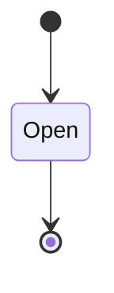
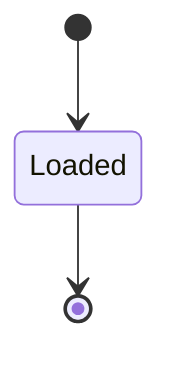
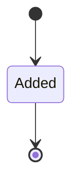

---
# generated by patchback-docs, do not edit
title: "score domain"
sidebar_label: "score"
description: "ESS reference for the score domain, generated from the specification."
custom_edit_url: null
---

<!-- generated by patchback-docs, do not edit -->

The score that drives a patch: versioned, sample-timed note events and control automation (DESIGN.md sections 10 and 11), and, later, an arrangement of several instrument stems (section 10 V3, Milestone E).

`patchback.score` is one of patchback's bounded contexts. [All domains](./index.mdx).

## Types

### `ArrangementId`

`patchback.score.ArrangementId` wraps `Uuid` and is not interchangeable with one: the whole value of naming it separately is the crossings the model then refuses.

### `ControlEvent`

`patchback.score.ControlEvent` is a record of three fields:

- `sample` — `Integer`
- `parameter_path` — `patchback.patch.ParameterPath`
- `normalized_value` — `Decimal`

### `NoteEvent`

`patchback.score.NoteEvent` is a record of four fields:

- `start_sample` — `Integer`
- `end_sample` — `Integer`
- `midi_note` — `Integer`
- `velocity` — `Decimal`

### `NoteSequenceId`

`patchback.score.NoteSequenceId` wraps `Uuid` and is not interchangeable with one: the whole value of naming it separately is the crossings the model then refuses.

### `StemId`

`patchback.score.StemId` wraps `Uuid` and is not interchangeable with one: the whole value of naming it separately is the crossings the model then refuses.

## Entities

An entity is what this context is about: something with an identity that outlives any one request, a shape, and a lifecycle. The lifecycle is exhaustive — a move that is not drawn below is a move this specification does not permit, and that is the only way it says so. Every move is labelled with the command that takes it, because a move nothing can trigger is refused rather than drawn.

### `Arrangement`

`patchback.score.Arrangement`.

An instance is identified by `arrangement_id`, a `patchback.score.ArrangementId`. The name is part of the model and not a convention: a view projects the identity under that name, so a projection inventing its own would disagree with the view.

It holds nothing beyond its identity and its state.

It owns any number of [`Stem`](#stem), as `stems`, carried by `Stem.arrangement_id`.

No invariant is declared, so nothing here constrains an instance at rest.

Its state is a `patchback.score.Arrangement.State`, one of `Open`. That enum is synthesised from the lifecycle rather than declared beside it, so the states a view's filter compares and the states drawn below cannot disagree.

An instance is created in `Open`. `Open` is terminal, so an instance may rest there forever. That is declared rather than inferred from having no way out: an entity that cannot leave a state is either finished or stuck, and only its author knows which.

It declares no moves, so nothing changes its state once it exists.

It has one state, so there is no move to permit or to forbid.

No view projects it, so nothing outside this context is promised a way to observe one.

### `NoteSequence`

`patchback.score.NoteSequence`.

An instance is identified by `note_sequence_id`, a `patchback.score.NoteSequenceId`. The name is part of the model and not a convention: a view projects the identity under that name, so a projection inventing its own would disagree with the view.

It holds:

- `format_version` — `Integer`
- `sample_rate_hz` — `Integer`
- `patch_id` — `patchback.patch.PatchId`
- `notes` — `List<patchback.score.NoteEvent>`
- `controls` — `List<patchback.score.ControlEvent>`
- `note_estimation_id` — `Optional<patchback.analysis.NoteEstimationId>`, which may be absent

It references at most one [`patchback.patch.Patch`](patchback-patch.md#patch), as `patch`, carried by `NoteSequence.patch_id`. It references at most one [`patchback.analysis.NoteEstimation`](patchback-analysis.md#noteestimation), as `estimation`, carried by `NoteSequence.note_estimation_id`.

No invariant is declared, so nothing here constrains an instance at rest.

Its state is a `patchback.score.NoteSequence.State`, one of `Loaded`. That enum is synthesised from the lifecycle rather than declared beside it, so the states a view's filter compares and the states drawn below cannot disagree.

An instance is created in `Loaded`. `Loaded` is terminal, so an instance may rest there forever. That is declared rather than inferred from having no way out: an entity that cannot leave a state is either finished or stuck, and only its author knows which.

It declares no moves, so nothing changes its state once it exists.

It has one state, so there is no move to permit or to forbid.

One view projects it: [`NoteSequences`](#notesequences).

### `Stem`

`patchback.score.Stem`.

An instance is identified by `stem_id`, a `patchback.score.StemId`. The name is part of the model and not a convention: a view projects the identity under that name, so a projection inventing its own would disagree with the view.

It holds:

- `arrangement_id` — `patchback.score.ArrangementId`
- `patch_id` — `patchback.patch.PatchId`
- `note_sequence_id` — `patchback.score.NoteSequenceId`

It references at most one [`patchback.patch.Patch`](patchback-patch.md#patch), as `patch`, carried by `Stem.patch_id`. It references at most one [`NoteSequence`](#notesequence), as `notes`, carried by `Stem.note_sequence_id`. Its `arrangement_id` is what [`Arrangement`](#arrangement) owns it by, as `stems`.

No invariant is declared, so nothing here constrains an instance at rest.

Its state is a `patchback.score.Stem.State`, one of `Added`. That enum is synthesised from the lifecycle rather than declared beside it, so the states a view's filter compares and the states drawn below cannot disagree.

An instance is created in `Added`. `Added` is terminal, so an instance may rest there forever. That is declared rather than inferred from having no way out: an entity that cannot leave a state is either finished or stuck, and only its author knows which.

It declares no moves, so nothing changes its state once it exists.

It has one state, so there is no move to permit or to forbid.

One view projects it: [`Stems`](#stems).

## Views

A view is what the outside world is promised it can observe. Each one says which instances it contains and how soon it reflects a command that has already returned, because "you can read this" without "how soon" is the promise every flaky suite is built on.

### `NoteSequences`

`patchback.score.NoteSequences`.

It reads [`NoteSequence`](#notesequence).

It contains every instance of that entity: no filter narrows it, which is a decision somebody made and not a line somebody omitted.

It exposes:

- `note_sequence_id` — `patchback.score.NoteSequenceId`
- `state` — `patchback.score.NoteSequence.State`
- `format_version` — `Integer`
- `sample_rate_hz` — `Integer`
- `patch_id` — `patchback.patch.PatchId`
- `note_estimation_id` — `Optional<patchback.analysis.NoteEstimationId>`, which may be absent

It declares no order, so the rows come back in whatever order the implementation has, and two reads may disagree.

**Read-your-writes**: it is current the moment the command that changed it returns. A caller that has just created an invoice and cannot see it in here has been told a lie about what it did.

A generated scenario asserts it once, immediately after the command: a view promising this and not keeping the promise has to fail the suite rather than be retried until it passes.

### `Stems`

`patchback.score.Stems`.

It reads [`Stem`](#stem).

It contains every instance of that entity: no filter narrows it, which is a decision somebody made and not a line somebody omitted.

It exposes:

- `stem_id` — `patchback.score.StemId`
- `state` — `patchback.score.Stem.State`
- `arrangement_id` — `patchback.score.ArrangementId`
- `patch_id` — `patchback.patch.PatchId`
- `note_sequence_id` — `patchback.score.NoteSequenceId`

It declares no order, so the rows come back in whatever order the implementation has, and two reads may disagree.

**Read-your-writes**: it is current the moment the command that changed it returns. A caller that has just created an invoice and cannot see it in here has been told a lie about what it did.

A generated scenario asserts it once, immediately after the command: a view promising this and not keeping the promise has to fail the suite rather than be retried until it passes.

## Commands

### `AddStem`

`patchback.score.AddStem`.

It takes:

- `stem_id` — `patchback.score.StemId`
- `arrangement_id` — `patchback.score.ArrangementId`
- `patch_id` — `patchback.patch.PatchId`
- `note_sequence_id` — `patchback.score.NoteSequenceId`

It has four outcomes.

**`no-such-arrangement`** — Taken when no `patchback.score.Arrangement` carries the identity `input.arrangement_id` names. No entity in this specification changes. It reports `patchback.score.ArrangementNotFound`, carrying `arrangement_id`. It emits nothing. A test reaches it by arranging the row of the other entity the input names, or its absence, and sending the command for it.

**`no-such-sequence`** — Taken when no `patchback.score.NoteSequence` carries the identity `input.note_sequence_id` names. No entity in this specification changes. It reports `patchback.score.NoteSequenceNotFound`, carrying `note_sequence_id`. It emits nothing. A test reaches it by arranging the row of the other entity the input names, or its absence, and sending the command for it.

**`sequence-for-another-patch`** — Taken when the `patchback.score.NoteSequence` that `input.note_sequence_id` names exists and its stored fields satisfy `patch_id != input.patch_id`. No entity in this specification changes. It reports `patchback.score.SequenceForAnotherPatch`, carrying `stem_id` and `note_sequence_id`. It emits nothing. A test reaches it by arranging the row of the other entity the input names, or its absence, and sending the command for it.

**`added`** — The default branch, taken when no other outcome's condition matched. It creates a `patchback.score.Stem`, which starts in `Added`. The new instance's identity is published as `stem_id` on `patchback.score.StemAdded`. It emits `patchback.score.StemAdded`. It sets `arrangement_id` from `input.arrangement_id`, `patch_id` from `input.patch_id` and `note_sequence_id` from `input.note_sequence_id`. A test reaches it by constructing an input that satisfies no other outcome's condition.

### `AutomateParameters`

`patchback.score.AutomateParameters`.

It takes:

- `note_sequence_id` — `patchback.score.NoteSequenceId`
- `controls` — `List<patchback.score.ControlEvent>`

It has five outcomes.

**`no-such-sequence`** — Taken when the identity the command names is one no record carries, before any other answer for it. No entity in this specification changes. It reports `patchback.score.NoteSequenceNotFound`, carrying `note_sequence_id`. It emits nothing. A test reaches it by sending an identity no record carries, arranging nothing.

**`non-finite`** — Decided outside the input: a control event's normalized value is NaN or infinite. No predicate over the input reaches this branch, and saying `when: false` instead would have claimed it is unreachable, which is a different and false statement. No entity in this specification changes. It reports `patchback.score.NonFiniteControlValue`, carrying `note_sequence_id`. It emits nothing. A test reaches it by injecting the declared fault, because no input can.

**`unknown-path`** — Decided outside the input: a control event names a path that is no parameter contract of the patch's topology. No predicate over the input reaches this branch, and saying `when: false` instead would have claimed it is unreachable, which is a different and false statement. No entity in this specification changes. It reports `patchback.score.UnknownParameterPath`, carrying `note_sequence_id`. It emits nothing. A test reaches it by injecting the declared fault, because no input can.

**`clamped`** — Taken when `exists c in controls: ((c.normalized_value < 0 or c.normalized_value > 1))` holds of the input. It changes a `patchback.score.NoteSequence` without moving it along its lifecycle. The instance is the one named by the input field `note_sequence_id`. It emits `patchback.score.ParametersAutomated` and `patchback.score.ControlValuesClamped`. It sets `controls` from `input.controls`. A test reaches it by constructing an input that satisfies that condition.

**`automated`** — The default branch, taken when no other outcome's condition matched. It changes a `patchback.score.NoteSequence` without moving it along its lifecycle. The instance is the one named by the input field `note_sequence_id`. It emits `patchback.score.ParametersAutomated`. It sets `controls` from `input.controls`. A test reaches it by constructing an input that satisfies no other outcome's condition.

### `CreateArrangement`

`patchback.score.CreateArrangement`.

It takes:

- `arrangement_id` — `patchback.score.ArrangementId`

It has one outcome.

**`created`** — The default branch, taken when no other outcome's condition matched. It creates a `patchback.score.Arrangement`, which starts in `Open`. The new instance's identity is published as `arrangement_id` on `patchback.score.ArrangementCreated`. It emits `patchback.score.ArrangementCreated`. A test reaches it by constructing an input that satisfies no other outcome's condition.

### `LoadNoteSequence`

`patchback.score.LoadNoteSequence`.

It takes:

- `note_sequence_id` — `patchback.score.NoteSequenceId`
- `format_version` — `Integer`
- `sample_rate_hz` — `Integer`
- `patch_id` — `patchback.patch.PatchId`
- `notes` — `List<patchback.score.NoteEvent>`
- `note_estimation_id` — `Optional<patchback.analysis.NoteEstimationId>`, which may be absent

It has 11 outcomes.

**`unknown-version`** — Taken when `format_version != 1` holds of the input. No entity in this specification changes. It reports `patchback.score.UnknownFormatVersion`, carrying `format_version`. It emits nothing. A test reaches it by constructing an input that satisfies that condition.

**`invalid-timing`** — Taken when `exists n in notes: ((n.start_sample < 0 or n.end_sample <= n.start_sample))` holds of the input. No entity in this specification changes. It reports `patchback.score.InvalidNoteTiming`, carrying `note_sequence_id`. It emits nothing. A test reaches it by constructing an input that satisfies that condition.

**`midi-out-of-range`** — Taken when `exists n in notes: ((n.midi_note < 0 or n.midi_note > 127))` holds of the input. No entity in this specification changes. It reports `patchback.score.MidiNoteOutOfRange`, carrying `note_sequence_id`. It emits nothing. A test reaches it by constructing an input that satisfies that condition.

**`velocity-out-of-range`** — Taken when `exists n in notes: ((n.velocity < 0 or n.velocity > 1))` holds of the input. No entity in this specification changes. It reports `patchback.score.VelocityOutOfRange`, carrying `note_sequence_id`. It emits nothing. A test reaches it by constructing an input that satisfies that condition.

**`overlap`** — Taken when `(not (distinct n in notes by n.start_sample as integer) or exists a in notes: (exists b in notes: ((b.start_sample > a.start_sample and b.start_sample < a.end_sample))))` holds of the input. No entity in this specification changes. It reports `patchback.score.OverlappingNotes`, carrying `note_sequence_id`. It emits nothing. A test reaches it by constructing an input that satisfies that condition.

**`unknown-patch`** — Taken when no `patchback.patch.Patch` carries the identity `input.patch_id` names. No entity in this specification changes. It reports `patchback.score.PatchNotFound`, carrying `patch_id`. It emits nothing. A test reaches it by arranging the row of the other entity the input names, or its absence, and sending the command for it.

**`unknown-estimation`** — Taken when `input.note_estimation_id`, checked only when present, names an identity no `patchback.analysis.NoteEstimation` carries. No entity in this specification changes. It reports `patchback.score.NoteEstimationNotFound`, carrying `note_estimation_id`. It emits nothing. A test reaches it by arranging the row of the other entity the input names, or its absence, and sending the command for it.

**`rate-mismatch`** — Taken when the `patchback.patch.Patch` that `input.patch_id` names exists and its stored fields satisfy `sample_rate_hz != input.sample_rate_hz`. No entity in this specification changes. It reports `patchback.score.SampleRateMismatch`, carrying `note_sequence_id` and `sample_rate_hz`. It emits nothing. A test reaches it by arranging the row of the other entity the input names, or its absence, and sending the command for it.

**`malformed-number`** — Decided outside the input: a numeric token does not parse as a finite decimal number. No predicate over the input reaches this branch, and saying `when: false` instead would have claimed it is unreachable, which is a different and false statement. No entity in this specification changes. It reports `patchback.score.MalformedNumber`, carrying `note_sequence_id`. It emits nothing. A test reaches it by injecting the declared fault, because no input can.

**`unbounded-length`** — Decided outside the input: a line, token or the note count exceeds the parser's bound. No predicate over the input reaches this branch, and saying `when: false` instead would have claimed it is unreachable, which is a different and false statement. No entity in this specification changes. It reports `patchback.score.LengthBoundExceeded`, carrying `note_sequence_id`. It emits nothing. A test reaches it by injecting the declared fault, because no input can.

**`loaded`** — The default branch, taken when no other outcome's condition matched. It creates a `patchback.score.NoteSequence`, which starts in `Loaded`. The new instance's identity is published as `note_sequence_id` on `patchback.score.NoteSequenceLoaded`. It emits `patchback.score.NoteSequenceLoaded`. It sets `format_version` from `input.format_version`, `sample_rate_hz` from `input.sample_rate_hz`, `patch_id` from `input.patch_id`, `notes` from `input.notes` and `note_estimation_id` from `input.note_estimation_id`. A test reaches it by constructing an input that satisfies no other outcome's condition.

## Events

### `ArrangementCreated`

`patchback.score.ArrangementCreated`.

It carries:

- `arrangement_id` — `patchback.score.ArrangementId`

Emitted by `patchback.score.CreateArrangement` on its `created` outcome.

Nothing in this system reacts to it.

### `ControlValuesClamped`

`patchback.score.ControlValuesClamped`.

It carries:

- `note_sequence_id` — `patchback.score.NoteSequenceId`

Emitted by `patchback.score.AutomateParameters` on its `clamped` outcome.

Nothing in this system reacts to it.

### `NoteSequenceLoaded`

`patchback.score.NoteSequenceLoaded`.

It carries:

- `note_sequence_id` — `patchback.score.NoteSequenceId`
- `patch_id` — `patchback.patch.PatchId`

Emitted by `patchback.score.LoadNoteSequence` on its `loaded` outcome.

Nothing in this system reacts to it.

### `ParametersAutomated`

`patchback.score.ParametersAutomated`.

It carries:

- `note_sequence_id` — `patchback.score.NoteSequenceId`

Emitted by `patchback.score.AutomateParameters` on its `clamped` and `automated` outcomes.

Nothing in this system reacts to it.

### `StemAdded`

`patchback.score.StemAdded`.

It carries:

- `stem_id` — `patchback.score.StemId`
- `arrangement_id` — `patchback.score.ArrangementId`

Emitted by `patchback.score.AddStem` on its `added` outcome.

Nothing in this system reacts to it.

## Errors

### `ArrangementNotFound`

It carries:

- `arrangement_id` — `patchback.score.ArrangementId`

Reported by `patchback.score.AddStem` on its `no-such-arrangement` outcome.

### `InvalidNoteTiming`

A note starts before sample 0 or does not end after it starts (section 10).

It carries:

- `note_sequence_id` — `patchback.score.NoteSequenceId`

Reported by `patchback.score.LoadNoteSequence` on its `invalid-timing` outcome.

### `LengthBoundExceeded`

The .events file exceeds a parser length bound, such as the note count (sections 11, 12.3).

It carries:

- `note_sequence_id` — `patchback.score.NoteSequenceId`

Reported by `patchback.score.LoadNoteSequence` on its `unbounded-length` outcome.

### `MalformedNumber`

A numeric token of the .events file does not parse as a finite number (section 11).

It carries:

- `note_sequence_id` — `patchback.score.NoteSequenceId`

Reported by `patchback.score.LoadNoteSequence` on its `malformed-number` outcome.

### `MidiNoteOutOfRange`

A note's MIDI number is outside 0 to 127 (section 10, u8 MIDI note).

It carries:

- `note_sequence_id` — `patchback.score.NoteSequenceId`

Reported by `patchback.score.LoadNoteSequence` on its `midi-out-of-range` outcome.

### `NonFiniteControlValue`

A control event's normalized value is NaN or infinite (section 5.2).

It carries:

- `note_sequence_id` — `patchback.score.NoteSequenceId`

Reported by `patchback.score.AutomateParameters` on its `non-finite` outcome.

### `NoteEstimationNotFound`

The sequence names a note estimation that does not exist; no sequence is loaded.

It carries:

- `note_estimation_id` — `Optional<patchback.analysis.NoteEstimationId>`, which may be absent

Reported by `patchback.score.LoadNoteSequence` on its `unknown-estimation` outcome.

### `NoteSequenceNotFound`

It carries:

- `note_sequence_id` — `patchback.score.NoteSequenceId`

Reported by `patchback.score.AddStem` on its `no-such-sequence` outcome.

Reported by `patchback.score.AutomateParameters` on its `no-such-sequence` outcome.

### `OverlappingNotes`

Two notes sound at once in a monophonic sequence (sections 5.2, 10 V0 and V1).

It carries:

- `note_sequence_id` — `patchback.score.NoteSequenceId`

Reported by `patchback.score.LoadNoteSequence` on its `overlap` outcome.

### `PatchNotFound`

It carries:

- `patch_id` — `patchback.patch.PatchId`

Reported by `patchback.score.LoadNoteSequence` on its `unknown-patch` outcome.

### `SampleRateMismatch`

The sequence's sample rate is not its patch's (section 10).

It carries:

- `note_sequence_id` — `patchback.score.NoteSequenceId`
- `sample_rate_hz` — `Integer`

Reported by `patchback.score.LoadNoteSequence` on its `rate-mismatch` outcome.

### `SequenceForAnotherPatch`

The stem's note sequence was written for a different patch than the stem's.

It carries:

- `stem_id` — `patchback.score.StemId`
- `note_sequence_id` — `patchback.score.NoteSequenceId`

Reported by `patchback.score.AddStem` on its `sequence-for-another-patch` outcome.

### `UnknownFormatVersion`

The .events file declares a format version this parser does not read (section 11).

It carries:

- `format_version` — `Integer`

Reported by `patchback.score.LoadNoteSequence` on its `unknown-version` outcome.

### `UnknownParameterPath`

A control event names a path that is no parameter of the patch's topology (section 10).

It carries:

- `note_sequence_id` — `patchback.score.NoteSequenceId`

Reported by `patchback.score.AutomateParameters` on its `unknown-path` outcome.

### `VelocityOutOfRange`

It carries:

- `note_sequence_id` — `patchback.score.NoteSequenceId`

Reported by `patchback.score.LoadNoteSequence` on its `velocity-out-of-range` outcome.

## Actors

An actor is who may ask this context for something. Every grant below points at a command this specification declares — a grant is a resolved reference, so "may invoke" something nobody wrote is not a permission this model can express, and an authorisation that authorises nothing cannot ship quietly.

### `Operator`

`patchback.score.Operator`.

It may invoke [`AddStem`](#addstem), [`AutomateParameters`](#automateparameters), [`CreateArrangement`](#createarrangement) and [`LoadNoteSequence`](#loadnotesequence).

---

Generated from patchback v1 · model digest `c0e45e273045c4c1f1c9fbc635f181079fb649874461451760a6b84e6335a1e2` · contract digest `slice-sha256/2:83a7484d0b1386f78ded11a67715da9a75368d06d86d6bb41cfddcf205f2b098`. Do not edit this file; change the specification and regenerate it with `task docs-generate`.
