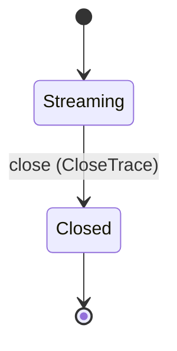
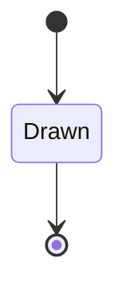
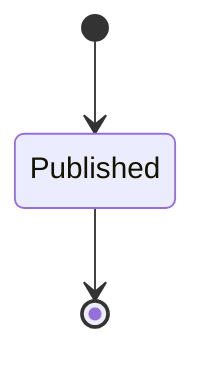
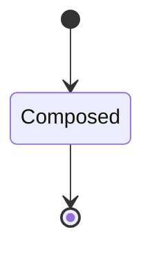
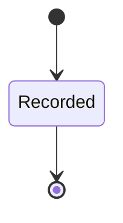

---
# generated by patchback-docs, do not edit
title: "studio domain"
sidebar_label: "studio"
description: "ESS reference for the studio domain, generated from the specification."
custom_edit_url: null
---

<!-- generated by patchback-docs, do not edit -->

What Patchback Studio, the browser view of Patchback, reads and draws (DESIGN.md section 16): the module catalogue of a topology (each atomic module kind with its ports, rates and parameter contracts), the graph of one patch with its delayed feedback marked, the evolution trace of one fit run (one frame per render evaluation, replayed from a fit run's artifacts or streamed live), and the end-result view of a run (recovered patch beside reference and render spectra). Patch, topology, fit run and render are referenced by identity type only; their rules stay in their own domains (DESIGN.md sections 5, 9, 11, 13 D; ADR-003).

`patchback.studio` is one of patchback's bounded contexts. [All domains](./index.mdx).

## Types

### `CatalogueId`

`patchback.studio.CatalogueId` wraps `Uuid` and is not interchangeable with one: the whole value of naming it separately is the crossings the model then refuses.

### `FrameOutcome`

`patchback.studio.FrameOutcome` is one of `FirstRetained`, `Improved`, `NotImproved` and `Rejected`.

### `GraphEdge`

`patchback.studio.GraphEdge` is a record of six fields:

- `from_node` — `Integer`
- `from_port` — `patchback.patch.PortName`
- `to_node` — `Integer`
- `to_port` — `patchback.patch.PortName`
- `rate` — `patchback.patch.PortRate`
- `delayed_feedback` — `Boolean`

### `GraphNode`

`patchback.studio.GraphNode` is a record of three fields:

- `node_id` — `Integer`
- `kind` — `patchback.patch.NodeKind`
- `rank` — `Integer`

Every value satisfies `node_id >= 0` and `rank >= 0`.

### `GraphViewId`

`patchback.studio.GraphViewId` wraps `Uuid` and is not interchangeable with one: the whole value of naming it separately is the crossings the model then refuses.

### `ModuleSpec`

`patchback.studio.ModuleSpec` is a record of four fields:

- `kind` — `patchback.patch.NodeKind`
- `family` — `Optional<patchback.patch.ModuleFamily>`, which may be absent
- `ports` — `List<patchback.studio.PortSpec>`
- `parameters` — `List<patchback.patch.ParameterContract>`

### `ParameterSample`

`patchback.studio.ParameterSample` is a record of two fields:

- `path` — `patchback.patch.ParameterPath`
- `normalized_value` — `Decimal`

### `PortDirection`

`patchback.studio.PortDirection` is one of `Input` and `Output`.

### `PortSpec`

`patchback.studio.PortSpec` is a record of four fields:

- `name` — `patchback.patch.PortName`
- `direction` — `patchback.studio.PortDirection`
- `rate` — `patchback.patch.PortRate`
- `meaning` — `String`

### `ResultViewId`

`patchback.studio.ResultViewId` wraps `Uuid` and is not interchangeable with one: the whole value of naming it separately is the crossings the model then refuses.

### `SpectrumSource`

`patchback.studio.SpectrumSource` is one of `Reference` and `Render`.

### `SpectrumSpec`

`patchback.studio.SpectrumSpec` is a record of two fields:

- `source` — `patchback.studio.SpectrumSource`
- `fft_size` — `Integer`

### `TraceEnd`

`patchback.studio.TraceEnd` is one of `Completed` and `Failed`.

### `TraceFrameId`

`patchback.studio.TraceFrameId` wraps `Uuid` and is not interchangeable with one: the whole value of naming it separately is the crossings the model then refuses.

### `TraceId`

`patchback.studio.TraceId` wraps `Uuid` and is not interchangeable with one: the whole value of naming it separately is the crossings the model then refuses.

### `TraceSource`

`patchback.studio.TraceSource` is one of `Replay` and `Live`.

## Entities

An entity is what this context is about: something with an identity that outlives any one request, a shape, and a lifecycle. The lifecycle is exhaustive — a move that is not drawn below is a move this specification does not permit, and that is the only way it says so. Every move is labelled with the command that takes it, because a move nothing can trigger is refused rather than drawn.

### `EvolutionTrace`

`patchback.studio.EvolutionTrace`.

An instance is identified by `trace_id`, a `patchback.studio.TraceId`. The name is part of the model and not a convention: a view projects the identity under that name, so a projection inventing its own would disagree with the view.

It holds:

- `fit_run_id` — `patchback.fit.FitRunId`
- `source` — `patchback.studio.TraceSource`
- `topology_id` — `patchback.patch.TopologyId`
- `parameter_paths` — `List<patchback.patch.ParameterPath>`
- `ended` — `Optional<patchback.studio.TraceEnd>`, which may be absent

It references at most one [`patchback.fit.FitRun`](patchback-fit.md#fitrun), as `fit_run`, carried by `EvolutionTrace.fit_run_id`. It references at most one [`patchback.patch.Topology`](patchback-patch.md#topology), as `topology`, carried by `EvolutionTrace.topology_id`.

No invariant is declared, so nothing here constrains an instance at rest.

Its state is a `patchback.studio.EvolutionTrace.State`, one of `Closed` and `Streaming`. That enum is synthesised from the lifecycle rather than declared beside it, so the states a view's filter compares and the states drawn below cannot disagree.

An instance is created in `Streaming`. `Closed` is terminal, so an instance may rest there forever. That is declared rather than inferred from having no way out: an entity that cannot leave a state is either finished or stuck, and only its author knows which.

Each move is taken by a declared command outcome, and a move nothing takes is refused as `missing_causation` rather than left as a state change nobody can trigger:

- `close` — taken by `patchback.studio.CloseTrace` on its `closed` outcome

An instance is brought into existence by `patchback.studio.OpenTrace` on its `opened` outcome.

Illegal transitions are illegal by absence: no rule forbids them, there is simply no arrow, because a rule would be a second place for the same truth to live. A diagram cannot show an absence, so the pairs it does not connect are listed here, derived from the same transitions — anything named below is a move this specification does not permit.

- `Closed` may not become `Streaming`

One view projects it: [`Traces`](#traces).

### `GraphView`

`patchback.studio.GraphView`.

An instance is identified by `graph_view_id`, a `patchback.studio.GraphViewId`. The name is part of the model and not a convention: a view projects the identity under that name, so a projection inventing its own would disagree with the view.

It holds:

- `patch_id` — `patchback.patch.PatchId`
- `topology_id` — `patchback.patch.TopologyId`
- `nodes` — `List<patchback.studio.GraphNode>`
- `edges` — `List<patchback.studio.GraphEdge>`

It references at most one [`patchback.patch.Patch`](patchback-patch.md#patch), as `patch`, carried by `GraphView.patch_id`. It references at most one [`patchback.patch.Topology`](patchback-patch.md#topology), as `topology`, carried by `GraphView.topology_id`.

No invariant is declared, so nothing here constrains an instance at rest.

Its state is a `patchback.studio.GraphView.State`, one of `Drawn`. That enum is synthesised from the lifecycle rather than declared beside it, so the states a view's filter compares and the states drawn below cannot disagree.

An instance is created in `Drawn`. `Drawn` is terminal, so an instance may rest there forever. That is declared rather than inferred from having no way out: an entity that cannot leave a state is either finished or stuck, and only its author knows which.

It declares no moves, so nothing changes its state once it exists.

It has one state, so there is no move to permit or to forbid.

One view projects it: [`GraphViews`](#graphviews).

### `ModuleCatalogue`

`patchback.studio.ModuleCatalogue`.

An instance is identified by `catalogue_id`, a `patchback.studio.CatalogueId`. The name is part of the model and not a convention: a view projects the identity under that name, so a projection inventing its own would disagree with the view.

It holds:

- `topology_id` — `patchback.patch.TopologyId`
- `modules` — `List<patchback.studio.ModuleSpec>`

It references at most one [`patchback.patch.Topology`](patchback-patch.md#topology), as `topology`, carried by `ModuleCatalogue.topology_id`.

No invariant is declared, so nothing here constrains an instance at rest.

Its state is a `patchback.studio.ModuleCatalogue.State`, one of `Published`. That enum is synthesised from the lifecycle rather than declared beside it, so the states a view's filter compares and the states drawn below cannot disagree.

An instance is created in `Published`. `Published` is terminal, so an instance may rest there forever. That is declared rather than inferred from having no way out: an entity that cannot leave a state is either finished or stuck, and only its author knows which.

It declares no moves, so nothing changes its state once it exists.

It has one state, so there is no move to permit or to forbid.

One view projects it: [`Catalogues`](#catalogues).

### `ResultView`

`patchback.studio.ResultView`.

An instance is identified by `result_view_id`, a `patchback.studio.ResultViewId`. The name is part of the model and not a convention: a view projects the identity under that name, so a projection inventing its own would disagree with the view.

It holds:

- `fit_run_id` — `patchback.fit.FitRunId`
- `best_patch_id` — `Optional<patchback.patch.PatchId>`, which may be absent
- `reference_clip_id` — `patchback.audio.AudioClipId`
- `best_render_id` — `Optional<patchback.audio.RenderId>`, which may be absent
- `spectra` — `List<patchback.studio.SpectrumSpec>`

It references at most one [`patchback.fit.FitRun`](patchback-fit.md#fitrun), as `fit_run`, carried by `ResultView.fit_run_id`. It references at most one [`patchback.patch.Patch`](patchback-patch.md#patch), as `best_patch`, carried by `ResultView.best_patch_id`. It references at most one [`patchback.audio.AudioClip`](patchback-audio.md#audioclip), as `reference`, carried by `ResultView.reference_clip_id`. It references at most one [`patchback.audio.Render`](patchback-audio.md#render), as `best_render`, carried by `ResultView.best_render_id`.

No invariant is declared, so nothing here constrains an instance at rest.

Its state is a `patchback.studio.ResultView.State`, one of `Composed`. That enum is synthesised from the lifecycle rather than declared beside it, so the states a view's filter compares and the states drawn below cannot disagree.

An instance is created in `Composed`. `Composed` is terminal, so an instance may rest there forever. That is declared rather than inferred from having no way out: an entity that cannot leave a state is either finished or stuck, and only its author knows which.

It declares no moves, so nothing changes its state once it exists.

It has one state, so there is no move to permit or to forbid.

One view projects it: [`ResultViews`](#resultviews).

### `TraceFrame`

`patchback.studio.TraceFrame`.

An instance is identified by `frame_id`, a `patchback.studio.TraceFrameId`. The name is part of the model and not a convention: a view projects the identity under that name, so a projection inventing its own would disagree with the view.

It holds:

- `trace_id` — `patchback.studio.TraceId`
- `sequence` — `Integer`
- `evaluation` — `Integer`
- `outcome` — `patchback.studio.FrameOutcome`
- `topology_id` — `patchback.patch.TopologyId`
- `patch_id` — `Optional<patchback.patch.PatchId>`, which may be absent
- `total_loss` — `Optional<Decimal>`, which may be absent
- `components` — `Optional<patchback.fit.LossComponents>`, which may be absent
- `best_loss` — `Optional<Decimal>`, which may be absent
- `parameters` — `List<patchback.studio.ParameterSample>`

It references at most one [`EvolutionTrace`](#evolutiontrace), as `trace`, carried by `TraceFrame.trace_id`. It references at most one [`patchback.patch.Topology`](patchback-patch.md#topology), as `topology`, carried by `TraceFrame.topology_id`. It references at most one [`patchback.patch.Patch`](patchback-patch.md#patch), as `patch`, carried by `TraceFrame.patch_id`.

Every instance satisfies `sequence >= 0` and `evaluation >= 1` — a predicate over this entity's own fields, checked against them rather than stored as a sentence, so an invariant reading something the entity does not have is refused instead of documented.

Its state is a `patchback.studio.TraceFrame.State`, one of `Recorded`. That enum is synthesised from the lifecycle rather than declared beside it, so the states a view's filter compares and the states drawn below cannot disagree.

An instance is created in `Recorded`. `Recorded` is terminal, so an instance may rest there forever. That is declared rather than inferred from having no way out: an entity that cannot leave a state is either finished or stuck, and only its author knows which.

It declares no moves, so nothing changes its state once it exists.

It has one state, so there is no move to permit or to forbid.

One view projects it: [`TraceFrames`](#traceframes).

## Views

A view is what the outside world is promised it can observe. Each one says which instances it contains and how soon it reflects a command that has already returned, because "you can read this" without "how soon" is the promise every flaky suite is built on.

### `Catalogues`

`patchback.studio.Catalogues`.

It reads [`ModuleCatalogue`](#modulecatalogue).

It contains every instance of that entity: no filter narrows it, which is a decision somebody made and not a line somebody omitted.

It exposes:

- `catalogue_id` — `patchback.studio.CatalogueId`
- `state` — `patchback.studio.ModuleCatalogue.State`
- `topology_id` — `patchback.patch.TopologyId`
- `modules` — `List<patchback.studio.ModuleSpec>`

It declares no order, so the rows come back in whatever order the implementation has, and two reads may disagree.

**Read-your-writes**: it is current the moment the command that changed it returns. A caller that has just created an invoice and cannot see it in here has been told a lie about what it did.

A generated scenario asserts it once, immediately after the command: a view promising this and not keeping the promise has to fail the suite rather than be retried until it passes.

### `GraphViews`

`patchback.studio.GraphViews`.

It reads [`GraphView`](#graphview).

It contains every instance of that entity: no filter narrows it, which is a decision somebody made and not a line somebody omitted.

It exposes:

- `graph_view_id` — `patchback.studio.GraphViewId`
- `state` — `patchback.studio.GraphView.State`
- `patch_id` — `patchback.patch.PatchId`
- `nodes` — `List<patchback.studio.GraphNode>`
- `edges` — `List<patchback.studio.GraphEdge>`

It declares no order, so the rows come back in whatever order the implementation has, and two reads may disagree.

**Read-your-writes**: it is current the moment the command that changed it returns. A caller that has just created an invoice and cannot see it in here has been told a lie about what it did.

A generated scenario asserts it once, immediately after the command: a view promising this and not keeping the promise has to fail the suite rather than be retried until it passes.

### `ResultViews`

`patchback.studio.ResultViews`.

It reads [`ResultView`](#resultview).

It contains every instance of that entity: no filter narrows it, which is a decision somebody made and not a line somebody omitted.

It exposes:

- `result_view_id` — `patchback.studio.ResultViewId`
- `state` — `patchback.studio.ResultView.State`
- `fit_run_id` — `patchback.fit.FitRunId`
- `best_patch_id` — `Optional<patchback.patch.PatchId>`, which may be absent
- `best_render_id` — `Optional<patchback.audio.RenderId>`, which may be absent

It declares no order, so the rows come back in whatever order the implementation has, and two reads may disagree.

**Read-your-writes**: it is current the moment the command that changed it returns. A caller that has just created an invoice and cannot see it in here has been told a lie about what it did.

A generated scenario asserts it once, immediately after the command: a view promising this and not keeping the promise has to fail the suite rather than be retried until it passes.

### `TraceFrames`

`patchback.studio.TraceFrames`.

It reads [`TraceFrame`](#traceframe).

It contains every instance of that entity: no filter narrows it, which is a decision somebody made and not a line somebody omitted.

It exposes:

- `frame_id` — `patchback.studio.TraceFrameId`
- `state` — `patchback.studio.TraceFrame.State`
- `trace_id` — `patchback.studio.TraceId`
- `sequence` — `Integer`
- `evaluation` — `Integer`
- `outcome` — `patchback.studio.FrameOutcome`
- `topology_id` — `patchback.patch.TopologyId`
- `total_loss` — `Optional<Decimal>`, which may be absent
- `best_loss` — `Optional<Decimal>`, which may be absent

It declares no order, so the rows come back in whatever order the implementation has, and two reads may disagree.

**Read-your-writes**: it is current the moment the command that changed it returns. A caller that has just created an invoice and cannot see it in here has been told a lie about what it did.

A generated scenario asserts it once, immediately after the command: a view promising this and not keeping the promise has to fail the suite rather than be retried until it passes.

### `Traces`

`patchback.studio.Traces`.

It reads [`EvolutionTrace`](#evolutiontrace).

It contains every instance of that entity: no filter narrows it, which is a decision somebody made and not a line somebody omitted.

It exposes:

- `trace_id` — `patchback.studio.TraceId`
- `state` — `patchback.studio.EvolutionTrace.State`
- `fit_run_id` — `patchback.fit.FitRunId`
- `source` — `patchback.studio.TraceSource`
- `topology_id` — `patchback.patch.TopologyId`
- `parameter_paths` — `List<patchback.patch.ParameterPath>`
- `ended` — `Optional<patchback.studio.TraceEnd>`, which may be absent

It declares no order, so the rows come back in whatever order the implementation has, and two reads may disagree.

**Read-your-writes**: it is current the moment the command that changed it returns. A caller that has just created an invoice and cannot see it in here has been told a lie about what it did.

A generated scenario asserts it once, immediately after the command: a view promising this and not keeping the promise has to fail the suite rather than be retried until it passes.

## Commands

### `AppendFrame`

`patchback.studio.AppendFrame`.

It takes:

- `frame_id` — `patchback.studio.TraceFrameId`
- `trace_id` — `patchback.studio.TraceId`
- `sequence` — `Integer`
- `evaluation` — `Integer`
- `outcome` — `patchback.studio.FrameOutcome`
- `topology_id` — `patchback.patch.TopologyId`
- `patch_id` — `Optional<patchback.patch.PatchId>`, which may be absent
- `total_loss` — `Optional<Decimal>`, which may be absent
- `components` — `Optional<patchback.fit.LossComponents>`, which may be absent
- `best_loss` — `Optional<Decimal>`, which may be absent
- `parameters` — `List<patchback.studio.ParameterSample>`

It has eight outcomes.

**`rejected-with-loss`** — Taken when `(outcome == Rejected and defined(total_loss))` holds of the input. No entity in this specification changes. It reports `patchback.studio.InconsistentFrame`, carrying `trace_id` and `sequence`. It emits nothing. A test reaches it by constructing an input that satisfies that condition.

**`valid-without-loss`** — Taken when `(outcome in [FirstRetained, Improved, NotImproved] and not (defined(total_loss)))` holds of the input. No entity in this specification changes. It reports `patchback.studio.InconsistentFrame`, carrying `trace_id` and `sequence`. It emits nothing. A test reaches it by constructing an input that satisfies that condition.

**`retained-not-best`** — Taken when `(outcome in [FirstRetained, Improved] and total_loss != {fact: best_loss})` holds of the input. No entity in this specification changes. It reports `patchback.studio.InconsistentFrame`, carrying `trace_id` and `sequence`. It emits nothing. A test reaches it by constructing an input that satisfies that condition.

**`unknown-trace`** — Taken when, of the `patchback.studio.EvolutionTrace` rows whose stored fields satisfy `trace_id == input.trace_id` before the outcome, exactly 0 rows are selected. No entity in this specification changes. It reports `patchback.studio.TraceNotFound`, carrying `trace_id`. It emits nothing. A test reaches it by arranging the row of the other entity the input names, or its absence, and sending the command for it.

**`trace-closed`** — Taken when, of the `patchback.studio.EvolutionTrace` rows whose stored fields satisfy `(trace_id == input.trace_id and state == Closed)` before the outcome, at least 1 rows are selected. No entity in this specification changes. It reports `patchback.studio.TraceClosed`, carrying `trace_id`. It emits nothing. A test reaches it by arranging the row of the other entity the input names, or its absence, and sending the command for it.

**`out-of-order`** — Taken when, of the `patchback.studio.TraceFrame` rows whose stored fields satisfy `(trace_id == input.trace_id and sequence >= input.sequence)` before the outcome, at least 1 rows are selected. No entity in this specification changes. It reports `patchback.studio.FrameOutOfOrder`, carrying `trace_id` and `sequence`. It emits nothing. A test reaches it by arranging the row of the other entity the input names, or its absence, and sending the command for it.

**`best-worsened`** — Taken when, of the `patchback.studio.TraceFrame` rows whose stored fields satisfy `(trace_id == input.trace_id and best_loss < input.best_loss)` before the outcome, at least 1 rows are selected, and `defined(best_loss)` holds of the input. No entity in this specification changes. It reports `patchback.studio.BestLossWorsened`, carrying `trace_id` and `sequence`. It emits nothing. A test reaches it by arranging the row of the other entity the input names, or its absence, and sending the command for it.

**`appended`** — The default branch, taken when no other outcome's condition matched. It creates a `patchback.studio.TraceFrame`, which starts in `Recorded`. The new instance's identity is published as `frame_id` on `patchback.studio.FrameAppended`. It emits `patchback.studio.FrameAppended`. It sets `trace_id` from `input.trace_id`, `sequence` from `input.sequence`, `evaluation` from `input.evaluation`, `outcome` from `input.outcome`, `topology_id` from `input.topology_id`, `patch_id` from `input.patch_id`, `total_loss` from `input.total_loss`, `components` from `input.components`, `best_loss` from `input.best_loss` and `parameters` from `input.parameters`. A test reaches it by constructing an input that satisfies no other outcome's condition.

### `CloseTrace`

`patchback.studio.CloseTrace`.

It takes:

- `trace_id` — `patchback.studio.TraceId`
- `ended` — `patchback.studio.TraceEnd`

It has three outcomes.

**`no-such-trace`** — Taken when the identity the command names is one no record carries, before any other answer for it. No entity in this specification changes. It reports `patchback.studio.TraceNotFound`, carrying `trace_id`. It emits nothing. A test reaches it by sending an identity no record carries, arranging nothing.

**`closed`** — The default branch, taken when no other outcome's condition matched. It moves a `patchback.studio.EvolutionTrace` from `Streaming` to `Closed`, along the declared move `close`. The instance is the one named by the input field `trace_id`. It emits `patchback.studio.TraceClosedEvent`. It sets `ended` from `input.ended`. A test reaches it by constructing an input that satisfies no other outcome's condition.

**`already-closed`** — Taken when the subject is resting in a state none of this command's moves start from — a `patchback.studio.EvolutionTrace` in `Closed`, which is what is left of the lifecycle once this command's own moves are taken away. The document lists none of it. No entity in this specification changes. It reports `patchback.studio.TraceStateConflict`, carrying `trace_id` and `state`. It emits nothing. A test reaches it by driving an instance into one of those states and then issuing the command, because no input selects this branch.

### `ComposeResultView`

`patchback.studio.ComposeResultView`.

It takes:

- `result_view_id` — `patchback.studio.ResultViewId`
- `fit_run_id` — `patchback.fit.FitRunId`
- `best_patch_id` — `Optional<patchback.patch.PatchId>`, which may be absent
- `reference_clip_id` — `patchback.audio.AudioClipId`
- `best_render_id` — `Optional<patchback.audio.RenderId>`, which may be absent
- `spectra` — `List<patchback.studio.SpectrumSpec>`

It has three outcomes.

**`no-retained-patch`** — Taken when `(not (defined(best_patch_id)) or not (defined(best_render_id)))` holds of the input. No entity in this specification changes. It reports `patchback.studio.NoRetainedPatch`, carrying `fit_run_id`. It emits nothing. A test reaches it by constructing an input that satisfies that condition.

**`unsupported-size`** — Taken when `exists s in spectra: (s.fft_size not in [512, 2048, 8192])` holds of the input. No entity in this specification changes. It reports `patchback.studio.UnsupportedSpectrumSize`, carrying `result_view_id`. It emits nothing. A test reaches it by constructing an input that satisfies that condition.

**`composed`** — The default branch, taken when no other outcome's condition matched. It creates a `patchback.studio.ResultView`, which starts in `Composed`. The new instance's identity is published as `result_view_id` on `patchback.studio.ResultComposed`. It emits `patchback.studio.ResultComposed`. It sets `fit_run_id` from `input.fit_run_id`, `best_patch_id` from `input.best_patch_id`, `reference_clip_id` from `input.reference_clip_id`, `best_render_id` from `input.best_render_id` and `spectra` from `input.spectra`. A test reaches it by constructing an input that satisfies no other outcome's condition.

### `DrawGraph`

`patchback.studio.DrawGraph`.

It takes:

- `graph_view_id` — `patchback.studio.GraphViewId`
- `patch_id` — `patchback.patch.PatchId`
- `topology_id` — `patchback.patch.TopologyId`
- `nodes` — `List<patchback.studio.GraphNode>`
- `edges` — `List<patchback.studio.GraphEdge>`

It has five outcomes.

**`duplicate-node`** — Taken when `not (distinct n in nodes by n.node_id as integer)` holds of the input. No entity in this specification changes. It reports `patchback.studio.DuplicateGraphNode`, carrying `graph_view_id`. It emits nothing. A test reaches it by constructing an input that satisfies that condition.

**`endpoint-missing`** — Taken when `exists e in edges: ((not (exists n in nodes: (n.node_id == e.from_node)) or not (exists n in nodes: (n.node_id == e.to_node))))` holds of the input. No entity in this specification changes. It reports `patchback.studio.GraphEndpointMissing`, carrying `graph_view_id`. It emits nothing. A test reaches it by constructing an input that satisfies that condition.

**`feedback-not-at-delay`** — Taken when `exists e in edges: ((e.delayed_feedback == true and not (exists n in nodes: ((n.node_id == e.from_node and n.kind == Delay)))))` holds of the input. No entity in this specification changes. It reports `patchback.studio.FeedbackNotAtDelay`, carrying `graph_view_id`. It emits nothing. A test reaches it by constructing an input that satisfies that condition.

**`not-validated`** — Decided outside the input: the patch is not in Validated or Compiled. No predicate over the input reaches this branch, and saying `when: false` instead would have claimed it is unreachable, which is a different and false statement. No entity in this specification changes. It reports `patchback.studio.PatchNotDrawable`, carrying `patch_id`. It emits nothing. A test reaches it by injecting the declared fault, because no input can.

**`drawn`** — The default branch, taken when no other outcome's condition matched. It creates a `patchback.studio.GraphView`, which starts in `Drawn`. The new instance's identity is published as `graph_view_id` on `patchback.studio.GraphDrawn`. It emits `patchback.studio.GraphDrawn`. It sets `patch_id` from `input.patch_id`, `topology_id` from `input.topology_id`, `nodes` from `input.nodes` and `edges` from `input.edges`. A test reaches it by constructing an input that satisfies no other outcome's condition.

### `OpenTrace`

`patchback.studio.OpenTrace`.

It takes:

- `trace_id` — `patchback.studio.TraceId`
- `fit_run_id` — `patchback.fit.FitRunId`
- `source` — `patchback.studio.TraceSource`
- `topology_id` — `patchback.patch.TopologyId`
- `parameter_paths` — `List<patchback.patch.ParameterPath>`

It has two outcomes.

**`duplicate-path`** — Taken when `not (distinct p in parameter_paths as string)` holds of the input. No entity in this specification changes. It reports `patchback.studio.DuplicateParameterPath`, carrying `trace_id`. It emits nothing. A test reaches it by constructing an input that satisfies that condition.

**`opened`** — The default branch, taken when no other outcome's condition matched. It creates a `patchback.studio.EvolutionTrace`, which starts in `Streaming`. The new instance's identity is published as `trace_id` on `patchback.studio.TraceOpened`. It emits `patchback.studio.TraceOpened`. It sets `fit_run_id` from `input.fit_run_id`, `source` from `input.source`, `topology_id` from `input.topology_id` and `parameter_paths` from `input.parameter_paths`. A test reaches it by constructing an input that satisfies no other outcome's condition.

### `PublishCatalogue`

`patchback.studio.PublishCatalogue`.

It takes:

- `catalogue_id` — `patchback.studio.CatalogueId`
- `topology_id` — `patchback.patch.TopologyId`
- `modules` — `List<patchback.studio.ModuleSpec>`

It has three outcomes.

**`duplicate-kind`** — Taken when `not (distinct m in modules by m.kind as enum)` holds of the input. No entity in this specification changes. It reports `patchback.studio.DuplicateModuleKind`, carrying `catalogue_id`. It emits nothing. A test reaches it by constructing an input that satisfies that condition.

**`duplicate-port`** — Taken when `exists m in modules: (not (distinct p in m.ports by p.name as string))` holds of the input. No entity in this specification changes. It reports `patchback.studio.DuplicatePortName`, carrying `catalogue_id`. It emits nothing. A test reaches it by constructing an input that satisfies that condition.

**`published`** — The default branch, taken when no other outcome's condition matched. It creates a `patchback.studio.ModuleCatalogue`, which starts in `Published`. The new instance's identity is published as `catalogue_id` on `patchback.studio.CataloguePublished`. It emits `patchback.studio.CataloguePublished`. It sets `topology_id` from `input.topology_id` and `modules` from `input.modules`. A test reaches it by constructing an input that satisfies no other outcome's condition.

## Events

### `CataloguePublished`

`patchback.studio.CataloguePublished`.

It carries:

- `catalogue_id` — `patchback.studio.CatalogueId`
- `topology_id` — `patchback.patch.TopologyId`
- `modules` — `List<patchback.studio.ModuleSpec>`

Emitted by `patchback.studio.PublishCatalogue` on its `published` outcome.

Nothing in this system reacts to it.

### `FrameAppended`

`patchback.studio.FrameAppended`.

It carries:

- `frame_id` — `patchback.studio.TraceFrameId`
- `trace_id` — `patchback.studio.TraceId`
- `sequence` — `Integer`
- `outcome` — `patchback.studio.FrameOutcome`
- `evaluation` — `Integer`
- `topology_id` — `patchback.patch.TopologyId`
- `patch_id` — `Optional<patchback.patch.PatchId>`, which may be absent
- `total_loss` — `Optional<Decimal>`, which may be absent
- `components` — `Optional<patchback.fit.LossComponents>`, which may be absent
- `best_loss` — `Optional<Decimal>`, which may be absent
- `parameters` — `List<patchback.studio.ParameterSample>`

Emitted by `patchback.studio.AppendFrame` on its `appended` outcome.

Nothing in this system reacts to it.

### `GraphDrawn`

`patchback.studio.GraphDrawn`.

It carries:

- `graph_view_id` — `patchback.studio.GraphViewId`
- `patch_id` — `patchback.patch.PatchId`
- `topology_id` — `patchback.patch.TopologyId`
- `nodes` — `List<patchback.studio.GraphNode>`
- `edges` — `List<patchback.studio.GraphEdge>`

Emitted by `patchback.studio.DrawGraph` on its `drawn` outcome.

Nothing in this system reacts to it.

### `ResultComposed`

`patchback.studio.ResultComposed`.

It carries:

- `result_view_id` — `patchback.studio.ResultViewId`
- `fit_run_id` — `patchback.fit.FitRunId`
- `best_patch_id` — `Optional<patchback.patch.PatchId>`, which may be absent
- `reference_clip_id` — `patchback.audio.AudioClipId`
- `best_render_id` — `Optional<patchback.audio.RenderId>`, which may be absent
- `spectra` — `List<patchback.studio.SpectrumSpec>`

Emitted by `patchback.studio.ComposeResultView` on its `composed` outcome.

Nothing in this system reacts to it.

### `TraceClosedEvent`

`patchback.studio.TraceClosedEvent`.

It carries:

- `trace_id` — `patchback.studio.TraceId`
- `ended` — `patchback.studio.TraceEnd`

Emitted by `patchback.studio.CloseTrace` on its `closed` outcome.

Nothing in this system reacts to it.

### `TraceOpened`

`patchback.studio.TraceOpened`.

It carries:

- `trace_id` — `patchback.studio.TraceId`
- `fit_run_id` — `patchback.fit.FitRunId`
- `source` — `patchback.studio.TraceSource`
- `topology_id` — `patchback.patch.TopologyId`
- `parameter_paths` — `List<patchback.patch.ParameterPath>`

Emitted by `patchback.studio.OpenTrace` on its `opened` outcome.

Nothing in this system reacts to it.

## Errors

### `BestLossWorsened`

A frame's retained best loss is above an earlier frame's (DESIGN.md 12.1).

It carries:

- `trace_id` — `patchback.studio.TraceId`
- `sequence` — `Integer`

Reported by `patchback.studio.AppendFrame` on its `best-worsened` outcome.

### `DuplicateGraphNode`

It carries:

- `graph_view_id` — `patchback.studio.GraphViewId`

Reported by `patchback.studio.DrawGraph` on its `duplicate-node` outcome.

### `DuplicateModuleKind`

A catalogue lists one module kind twice.

It carries:

- `catalogue_id` — `patchback.studio.CatalogueId`

Reported by `patchback.studio.PublishCatalogue` on its `duplicate-kind` outcome.

### `DuplicateParameterPath`

It carries:

- `trace_id` — `patchback.studio.TraceId`

Reported by `patchback.studio.OpenTrace` on its `duplicate-path` outcome.

### `DuplicatePortName`

A module declares two ports with one name.

It carries:

- `catalogue_id` — `patchback.studio.CatalogueId`

Reported by `patchback.studio.PublishCatalogue` on its `duplicate-port` outcome.

### `FeedbackNotAtDelay`

An edge marked as delayed feedback does not leave a Delay node (DESIGN.md 5.4).

It carries:

- `graph_view_id` — `patchback.studio.GraphViewId`

Reported by `patchback.studio.DrawGraph` on its `feedback-not-at-delay` outcome.

### `FrameOutOfOrder`

A frame's sequence is not above every sequence the trace already holds.

It carries:

- `trace_id` — `patchback.studio.TraceId`
- `sequence` — `Integer`

Reported by `patchback.studio.AppendFrame` on its `out-of-order` outcome.

### `GraphEndpointMissing`

An edge names a node the drawing does not hold.

It carries:

- `graph_view_id` — `patchback.studio.GraphViewId`

Reported by `patchback.studio.DrawGraph` on its `endpoint-missing` outcome.

### `InconsistentFrame`

A frame's outcome disagrees with its losses: a rejected candidate carries a loss, a valid one carries none, or a retained candidate's loss is not the best loss.

It carries:

- `trace_id` — `patchback.studio.TraceId`
- `sequence` — `Integer`

Reported by `patchback.studio.AppendFrame` on its `rejected-with-loss`, `valid-without-loss` and `retained-not-best` outcomes.

### `NoRetainedPatch`

The fit run retained no valid patch (DESIGN.md 9.2 step 5), so there is no end result to show.

It carries:

- `fit_run_id` — `patchback.fit.FitRunId`

Reported by `patchback.studio.ComposeResultView` on its `no-retained-patch` outcome.

### `PatchNotDrawable`

The patch has not passed validation (DESIGN.md invariant 3); the studio draws only validated patches.

It carries:

- `patch_id` — `patchback.patch.PatchId`

Reported by `patchback.studio.DrawGraph` on its `not-validated` outcome.

### `TraceClosed`

The trace has its run's end and takes no further frame.

It carries:

- `trace_id` — `patchback.studio.TraceId`

Reported by `patchback.studio.AppendFrame` on its `trace-closed` outcome.

### `TraceNotFound`

It carries:

- `trace_id` — `patchback.studio.TraceId`

Reported by `patchback.studio.AppendFrame` on its `unknown-trace` outcome.

Reported by `patchback.studio.CloseTrace` on its `no-such-trace` outcome.

### `TraceStateConflict`

It carries:

- `trace_id` — `patchback.studio.TraceId`
- `state` — `patchback.studio.EvolutionTrace.State`

Reported by `patchback.studio.CloseTrace` on its `already-closed` outcome.

### `UnsupportedSpectrumSize`

A spectrum's FFT length is not one of the analysis lengths 512, 2048 or 8192 (DESIGN.md 6.3).

It carries:

- `result_view_id` — `patchback.studio.ResultViewId`

Reported by `patchback.studio.ComposeResultView` on its `unsupported-size` outcome.

## Actors

An actor is who may ask this context for something. Every grant below points at a command this specification declares — a grant is a resolved reference, so "may invoke" something nobody wrote is not a permission this model can express, and an authorisation that authorises nothing cannot ship quietly.

### `FitStream`

`patchback.studio.FitStream`.

It may invoke [`AppendFrame`](#appendframe), [`CloseTrace`](#closetrace) and [`OpenTrace`](#opentrace).

### `Studio`

`patchback.studio.Studio`.

It may invoke [`AppendFrame`](#appendframe), [`CloseTrace`](#closetrace), [`ComposeResultView`](#composeresultview), [`DrawGraph`](#drawgraph), [`OpenTrace`](#opentrace) and [`PublishCatalogue`](#publishcatalogue).

---

Generated from patchback v1 · model digest `2da8f8957f46b5e4f892469e4f71f89c47302b15f6250f45221e03e18ece6b4b` · contract digest `slice-sha256/2:476946798a0173c2163bf841f2569cc29cfbd86755ee406ee9ef36bf6b81ed1c`. Do not edit this file; change the specification and regenerate it with `task docs-generate`.
